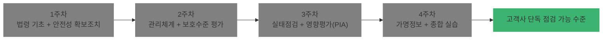
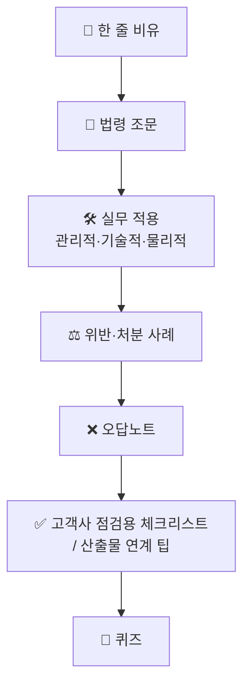

# 개인정보보호 컨설팅 실무 4주 코스 (Junior Consultant Track)

> 주니어 개인정보보호 컨설턴트가 **4주 동안** 법령 → 안전성 확보조치 → 5대 컨설팅 영역(관리체계 · 보호수준 평가 · 실태점검 · 영향평가 · 가명정보)을 현장 산출물 수준까지 익히는 학습 레포지토리입니다.

---

## 1. 프로젝트 개요

| 항목 | 내용 |
|---|---|
| 대상 | 개인정보보호 컨설팅 입문 ~ 1년 차 주니어 컨설턴트 |
| 기간 | 4주 (주차별 Chapter 8개 이하, 총 22개 Chapter) |
| 실습 환경 | Windows 11 (PowerShell, 로컬 보안 정책, 이벤트 뷰어, Excel 등) |
| 설명 방식 | ① 쉬운 비유 1줄 → ② 법령 조문 → ③ 실무 적용 → ④ 오답노트 |
| 산출물 | 챕터별 고객사 점검용 체크리스트 / 실무 산출물 연계 팁 / 퀴즈 |

### 1.1 법적 근거 (기준 법령)

| 구분 | 명칭 | 소관 |
|---|---|---|
| 법률 | 「개인정보 보호법」 | 개인정보보호위원회 |
| 대통령령 | 「개인정보 보호법 시행령」 | 개인정보보호위원회 |
| 고시 | 「개인정보의 안전성 확보조치 기준」 | 개인정보보호위원회 고시 |
| 고시 | 「개인정보 영향평가에 관한 고시」 | 개인정보보호위원회 고시 |
| 고시 | 「정보보호 및 개인정보보호 관리체계 인증 등에 관한 고시」(ISMS-P) | 과기정통부·개인정보보호위원회 공동 |
| 가이드라인 | 「가명정보 처리 가이드라인」, 「개인정보 안전성 확보조치 기준 해설서」 등 | 개인정보보호위원회 |

#### 📌 반영된 최신 개정 (2026-11-11 확인)

| 법령 | 개정 | 시행 | 핵심 |
|---|---|---|---|
| 「개인정보 보호법」 | 법률 제21445호 (2026.3.10. 공포) | 2026.9.11. (ISMS-P 의무 인증은 2027.7.1.) | 제30조의3 대표자 책임 신설, 과징금 최대 10%(제64조의2제2항), CPO 이사회 의결·신고(제31조제3항), 유출 가능성 통지(제34조제2항) |
| 「개인정보 보호법 시행령」 | 대통령령 제36804호 (2026.11.10. 타법개정, 2026.9.11. 개정분 포함) | 2026.11.10. | 유출 통지·신고 72시간, CPO 이사회 의결·신고 대상 기준, 과징금 투자 감경 |
| 「개인정보의 안전성 확보조치 기준」 | 고시 제2026-9호 (2026.7.1.) — 2025.10.31. 개정분 포함 | 2026.7.1. (제15조제5호·제18조는 2027.1.1.) | 인터넷망 차단 위험 기반 예외(제6조의2), 접속기록 대상 확대·**"월 1회 점검" 삭제**(제8조), 내부 관리계획 항목 추가(제4조), 공공시스템 취약점 점검·침투테스트(제18조) |
| 「개인정보 영향평가에 관한 고시」 + 수행안내서(2025.10.) | 고시 제2025-7호 (2025.9.5.) | — | 3주차 (별표 5: 5개 영역·29개 분야) |
| 「정보보호 및 개인정보보호 관리체계 인증 등에 관한 고시」 + 별표 7 | 고시 제2024-8호 (2024.7.24.) | — | 2주차 Ch10 (인증기준 101개) |
| 「개인정보 보호법 위반에 대한 과징금 부과기준」 | 고시 제2026-12호 | 2026.9.11. | 투자감경 40%, 인증 감경 30% 등 |
| 「개인정보 보호위원회의 조사 및 처분에 관한 규정」 | 고시 제2026-13호 | 2026.9.11. | 3주차 실태점검 |
| 「가명정보의 결합 및 반출 등에 관한 고시」 + 「가명정보 처리 가이드라인」(2026.3.) | 고시 제2025-8호 | 2025.9.9. | 4주차 |
| 시행령 별표 1·1의5·2 | — | — | CPO 자격, 과징금 산정, 과태료 금액 |
| 「개인정보 보호법」 시행예정본 (법률 제21910호 반영) | 2026.9.8. 공포 | 공포 후 6개월 경과일 | AI 기술 개발 특례 제28조의12~15 (Ch21) |
| 안내서: 자동화된 결정(2024.9.), 이동형 영상(2024.9.), 고정형 영상(2024.12.), 생성형 AI(2025.8.) | — | — | Ch21 |
| 처분 보도자료 8건 (2022~2025) | — | — | 전 챕터 처분 사례 금액 대조 (Ch22 총정리) |

> 원문 PDF는 [references/](references/) 폴더에 보관하며, 챕터 작성 시 이 파일로 조문을 대조합니다.

> **⚠ 조문 검증 원칙 (할루시네이션 방지)**
> - 모든 챕터의 조문은 **국가법령정보센터(https://www.law.go.kr)** 의 *현행* 법령으로 재확인 후 인용합니다.
> - 고시·가이드라인은 **개인정보보호위원회(https://www.pipc.go.kr) → 법령/고시/지침 및 자료실**의 최신 개정본으로 확인합니다.
> - 각 챕터 상단 메타정보에 **`법령 확인일`** 을 기록하며, 확인되지 않은 수치·조문은 본문에 쓰지 않고 `[확인 필요]` 로 표시합니다.
> - 2023년 전면 개정(2023.3.14. 공포, 2023.9.15. 시행) 이전 조문(예: 구 제39조의3 등 정보통신서비스 특례)은 **통합·삭제된 경우가 많으므로** 구법 조문을 인용하지 않습니다.

### 1.2 코스 전체 핵심 조문 맵

| 컨설팅 영역 | 핵심 근거 조문 (「개인정보 보호법」) |
|---|---|
| 공통 – 안전조치 | 제29조(안전조치의무), 제30조의3(사업주 또는 대표자의 책임), 「개인정보의 안전성 확보조치 기준」 |
| ① 관리체계 | 제30조(개인정보 처리방침), 제31조(개인정보 보호책임자), 제26조(업무위탁), 제32조의2(개인정보 보호 인증) |
| ② 보호수준 평가 | 제11조의2(개인정보 보호수준 평가) |
| ③ 실태점검 | 제63조(자료제출 요구 및 검사), 제63조의2(사전 실태점검) |
| ④ 영향평가(PIA) | 제33조(개인정보 영향평가), 시행령 제35조(영향평가의 대상) |
| ⑤ 가명정보 | 제2조제1호다목·제1호의2(가명정보·가명처리 정의), 제28조의2 ~ 제28조의7(가명정보 처리 특례) |
| 사고·제재 | 제34조(유출등의 통지·신고), 제64조의2(과징금), 제75조(과태료) |

---

## 2. 4주 학습 목차



### 📘 1주차 — 법령 기초 & 안전성 확보조치 (6 Chapters)

| Ch | 파일 | 제목 | 핵심 조문 |
|---|---|---|---|
| 01 | [ch01_intro.md](chapters/week1/ch01_intro.md) | 개인정보 컨설팅 입문과 법 체계 | 법 제1조~제3조, 제7조 |
| 02 | [ch02_lifecycle.md](chapters/week1/ch02_lifecycle.md) | 처리 단계별 법적 요건 (수집·이용·제공·파기) | 제15조, 제17조, 제18조, 제21조, 제22조 |
| 03 | [ch03_safeguard_admin.md](chapters/week1/ch03_safeguard_admin.md) | 안전성 확보조치 ① 관리적 조치 | 제29조, 고시 제4조·제5조 |
| 04 | [ch04_safeguard_tech.md](chapters/week1/ch04_safeguard_tech.md) | 안전성 확보조치 ② 기술적 조치 | 고시 제6조, 제6조의2, 제7조~제9조 |
| 05 | [ch05_safeguard_physical.md](chapters/week1/ch05_safeguard_physical.md) | 안전성 확보조치 ③ 물리적 조치·출력·파기 | 고시 제10조~제13조 |
| 06 | [ch06_breach_sanction.md](chapters/week1/ch06_breach_sanction.md) | 유출 대응과 행정처분 체계 | 제34조, 제64조의2, 제75조, 시행령 제39조·제40조 |

### 📗 2주차 — 개인정보 관리체계 & 보호수준 평가 컨설팅 (6 Chapters)

| Ch | 파일 | 제목 | 핵심 조문 |
|---|---|---|---|
| 07 | [ch07_governance_overview.md](chapters/week2/ch07_governance_overview.md) | 관리체계 컨설팅 개요 (CPO·처리방침) | 제30조, 제31조 |
| 08 | [ch08_dataflow_gap.md](chapters/week2/ch08_dataflow_gap.md) | 개인정보 흐름 분석과 현황 진단(GAP) | 제29조, 제32조 |
| 09 | [ch09_outsourcing_transfer.md](chapters/week2/ch09_outsourcing_transfer.md) | 위탁·제3자 제공·국외이전 관리 | 제17조, 제26조, 제28조의8 |
| 10 | [ch10_ismsp.md](chapters/week2/ch10_ismsp.md) | ISMS-P 인증 연계 관리체계 | 제32조의2 |
| 11 | [ch11_level_assessment.md](chapters/week2/ch11_level_assessment.md) | 개인정보 보호수준 평가 개요 | 제11조의2 |
| 12 | [ch12_level_evidence.md](chapters/week2/ch12_level_evidence.md) | 보호수준 평가 지표 대응과 증빙 작성 | 제11조의2 및 관련 시행령·지침 |

### 📙 3주차 — 실태점검 & 개인정보 영향평가(PIA) 컨설팅 (5 Chapters)

| Ch | 파일 | 제목 | 핵심 조문 |
|---|---|---|---|
| 13 | [ch13_inspection_overview.md](chapters/week3/ch13_inspection_overview.md) | 실태점검 컨설팅 개요 | 제63조, 제63조의2 |
| 14 | [ch14_inspection_field.md](chapters/week3/ch14_inspection_field.md) | 실태점검 현장 수행 (Windows 11 점검 실습) | 제29조, 고시 제5조~제8조 |
| 15 | [ch15_pia_overview.md](chapters/week3/ch15_pia_overview.md) | 개인정보 영향평가(PIA) 개요와 대상 | 제33조, 시행령 제35조 |
| 16 | [ch16_pia_process.md](chapters/week3/ch16_pia_process.md) | PIA 수행 절차 (사전준비→수행→이행) | 제33조, 「개인정보 영향평가에 관한 고시」 |
| 17 | [ch17_pia_report.md](chapters/week3/ch17_pia_report.md) | PIA 평가영역·위험도 산정·개선계획 | 「개인정보 영향평가에 관한 고시」 |

### 📕 4주차 — 가명정보 관리체계 & 종합 실습 (5 Chapters)

| Ch | 파일 | 제목 | 핵심 조문 |
|---|---|---|---|
| 18 | [ch18_pseudonym_concept.md](chapters/week4/ch18_pseudonym_concept.md) | 가명정보의 개념과 처리 특례 | 제2조, 제28조의2 |
| 19 | [ch19_pseudonym_process.md](chapters/week4/ch19_pseudonym_process.md) | 가명처리 절차와 적정성 검토 | 제28조의2, 「가명정보 처리 가이드라인」 |
| 20 | [ch20_pseudonym_safeguard.md](chapters/week4/ch20_pseudonym_safeguard.md) | 가명정보 안전조치·결합·금지의무 | 제28조의3 ~ 제28조의5 |
| 21 | [ch21_new_issues.md](chapters/week4/ch21_new_issues.md) | 신규 이슈 (자동화된 결정·이동형 영상기기 등) | 제37조의2, 제25조의2 |
| 22 | [ch22_capstone.md](chapters/week4/ch22_capstone.md) | 종합 실습: 가상 고객사 컨설팅 수행 | 전 범위 |

> 📌 정답 및 해설: [answers_and_explanations.md](answers_and_explanations.md)

---

## 3. 학습 가이드

### 3.1 하루 학습 루틴 (권장 2시간)

| 단계 | 시간 | 활동 |
|---|---|---|
| 1. 비유로 감 잡기 | 5분 | 챕터 상단 「한 줄 비유」 읽기 |
| 2. 조문 정독 | 25분 | 국가법령정보센터에서 **원문을 직접 열어** 챕터 인용과 대조 |
| 3. 실무 적용 | 40분 | 관리적·기술적·물리적 조치 표 학습, Windows 11 실습 수행 |
| 4. 처분 사례 | 15분 | 개인정보보호위원회 의결서 원문 확인 (위원회 홈페이지 → 심의·의결) |
| 5. 오답노트 | 15분 | 현업 실수 사례를 내 말로 다시 정리 |
| 6. 퀴즈·체크리스트 | 20분 | 퀴즈 풀이 후 [정답 해설](answers_and_explanations.md) 대조 |

### 3.2 챕터 읽는 법

모든 챕터는 [templates/chapter_template.md](templates/chapter_template.md) 의 동일한 구조를 따릅니다.



### 3.3 강조 표시 규칙

폰트 색상은 지정하지 않으며(다크/라이트 모드 자동 대응), 강조 배경색은 아래 4가지만 사용합니다.

| HEX | 의미 | 사용처 |
|---|---|---|
| `#c35b5b` (적색) | 위반·처분·필수 | 과징금/과태료 사례, 법정 필수 항목 |
| `#daa520` (황색) | 주의·자주 하는 실수 | 오답노트, 해석이 갈리는 부분 |
| `#3cb371` (녹색) | 적합·모범 사례 | 양호 판정 기준, Best Practice |
| `#808080` (회색) | 참고·보조 정보 | 구법 비교, 배경 설명 |

### 3.4 Windows 11 실습 준비물

| 도구 | 용도 | 실행 방법 |
|---|---|---|
| PowerShell 5.1 / 7 | 계정·정책·로그 점검 | `Win + X` → 터미널 |
| 로컬 보안 정책 | 비밀번호·계정 잠금 정책 확인 | `Win + R` → `secpol.msc` |
| 이벤트 뷰어 | 로그인·접속 기록 확인 | `Win + R` → `eventvwr.msc` |
| 로컬 사용자 및 그룹 | 계정·권한 현황 확인 | `Win + R` → `lusrmgr.msc` (Pro 이상) |
| BitLocker | 저장매체 암호화 확인 | `manage-bde -status` (관리자 권한) |
| Excel | 체크리스트·흐름표·위험도 산정 | — |

### 3.5 레포지토리 구조

```text
study2026/
├── README.md                      # 본 문서 (개요·목차·학습 가이드)
├── templates/
│   ├── README.md                  # 템플릿 작성 규칙
│   └── chapter_template.md        # 챕터 공통 템플릿
├── chapters/
│   ├── week1/  ch01 ~ ch06
│   ├── week2/  ch07 ~ ch12
│   ├── week3/  ch13 ~ ch17
│   └── week4/  ch18 ~ ch22
└── answers_and_explanations.md    # 챕터별 퀴즈 정답·해설
```

---

## 4. 진행 현황

- [x] 1단계: `README.md`
- [x] 2단계: `templates/README.md`, `templates/chapter_template.md`
- [x] 3단계: 챕터 작성
  - [x] week1 (Ch01 ~ Ch06)
  - [x] week2 (Ch07 ~ Ch12)
  - [x] week3 (Ch13 ~ Ch17)
  - [x] week4 (Ch18 ~ Ch22)
- [x] 4단계: `answers_and_explanations.md`

---

> **면책**: 본 자료는 학습용이며 법률 자문이 아닙니다. 실제 컨설팅 산출물에는 반드시 현행 법령·고시 원문과 개인정보보호위원회 공식 해설서를 근거로 기재하십시오.
