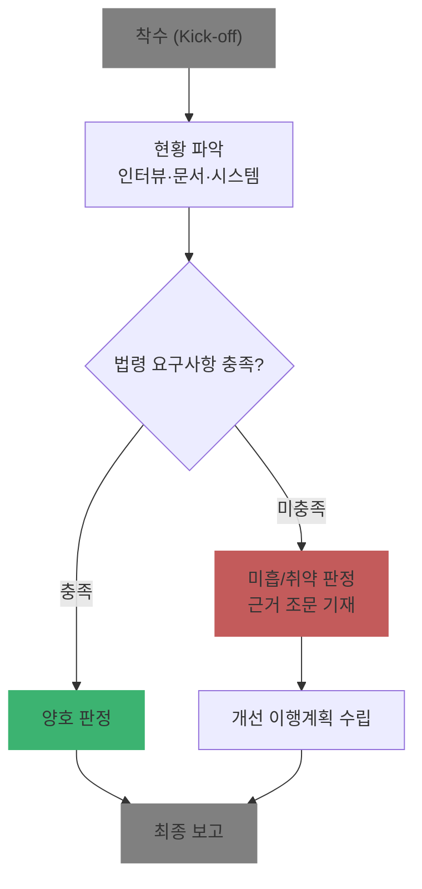

# Ch01. 개인정보 컨설팅 입문과 법 체계

| 항목 | 내용 |
|---|---|
| 주차 | 1주차 |
| 컨설팅 영역 | 공통 |
| 핵심 근거 | 「개인정보 보호법」 제1조, 제2조, 제3조, 제7조, 제29조, 제30조의3 |
| 법령 확인일 | 2026-11-11 (법률 제21445호, 2026.9.11. 시행분 반영 — 국가법령정보센터 원문 재확인 권장) |
| 예상 학습 시간 | 2시간 |
| 선수 챕터 | 없음 |

---

## 1. 학습 목표

1. 개인정보 보호 법령 체계(법률 → 시행령 → 고시 → 가이드라인)를 구분할 수 있다.
2. 5대 컨설팅 영역(관리체계·보호수준 평가·실태점검·영향평가·가명정보)의 근거 조문을 말할 수 있다.
3. 2026년 법 개정의 핵심 3가지를 고객사에 설명할 수 있다.

---

## 2. 🧩 한 줄 비유

> 개인정보 법령은 "헌법(법률) → 시행규칙(시행령) → 현장 매뉴얼(고시) → 해설 교재(가이드라인)"로 내려가는 **4층 건물**이고, 컨설턴트는 고객사가 각 층의 규칙을 지키는지 보는 **건물 안전점검원**이다.

---

## 3. 📜 법령 조문

> ※ 아래 인용은 학습용 요지 정리입니다. 산출물에는 국가법령정보센터 원문을 복사해 쓰십시오.

### 3.1 핵심 조문

| 조문 | 요지 |
|---|---|
| 제1조(목적) | 개인정보 처리·보호에 관한 사항을 정해 개인의 자유와 권리를 보호하고 개인의 존엄과 가치를 구현 |
| 제2조(정의) | 개인정보(제1호 가·나·다목), 가명처리(제1호의2), 처리(제2호), 정보주체(제3호), 개인정보처리자(제5호) 등 |
| 제3조(개인정보 보호 원칙) | 목적 명확화·최소수집, 목적 외 활용 금지, 정확성·최신성, 안전한 관리, 처리방침 공개, 사생활 침해 최소화, 익명·가명 처리 우선 등 |
| 제7조(개인정보 보호위원회) | 국무총리 소속 중앙행정기관으로서 개인정보 보호 업무를 독립적으로 수행 |
| 제29조(안전조치의무) | 분실·도난·유출·위조·변조·훼손 방지를 위해 대통령령으로 정하는 바에 따라 기술적·관리적·물리적 조치 |
| 제30조의3(사업주 또는 대표자의 책임) **[2026.9.11. 신설]** | 사업주·대표자는 개인정보 안전 처리의 **최종 책임자**로서 전문 인력·예산 지원 등 총괄적 관리조치를 실효성 있게 해야 함 |

### 3.2 쉬운 풀이 — 법령 4층 구조

| 층 | 명칭 | 누가 만드나 | 컨설턴트 활용 |
|---|---|---|---|
| 1층 | 「개인정보 보호법」 | 국회 | 의무 존재 여부 판단 |
| 2층 | 「개인정보 보호법 시행령」 | 대통령령 | 대상 기준(인원·매출액), 기한(72시간 등) |
| 3층 | 고시 (안전성 확보조치 기준, 영향평가 고시, 과징금 고시 등) | 개인정보보호위원회 | 점검 항목의 직접 근거 |
| 4층 | 안내서·해설서·가이드라인 | 개인정보보호위원회 | 해석·예시 (법적 구속력은 고시보다 약함) |

### 3.3 5대 컨설팅 영역과 근거

| 영역 | 근거 | 성격 |
|---|---|---|
| 관리체계 | 제29조, 제30조, 제31조, 제32조의2 | 자율 구축 + 인증(ISMS-P) |
| 보호수준 평가 | 제11조의2 | 공공기관 대상 평가 |
| 실태점검 | 제63조, 제63조의2 | 위원회의 점검·검사 대비 |
| 영향평가(PIA) | 제33조, 시행령 제35조 | 공공기관 대상 사전 평가 |
| 가명정보 | 제28조의2 ~ 제28조의7 | 가명처리·결합·안전조치 |

### 3.4 2026년 개정 핵심 (법률 제21445호, 2026.3.10. 공포, 2026.9.11. 시행)

| # | 변경 | 조문 |
|---|---|---|
| 1 | 사업주·대표자의 최종 책임 명시 | 제30조의3 신설 |
| 2 | 중대 위반 시 과징금 상한 전체 매출액 **3% → 최대 10%** | 제64조의2제2항 신설 |
| 3 | 일정 규모 이상 처리자는 CPO 지정·변경·해제 시 **이사회 의결 + 위원회 신고** | 제31조제3항 신설, 시행령 제32조제3항 |
| 4 | 유출 **가능성**만 있어도 통지 | 제34조제2항 신설, 시행령 제39조의2 |
| 5 | 일정 기준 이상 처리자 ISMS-P **의무 인증** (2027.7.1. 시행) | 제32조의2제1항 단서 |

---

## 4. 🛠 실무 적용 — 안전성 확보조치 큰 그림

| 구분 | 의미 | 대표 항목 (「개인정보의 안전성 확보조치 기준」) | 증빙 예시 |
|---|---|---|---|
| 관리적 | 사람·문서·절차 | 내부 관리계획(제4조), 접근 권한 관리(제5조) | 내부 관리계획서, 권한 부여 대장, 교육 기록 |
| 기술적 | 시스템 설정 | 접근통제(제6조), 인터넷망 차단(제6조의2), 암호화(제7조), 접속기록(제8조), 악성프로그램 방지(제9조) | 방화벽 정책, 암호화 설정 화면, 접속기록 점검 결과 |
| 물리적 | 장소·매체 | 물리적 안전조치(제10조), 재해·재난 대비(제11조), 출력·복사(제12조), 파기(제13조) | 출입 기록, 잠금장치 사진, 파기 대장 |

### 4.1 Windows 11 실습 — 법령 원문 바로가기 만들기

```powershell
# 바탕화면에 국가법령정보센터·개인정보위 바로가기 생성
$desk = [Environment]::GetFolderPath('Desktop')
"[InternetShortcut]`r`nURL=https://www.law.go.kr" | Out-File "$desk\국가법령정보센터.url" -Encoding ascii
"[InternetShortcut]`r`nURL=https://www.pipc.go.kr" | Out-File "$desk\개인정보보호위원회.url" -Encoding ascii
```

| 확인 항목 | 🟩 양호 | 🟥 취약 |
|---|---|---|
| 참고 법령 출처 | 국가법령정보센터 현행 원문 + 확인일 기재 | 블로그·과거 해설서 캡처 인용 |

---

## 5. 🔄 프로세스 다이어그램 — 컨설팅 공통 수행 흐름



---

## 6. ⚖ 개인정보보호위원회 위반·처분 사례

| 항목 | 내용 |
|---|---|
| 의결 연도 | 2025년 (8월 전체회의) |
| 피심인 유형 | 이동통신사업자 (SK텔레콤, 유심 정보 유출) |
| 위반 사실 | 해킹으로 유심 인증키(Ki, OPc) 등 25종 정보 유출. 유심 인증키를 **암호화하지 않고 평문 저장**, 유출 **통지 지연** |
| 위반 조문 | 🟥 「개인정보 보호법」 제29조(안전조치의무), 제34조(유출 통지) 등 |
| 처분 결과 | 🟥 과징금 **1,347억 9,100만 원**, 과태료 **960만 원**(통지 지연), 시정명령·개선권고 |
| 컨설팅 시사점 | 단일 사고가 **역대 최대 규모 과징금**으로 이어짐 → 경영진이 "안전조치=경영 리스크"로 인식하는 계기. 2026년 개정(최대 10%) 이후 리스크는 더 커짐 |
| 출처 | 개인정보보호위원회 보도자료 (2025.8.28.) — `references/250828 (석간) 개인정보위 ‘SK텔레콤 개인정보 유출사고’ 제재처분 의결` |

---

## 7. ❌ 오답노트

| # | 🟨 흔한 착각 | 🟩 올바른 이해 | 근거 |
|---|---|---|---|
| 1 | "정보통신서비스 제공자는 제39조의3 특례를 따른다" | 2023년 개정으로 정보통신서비스 특례 대부분이 일반 규정으로 **통합·삭제**됨. 구 조문 인용 금지 | 법률 제19234호(2023.3.14.) |
| 2 | "가이드라인에 없으면 의무도 없다" | 의무는 **법률·시행령·고시**에서 나온다. 안내서는 해석 자료 | 법령 체계 |
| 3 | "과징금은 최대 매출 3%다" | 2026.9.11.부터 중대 위반(재위반·1천만 명 이상 피해·시정명령 불이행)은 **최대 10%** | 제64조의2제2항 |
| 4 | "CPO만 지정하면 대표는 책임이 없다" | 대표자는 **최종 책임자** (제30조의3). 이행 정도는 과징금 감경 판단 요소 | 제30조의3, 시행령 제60조의2 |

---

## 8. ✅ 고객사 점검용 체크리스트 (착수 단계)

| No | 점검 항목 | 근거 조문 | 점검 방법 | 결과 | 비고 |
|---|---|---|---|---|---|
| 1 | 고객사가 개인정보처리자에 해당하는가, 공공기관인가 | 제2조제5호·제6호 | 인터뷰 | | 공공이면 보호수준 평가·PIA 대상 검토 |
| 2 | 처리 정보주체 수·민감정보·고유식별정보 처리 여부 | 제23조, 제24조 | 문서 | | 각종 대상 기준 판단의 출발점 |
| 3 | CPO 지정 및 이사회 의결·신고 대상 여부 | 제31조, 시행령 제32조 | 문서 | | 2026.9.11. 신설 |
| 4 | 대표자 보고 체계(예산·인력 지원) 존재 여부 | 제30조의3 | 인터뷰·문서 | | |
| 5 | ISMS-P 의무 대상 가능성 | 제32조의2제1항 단서 | 매출·규모 확인 | | 2027.7.1. 시행, 시행령 기준 확정 여부 확인 |

### 8.1 💡 실무 산출물 연계 팁

- **연계 산출물**: 착수보고서 → "적용 법령 및 기준" 장
- **작성 팁**: 법령명 + 법률 번호 + 시행일 + **확인일**을 표로 고정해 두면, 감리·고객 질의 때 "어느 버전 기준이냐"는 논쟁을 없앨 수 있음
- **Excel 활용**: `법령목록.xlsx`에 [법령명 | 번호 | 시행일 | 확인일 | URL] 열 구성

---

## 9. 📝 퀴즈

> 정답·해설: [answers_and_explanations.md](../../answers_and_explanations.md#ch01)

**Q1. (OX)** 개인정보보호위원회 안내서(가이드라인)는 고시와 동일한 법적 구속력을 가진다.

**Q2. (객관식)** 2026.9.11. 시행 개정 「개인정보 보호법」에 해당하지 **않는** 것은?
- ① 사업주·대표자 책임 조항 신설 ② 중대 위반 과징금 최대 10% ③ 유출 가능성 통지 ④ 개인정보 영향평가 민간 전면 의무화

**Q3. (단답)** 안전성 확보조치 3분류(기술적·관리적·물리적)의 법률상 근거 조문은?

---

## 10. 📚 참고 자료

- 국가법령정보센터 「개인정보 보호법」: https://www.law.go.kr
- 개인정보보호위원회 법령·고시: https://www.pipc.go.kr
- 개인정보 포털: https://www.privacy.go.kr

---

[목차](../../README.md) | [다음: Ch02](ch02_lifecycle.md) ➡
