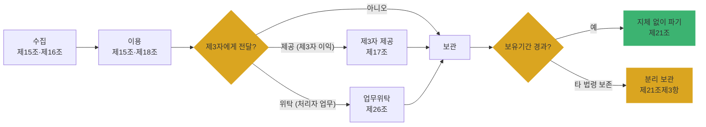

# Ch02. 처리 단계별 법적 요건 (수집·이용·제공·파기)

| 항목 | 내용 |
|---|---|
| 주차 | 1주차 |
| 컨설팅 영역 | 공통 (모든 컨설팅의 흐름 분석 기초) |
| 핵심 근거 | 「개인정보 보호법」 제15조, 제16조, 제17조, 제18조, 제21조, 제22조, 제23조, 제24조, 제24조의2 |
| 법령 확인일 | 2026-11-11 (국가법령정보센터 원문 재확인 권장) |
| 예상 학습 시간 | 2.5시간 |
| 선수 챕터 | Ch01 |

---

## 1. 학습 목표

1. 수집 → 이용 → 제공 → 보관 → 파기 단계별 근거 조문을 매칭할 수 있다.
2. "동의만이 유일한 수집 근거"라는 오해를 바로잡을 수 있다.
3. 고객사 개인정보 흐름표에 단계별 적법 근거 열을 채울 수 있다.

---

## 2. 🧩 한 줄 비유

> 개인정보 처리는 **택배의 일생**(접수 → 배송 → 전달 → 보관 → 폐기)이며, 단계마다 "운송장(법적 근거)"이 붙어 있어야 한다.

---

## 3. 📜 법령 조문

> ※ 학습용 요지입니다. 각 호의 정확한 문언은 원문으로 확인하십시오.

### 3.1 단계별 핵심 조문

| 단계 | 조문 | 요지 |
|---|---|---|
| 수집·이용 | 제15조제1항 | 동의, 법률 특별규정·법령상 의무, 공공기관 소관업무, 계약 체결·이행, 급박한 생명·신체·재산 이익, 정당한 이익, 공중위생 등 공공의 안전 — **각 호 중 하나**면 수집·이용 가능 |
| 수집·이용 | 제15조제2항 | 동의 받을 때 고지 사항: 목적, 항목, 보유·이용 기간, 거부 권리 및 불이익 |
| 최소수집 | 제16조 | 목적에 필요한 최소한, 입증책임은 처리자, 미동의 시 서비스 거부 금지 |
| 제3자 제공 | 제17조 | 동의 또는 제15조제1항 일부 호에 해당하는 경우 등 |
| 목적 외 이용·제공 | 제18조 | 원칙 금지, 별도 동의 등 예외 열거 |
| 파기 | 제21조 | 보유기간 경과·목적 달성 등으로 불필요해지면 **지체 없이** 파기, 다른 법령상 보존 시 분리 보관 |
| 동의 방법 | 제22조 | 각각의 동의 사항을 구분, 명확히 알리고 받기 |
| 민감정보 | 제23조 | 원칙 금지, 별도 동의 또는 법령 근거 시만 처리 + 안전조치 |
| 고유식별정보 | 제24조 | 원칙 금지, 별도 동의 또는 법령 근거 |
| 주민등록번호 | 제24조의2 | 법령 근거 등 예외에서만 처리, **암호화** 의무 |

### 3.2 쉬운 풀이

| 조문 요소 | 쉬운 말 | 컨설턴트가 확인할 것 |
|---|---|---|
| 누가 | 개인정보처리자 | 수탁자 처리분도 위탁자 흐름에 포함 |
| 무엇을 | 단계마다 적법 근거 확보 | 흐름표의 "법적 근거" 열이 비어 있지 않은지 |
| 언제 | 수집 전 고지·동의, 불필요 시 지체 없이 파기 | 동의서 양식·파기 절차서 |
| 위반 시 | 과징금(제64조의2), 과태료(제75조), 형사벌(제71조 등) | 조항별 제재 유형 구분 |

---

## 4. 🛠 실무 적용

| 구분 | 요구사항 (근거) | 현장 확인 방법 | 증빙 자료 예시 |
|---|---|---|---|
| 관리적 | 단계별 처리 근거 문서화 (제15조~제22조) | 흐름표·동의서 대조 | 개인정보 흐름표, 동의서 양식, 처리방침 |
| 관리적 | 보유기간 표 관리 (제21조) | 보유기간 표와 실제 DB 비교 | 보유기간 관리 대장 |
| 기술적 | 주민등록번호 암호화 (제24조의2, 고시 제7조) | DB 컬럼 샘플링 | 암호화 설정 화면 |
| 기술적 | 파기 대상 자동 추출·삭제 배치 (제21조, 고시 제13조) | 배치 로그 확인 | 파기 배치 로그, 파기 대장 |
| 물리적 | 분리 보관 매체·장소 관리 (제21조제3항) | 현장 확인 | 분리 보관 목록 |

### 4.1 Windows 11 실습 — PC 내 주민등록번호 패턴 파일 탐지

```powershell
# 문서 폴더에서 주민등록번호 형식(6자리-7자리) 의심 파일 찾기 (txt, csv)
Get-ChildItem "$env:USERPROFILE\Documents" -Recurse -Include *.txt,*.csv -ErrorAction SilentlyContinue |
  Select-String -Pattern '\b\d{6}-[1-4]\d{6}\b' -List |
  Select-Object Path, LineNumber
```

| 확인 항목 | 🟩 양호 | 🟥 취약 |
|---|---|---|
| 업무 PC 평문 주민번호 파일 | 없음 또는 암호화 저장 | 평문 엑셀·CSV 다수 방치 |

> ※ xlsx·hwp는 압축·바이너리라 위 명령으로 탐지되지 않습니다. 실무에서는 개인정보 검출 솔루션을 병행합니다.

---

## 5. 🔄 프로세스 다이어그램



---

## 6. ⚖ 개인정보보호위원회 위반·처분 사례

| 항목 | 내용 |
|---|---|
| 의결 연도 | 2022년 9월 |
| 피심인 유형 | 글로벌 플랫폼 사업자 (구글, 메타) |
| 위반 사실 | 이용자의 타 웹사이트·앱 행태정보를 맞춤형 광고에 활용하면서 **명확히 알리고 동의를 받지 않음** |
| 위반 조문 | 🟥 당시 「개인정보 보호법」의 동의 관련 규정 (당시 정보통신서비스 특례 조항 — 현행 조문과 다름) |
| 처분 결과 | 🟥 과징금 구글 약 692억 원, 메타 약 308억 원 `[의결서 원문 확인 필요]` |
| 컨설팅 시사점 | 동의는 "받았다"가 아니라 **명확히 알리고 구분해서** 받았는지가 쟁점 → 동의 화면 UI까지 점검 |
| 출처 | 개인정보보호위원회 보도자료 (2022.9.14.) |

---

## 7. ❌ 오답노트

| # | 🟨 흔한 착각 | 🟩 올바른 이해 | 근거 |
|---|---|---|---|
| 1 | "모든 수집에는 동의가 필요하다" | 계약 이행, 법령상 의무 등 **동의 외 근거**도 동등한 적법 근거 | 제15조제1항 |
| 2 | "위탁도 제3자 제공 동의를 받아야 한다" | 위탁은 처리자 업무 처리 → 제26조(공개·문서화) 적용. 제공은 제3자 이익 → 제17조 | 제17조, 제26조 |
| 3 | "회원 탈퇴 후 1년 보관 후 파기하면 된다" | 근거 없는 임의 보관은 위반. 지체 없이 파기, 법령 보존 시만 분리 보관 | 제21조 |
| 4 | "민감정보 동의를 일반 동의에 포함했다" | 민감정보·고유식별정보는 **별도 동의** | 제23조, 제24조 |

---

## 8. ✅ 고객사 점검용 체크리스트

| No | 점검 항목 | 근거 조문 | 점검 방법 | 결과 | 비고 |
|---|---|---|---|---|---|
| 1 | 수집 항목별 적법 근거가 흐름표에 기재되어 있는가 | 제15조 | 문서 | | |
| 2 | 동의서에 법정 고지 4항목이 있는가 | 제15조제2항 | 문서 | | |
| 3 | 필수/선택 동의가 구분되고 선택 미동의 시 서비스 거부가 없는가 | 제16조, 제22조 | 화면 | | |
| 4 | 민감·고유식별정보 별도 동의 또는 법령 근거 | 제23조, 제24조 | 문서·화면 | | |
| 5 | 주민등록번호 처리 법령 근거 및 암호화 | 제24조의2 | 문서·DB | | |
| 6 | 보유기간 경과 정보 파기 및 파기 기록 | 제21조 | DB·대장 | | |

### 8.1 💡 실무 산출물 연계 팁

- **연계 산출물**: 개인정보 흐름표 / 흐름도 (Ch08, PIA Ch16에서 재사용)
- **작성 팁**: 흐름표 열 구성 `업무명 | 수집항목 | 수집경로 | 법적근거(조·항·호) | 이용목적 | 제공/위탁처 | 보유기간 | 파기방법`
- **Excel 활용**: "법적근거" 열에 데이터 유효성 목록(제15조①1호 ~ 7호)을 걸어 근거 누락을 필터로 찾기

---

## 9. 📝 퀴즈

> 정답·해설: [answers_and_explanations.md](../../answers_and_explanations.md#ch02)

**Q1. (OX)** 쇼핑몰이 배송업체에 주소를 넘기는 것은 원칙적으로 제3자 제공이므로 제17조 동의가 필요하다.

**Q2. (객관식)** 제15조제2항 동의 시 고지 사항이 **아닌** 것은?
- ① 수집·이용 목적 ② 수집 항목 ③ 보유·이용 기간 ④ 개인정보 보호책임자 연락처

**Q3. (사례)** 회원 탈퇴 후 "재가입 방지" 목적으로 이름·휴대폰번호를 무기한 보관하는 고객사에 대해 지적할 조문과 개선 방향은?

---

## 10. 📚 참고 자료

- 국가법령정보센터 「개인정보 보호법」: https://www.law.go.kr
- 개인정보보호위원회 「개인정보 처리 통합 안내서」: https://www.pipc.go.kr

---

⬅ [이전: Ch01](ch01_intro.md) | [목차](../../README.md) | [다음: Ch03](ch03_safeguard_admin.md) ➡
