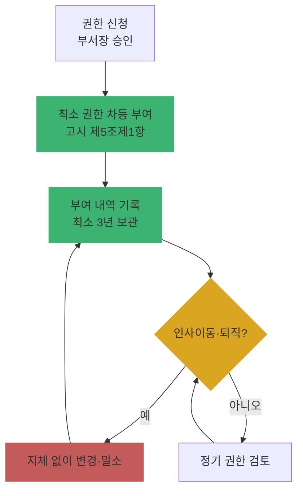

# Ch03. 안전성 확보조치 ① 관리적 조치 (내부 관리계획·접근 권한)

| 항목 | 내용 |
|---|---|
| 주차 | 1주차 |
| 컨설팅 영역 | 공통 (관리체계·실태점검의 핵심) |
| 핵심 근거 | 「개인정보 보호법」 제29조, 시행령 제30조, 「개인정보의 안전성 확보조치 기준」 제4조·제5조 |
| 법령 확인일 | 2026-11-11 (고시 **제2026-9호**, 2026.7.1. 일부개정 원문 대조 완료 — `references/` 폴더) |
| 예상 학습 시간 | 2.5시간 |
| 선수 챕터 | Ch01, Ch02 |

---

## 1. 학습 목표

1. 내부 관리계획의 필수 포함 사항과 생략 가능 대상을 설명할 수 있다.
2. 접근 권한 부여·변경·말소 관리 요건을 점검할 수 있다.
3. 2025년 고시 개정으로 바뀐 관리적 조치 포인트를 고객사에 안내할 수 있다.

---

## 2. 🧩 한 줄 비유

> 내부 관리계획은 회사의 **개인정보 "헌법"**, 접근 권한 관리는 그 헌법에 따라 나눠준 **"출입카드 발급 대장"**이다.

---

## 3. 📜 법령 조문

### 3.1 원문 인용

> **「개인정보 보호법」 제29조(안전조치의무)**
> 개인정보처리자는 개인정보가 분실·도난·유출·위조·변조 또는 훼손되지 아니하도록 내부 관리계획 수립, 접속기록 보관 등 대통령령으로 정하는 바에 따라 안전성 확보에 필요한 기술적·관리적 및 물리적 조치를 하여야 한다.

### 3.2 고시 제4조 · 제5조 요지

| 조문 | 요지 | 2025 개정 |
|---|---|---|
| 제4조제1항 | 개인정보처리자는 내부 관리계획을 수립·시행. 단, **정보주체 1만 명 미만**을 처리하는 소상공인·개인·단체는 생략 가능 | 필수 항목에 **제12호 출력·복사 시 안전조치**, **제13호 개인정보의 파기** 추가 (기존 항목은 제14호 이하로 이동: 유출사고 대응, 위험 분석, 수탁자 관리·감독, 수립·변경·승인 등) |
| 제4조제2항 | CPO·개인정보취급자 대상 교육을 교육목적·대상, 내용, 일정·방법을 정해 사업규모 등에 따라 **차등화하여 정기적으로** 실시 | — |
| 제4조제3항 | 제1항 각 호에 중요한 변경 시 **즉시** 내부 관리계획 수정·시행, **수정 이력 관리** | — |
| 제4조제4항 | **개인정보 보호책임자**는 접근 권한 관리, 접속기록 보관·점검, 암호화 조치 등 내부 관리계획의 이행 실태를 **연 1회 이상** 점검·관리 | — |
| 제5조제1항 | 개인정보처리시스템 접근 권한을 업무 수행에 필요한 **최소한의 범위로 차등 부여** | 2025 개정 문언 (현재 시행 중) |
| 제5조제2항 | 개인정보취급자 또는 그 업무가 변경되면 **지체 없이** 권한 변경·말소 | — |
| 제5조제3항 | 권한 부여·변경·말소 내역 기록, **최소 3년간** 보관 | — |
| 제5조제4항 | 정당한 사유가 없는 한 취급자별 계정 발급, 다른 취급자와 **공유 금지** | — |
| 제5조제5항 | 개인정보취급자 또는 정보주체의 **인증수단을 안전하게 적용·관리** | 비밀번호 정의(제2조제8호)는 "인증할 수 있도록"으로 수정 |
| 제5조제6항 | 정당한 권한을 가진 자만 접근하도록 일정 횟수 이상 **인증 실패** 시 접근 제한 등 조치 | 2025 개정 문언 (현재 시행 중) |

### 3.3 쉬운 풀이

| 조문 요소 | 쉬운 말 | 컨설턴트가 확인할 것 |
|---|---|---|
| 누가 | 모든 개인정보처리자 (1만 명 미만 소상공인 등은 계획서 생략 가능, 조치 자체는 의무) | 정보주체 수 확인 |
| 무엇을 | 계획서 수립 + 승인 + 이행 + 점검 | CPO·대표 승인 이력 |
| 얼마나 | 연 1회 이상 이행 점검, 권한 기록 3년 | 점검 보고서 날짜 |
| 위반 시 | 제29조 위반 → 과태료(제75조) / 유출 시 과징금(제64조의2) | 유출 여부에 따라 제재 구분 |

---

## 4. 🛠 실무 적용

| 구분 | 요구사항 (근거) | 현장 확인 방법 | 증빙 자료 예시 |
|---|---|---|---|
| 관리적 | 내부 관리계획 수립·승인 (제4조) | 최신본 결재 여부, 개정 이력 | 내부 관리계획서(결재본) |
| 관리적 | 2025 개정 항목(출력·복사, 파기) 반영 (제4조제1항제12·13호) | 목차 대조 | 개정 대비표 |
| 관리적 | 연 1회 이상 이행 점검 (제4조) | 점검 결과 보고서 | 점검 결과·조치 보고서 |
| 관리적 | 개인정보취급자 교육 | 교육 계획·결과 | 교육 일지, 수료 명단 |
| 기술적 | 권한 차등 부여·말소 (제5조) | 퇴직자 목록 vs 활성 계정 대조 | 권한 관리 대장, 시스템 계정 목록 |
| 기술적 | 계정 공유 금지·인증 실패 제한 (제5조) | 공용 ID 존재 여부, 잠금 정책 | 계정 정책 화면 |
| 물리적 | (해당 조문 없음 — 제10조에서 다룸) | — | — |

### 4.1 Windows 11 실습 — 로컬 계정·잠금 정책 점검

```powershell
# 1) 로컬 계정 현황 (사용 여부, 마지막 로그인, 비밀번호 변경일)
Get-LocalUser | Select-Object Name, Enabled, LastLogon, PasswordLastSet

# 2) 비밀번호·계정 잠금 정책 확인
net accounts

# 3) 관리자 그룹 구성원 (권한 최소화 확인)
Get-LocalGroupMember -Group "Administrators"
```

| 확인 항목 | 🟩 양호 | 🟥 취약 |
|---|---|---|
| 퇴직·미사용 계정 | 비활성화 또는 삭제 | 장기 미사용 계정 Enabled=True |
| 계정 잠금 임계값 (`Lockout threshold`) | 일정 횟수로 설정됨 | `Never` |
| Administrators 구성원 | 최소 인원 | 일반 사용자 다수 포함 |

> ※ 고객사 개인정보처리시스템 자체 점검은 시스템 관리 화면·DB 계정 목록으로 수행합니다. PC 점검은 보조 증빙입니다.

---

## 5. 🔄 프로세스 다이어그램 — 접근 권한 생명주기



---

## 6. ⚖ 개인정보보호위원회 위반·처분 사례

| 항목 | 내용 |
|---|---|
| 의결 연도 | 2024년 5월 |
| 피심인 유형 | 메신저 플랫폼 (카카오, 오픈채팅 이용자 정보 유출) |
| 위반 사실 | 일반채팅과 오픈채팅 이용자를 **동일한 회원일련번호**로 식별하도록 구현, 2020.8월 이전 오픈채팅방은 임시ID를 **암호화하지 않아** 회원일련번호 확인 가능 → 해커가 정보를 결합해 개인정보 파일 생성·판매. 유출 신고·통지 미이행 |
| 위반 조문 | 🟥 「개인정보 보호법」 제29조(안전조치의무), 당시 유출 신고·통지 조항(구 제39조의4제1항) |
| 처분 결과 | 🟥 과징금 **151억 4,196만 원**, 과태료 **780만 원**, 시정명령, 처분결과 공표 |
| 컨설팅 시사점 | 기술 취약점의 이면에는 **위험 분석·내부 관리계획의 실효성 부족**이 있음 → 관리적 조치가 "문서만 있는 상태"인지 점검 |
| 출처 | 개인정보보호위원회 보도자료 (2024.5.23.) |

---

## 7. ❌ 오답노트

| # | 🟨 흔한 착각 | 🟩 올바른 이해 | 근거 |
|---|---|---|---|
| 1 | "1만 명 미만이면 안전조치 의무가 없다" | **계획서 수립만** 생략 가능. 접근통제·암호화 등 조치 의무는 그대로 | 고시 제4조제1항 단서 |
| 2 | "내부 관리계획은 한 번 만들면 끝" | 연 1회 이상 이행 점검, 법령 개정 시 갱신·승인 | 고시 제4조 |
| 3 | "팀 공용 계정 1개로 운영해도 로그가 남으니 괜찮다" | 취급자별 계정 발급, 공유 금지 → 공용 계정은 **행위자 특정 불가** | 고시 제5조 |
| 4 | "퇴직자 계정은 분기마다 정리한다" | 인사이동 시 **지체 없이** 변경·말소 | 고시 제5조 |

---

## 8. ✅ 고객사 점검용 체크리스트

| No | 점검 항목 | 근거 조문 | 점검 방법 | 결과 | 비고 |
|---|---|---|---|---|---|
| 1 | 내부 관리계획 최신본 수립·결재 | 고시 제4조 | 문서 | | |
| 2 | 2025 개정 필수 항목(출력·복사, 파기) 반영 | 고시 제4조제1항제12·13호 | 문서 | | 현재 시행 중 |
| 3 | 연 1회 이상 이행 점검 결과 | 고시 제4조 | 문서 | | |
| 4 | 권한 최소·차등 부여 | 고시 제5조제1항 | 시스템 | | |
| 5 | 퇴직·전보자 권한 지체 없이 말소 | 고시 제5조 | 인사목록 대조 | | 샘플 10건 |
| 6 | 권한 변경 기록 3년 보관 | 고시 제5조 | 대장 | | |
| 7 | 공용 계정 부재, 비밀번호 규칙·인증 실패 제한 | 고시 제5조 | 시스템 | | |

### 8.1 💡 실무 산출물 연계 팁

- **연계 산출물**: 내부 관리계획서 개정안, 권한 관리 절차서
- **작성 팁**: 고시 제4조제1항 각 호를 **목차 번호와 1:1로 매핑**한 대비표를 부록으로 붙이면 실태점검 시 즉시 증빙 가능
- **Excel 활용**: 인사 퇴직자 목록과 시스템 계정 목록을 `XLOOKUP`으로 대조 → 미말소 계정 자동 표시

---

## 9. 📝 퀴즈

> 정답·해설: [answers_and_explanations.md](../../answers_and_explanations.md#ch03)

**Q1. (OX)** 정보주체 5천 명을 처리하는 소상공인은 내부 관리계획 수립을 생략할 수 있으므로 접근통제 조치도 하지 않아도 된다.

**Q2. (객관식)** 2025년 고시 개정으로 내부 관리계획 필수 항목에 추가된 것 2가지는?
- ① 출력·복사 시 안전조치 ② 영상정보처리기기 운영 ③ 개인정보의 파기 ④ 가명정보 결합

**Q3. (단답)** 접근 권한 부여·변경·말소 내역의 최소 보관 기간은?

---

## 10. 📚 참고 자료

- 국가법령정보센터 행정규칙 「개인정보의 안전성 확보조치 기준」: https://www.law.go.kr
- 개인정보보호위원회 「개인정보의 안전성 확보조치 기준 안내서」(2025.11.): https://www.pipc.go.kr

---

⬅ [이전: Ch02](ch02_lifecycle.md) | [목차](../../README.md) | [다음: Ch04](ch04_safeguard_tech.md) ➡
