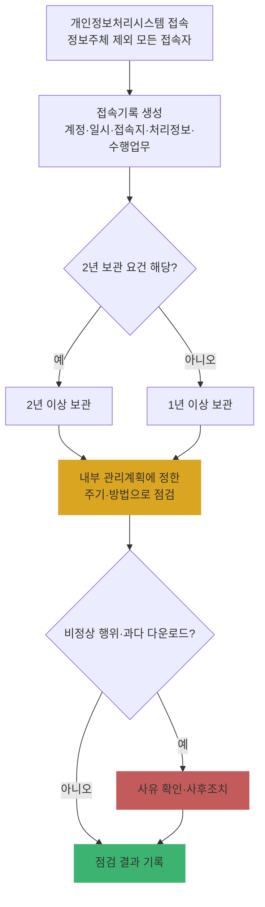

# Ch04. 안전성 확보조치 ② 기술적 조치 (접근통제·암호화·접속기록·악성프로그램)

| 항목 | 내용 |
|---|---|
| 주차 | 1주차 |
| 컨설팅 영역 | 공통 (실태점검·PIA 기술 영역) |
| 핵심 근거 | 「개인정보의 안전성 확보조치 기준」 제6조, 제6조의2, 제7조, 제8조, 제9조 / 「개인정보 보호법」 제24조의2 |
| 법령 확인일 | 2026-11-11 (고시 제2025-9호 반영. 제6조제2항·제8조제1항·제2항은 발령 1년 후 시행분 — 원문 부칙으로 시행일 확인) |
| 예상 학습 시간 | 3시간 |
| 선수 챕터 | Ch03 |

---

## 1. 학습 목표

1. 접근통제·인터넷망 차단·암호화·접속기록·악성프로그램 방지 요건을 구분할 수 있다.
2. 2025년 고시 개정으로 바뀐 **접속기록 점검 주기**와 **외부 접속 인증** 대상을 설명할 수 있다.
3. Windows 11에서 기본 기술 조치 상태를 직접 확인할 수 있다.

---

## 2. 🧩 한 줄 비유

> 접근통제는 **정문 경비**, 암호화는 **금고**, 접속기록은 **CCTV 녹화**, 백신·업데이트는 **방역** — 하나라도 빠지면 건물은 뚫린다.

---

## 3. 📜 법령 조문

### 3.1 고시 조문 요지

| 조문 | 요지 | 2025 개정 포인트 |
|---|---|---|
| 제6조(접근통제) | 불법 접근·침해 방지 조치(접속 권한 IP 제한, 유출 시도 탐지·대응 등), 홈페이지 등을 통한 노출 방지, 일정 시간 미사용 시 자동 접속 차단 등 `[각 항 번호 원문 확인]` | — |
| 제6조제2항 | 외부에서 개인정보처리시스템 접속 시 **안전한 인증수단**(인증서, 보안토큰, 일회용 비밀번호 등) 적용 | 대상: "개인정보처리시스템에 대한 정당한 접근 권한을 가진 자(정보주체 제외)"로 확대 (1년 후 시행) |
| 제6조의2(인터넷망의 차단 조치 등) **[신설, 즉시 시행]** | 전년도 말 기준 직전 3개월 일일평균 이용자 **100만 명 이상** 처리자 → 권한 설정 가능 취급자, 다운로드·파기 가능 취급자 PC에 인터넷망 차단 | 다운로드·파기 취급자는 **위험 분석 결과** 위험이 현저히 낮거나 보호조치 적용 시 예외 가능. 단 **민감정보·법정 암호화 대상 정보** 다운로드·파기 PC는 예외 불가 |
| 제7조(개인정보의 암호화) | 비밀번호·생체인식정보·고유식별정보 등 전송·저장 시 암호화, 비밀번호는 **일방향 암호화** 저장 `[세부 항·호 원문 확인]` | — |
| 제8조제1항(접속기록 보관) | 접속기록 **1년 이상** 보관. 일정 요건 해당 시 **2년 이상** (예: 정보주체 5만 명 이상, 고유식별정보·민감정보 처리 등 `[각 호 원문 확인]`) | 대상: "개인정보취급자" → **개인정보처리시스템에 접속한 자(정보주체 제외)** 로 확대 (1년 후 시행) |
| 제8조제2항(접속기록 점검) | 접속기록·다운로드 상황 점검 | 🟨 기존 **"월 1회 이상" 문구 삭제** → 점검 **주기·방법·사후조치를 내부 관리계획으로 정하고 이행** (1년 후 시행) |
| 제9조(악성프로그램 등 방지) | 보안 프로그램 설치·운영, 경보 발령·보안 업데이트 공지 시 **정당한 사유 없는 한 즉시** 업데이트, 발견 시 삭제 등 대응 | — |
| 「개인정보 보호법」 제24조의2제2항 | 주민등록번호는 암호화 조치를 통해 안전하게 보관 | — |

### 3.2 쉬운 풀이

| 조문 요소 | 쉬운 말 | 컨설턴트가 확인할 것 |
|---|---|---|
| 누가 | 모든 개인정보처리자 (제6조의2는 100만 명 이상 대규모만) | 이용자 규모 확인 |
| 무엇을 | 문 잠그기·금고·녹화·방역 | 정책 화면 + 실제 동작 |
| 얼마나 | 접속기록 1년/2년, 점검 주기는 **내부 관리계획에 정한 대로** | 계획서 주기와 실제 점검 기록 일치 여부 |
| 위반 시 | 제29조 위반 과태료, 유출 시 과징금(제64조의2) | |

---

## 4. 🛠 실무 적용

| 구분 | 요구사항 (근거) | 현장 확인 방법 | 증빙 자료 예시 |
|---|---|---|---|
| 관리적 | 접속기록 점검 주기·방법·사후조치를 **내부 관리계획에 명시** (제8조제2항) | 계획서 조항 확인 | 내부 관리계획서, 점검 보고서 |
| 관리적 | 인터넷망 차단 예외 적용 시 **위험 분석 문서** (제6조의2) | 위험 분석서 검토 | 위험 분석 결과서 |
| 기술적 | IP 제한·침입탐지·자동 세션 차단 (제6조) | 방화벽·WAS 설정 | 정책 캡처 |
| 기술적 | 외부 접속 2차 인증 (제6조제2항) | VPN·OTP 설정 | 인증 정책 화면 |
| 기술적 | 비밀번호 일방향 암호화, 고유식별정보 암호화 (제7조) | DB 샘플 조회 | 해시 값 화면, 암호화 설정 |
| 기술적 | 접속기록 항목·보관 기간·위변조 방지 (제8조) | 로그 샘플·보관 기간 확인 | 로그 샘플, 백업 정책 |
| 기술적 | 백신·보안 업데이트 (제9조) | 엔진 버전·패치 이력 | 백신 관리 콘솔 화면 |
| 물리적 | (해당 없음 — Ch05에서 다룸) | — | — |

### 4.1 Windows 11 실습 — 기술적 조치 상태 점검

```powershell
# 1) Microsoft Defender 상태 (실시간 보호, 정의 업데이트 일자)
Get-MpComputerStatus | Select-Object AMServiceEnabled, RealTimeProtectionEnabled, AntivirusSignatureLastUpdated

# 2) 최근 설치된 보안 업데이트
Get-HotFix | Sort-Object InstalledOn -Descending | Select-Object -First 5

# 3) 화면 보호기 잠금 (일정 시간 미사용 시 차단)
Get-ItemProperty 'HKCU:\Control Panel\Desktop' | Select-Object ScreenSaveActive, ScreenSaverIsSecure, ScreenSaveTimeOut

# 4) 로그인 실패 이벤트 (관리자 권한 PowerShell 필요)
Get-WinEvent -FilterHashtable @{LogName='Security'; Id=4625} -MaxEvents 10 |
  Select-Object TimeCreated, Message
```

| 확인 항목 | 🟩 양호 | 🟥 취약 |
|---|---|---|
| 실시간 보호 | `True`, 정의 업데이트 최근 | `False` 또는 수주 이상 지연 |
| 보안 업데이트 | 최근 월 패치 설치 | 수개월 미설치 |
| 화면 잠금 | `ScreenSaverIsSecure=1`, 적정 시간 | 미설정 |
| 로그인 실패 | 이상 반복 없음 / 대응 기록 | 대량 실패 방치 |

---

## 5. 🔄 프로세스 다이어그램 — 접속기록 관리 (2025 개정 반영)



---

## 6. ⚖ 개인정보보호위원회 위반·처분 사례

| 항목 | 내용 |
|---|---|
| 의결 연도 | 2023년 7월 |
| 피심인 유형 | 이동통신사업자 (LG유플러스, 고객정보 유출) |
| 위반 사실 | 고객인증 시스템 관리 미흡 — 초기 비밀번호 사용, 접근통제·불법 접근 탐지 미흡, 장기간 유출 미인지 |
| 위반 조문 | 🟥 「개인정보 보호법」 제29조(안전조치의무) 등 |
| 처분 결과 | 🟥 과징금 약 68억 원, 과태료 `[의결서 원문 확인 필요]` |
| 컨설팅 시사점 | "솔루션이 있다" ≠ "통제가 동작한다". **기본 계정·초기 비밀번호, 이상 접속 탐지 로그 검토**를 반드시 샘플링 |
| 출처 | 개인정보보호위원회 보도자료 (2023.7.12.) |

---

## 7. ❌ 오답노트

| # | 🟨 흔한 착각 | 🟩 올바른 이해 | 근거 |
|---|---|---|---|
| 1 | "접속기록은 법정 주기 월 1회 점검이다" | 2025 개정(1년 후 시행분)으로 문구 삭제 → **내부 관리계획에 정한 주기**를 지켜야 함. 주기를 정하지 않거나 정해 놓고 안 지키면 위반 | 고시 제8조제2항 |
| 2 | "접속기록은 개인정보취급자 것만 남기면 된다" | **정보주체를 제외한 모든 접속자**(외주 개발자·운영자 등 포함)로 확대 | 고시 제8조제1항 |
| 3 | "비밀번호는 AES로 암호화해서 저장하면 된다" | 비밀번호는 복호화 불가한 **일방향(해시)** 암호화 | 고시 제7조 |
| 4 | "망분리는 이제 폐지됐다" | 폐지가 아니라 **위험 기반 예외** 허용. 민감정보·법정 암호화 대상 다운로드·파기 PC는 여전히 차단 | 고시 제6조의2 |
| 5 | "백신만 깔려 있으면 양호" | 업데이트·경보 시 **즉시 업데이트**와 발견 시 대응까지 확인 | 고시 제9조 |

---

## 8. ✅ 고객사 점검용 체크리스트

| No | 점검 항목 | 근거 조문 | 점검 방법 | 결과 | 비고 |
|---|---|---|---|---|---|
| 1 | 접속 IP 제한 및 침입 탐지·대응 | 고시 제6조 | 시스템 | | |
| 2 | 외부 접속 시 안전한 인증수단 (정당 권한자 전체) | 고시 제6조제2항 | 시스템 | | 2025 개정 |
| 3 | 일일평균 이용자 100만 명 이상 여부 및 인터넷망 차단·예외 위험 분석 | 고시 제6조의2 | 문서·시스템 | | |
| 4 | 비밀번호 일방향 암호화, 고유식별정보 암호화 | 고시 제7조, 법 제24조의2 | DB | | |
| 5 | 접속기록 대상(정보주체 제외 전 접속자)·보관 기간 1년/2년 | 고시 제8조제1항 | 로그 | | |
| 6 | 접속기록 점검 주기·방법·사후조치의 계획 명시 및 이행 | 고시 제8조제2항 | 문서·기록 | | |
| 7 | 백신 설치·즉시 업데이트·발견 시 대응 | 고시 제9조 | 콘솔 | | |

### 8.1 💡 실무 산출물 연계 팁

- **연계 산출물**: 기술적 취약점 진단 결과서, 개선 이행계획서
- **작성 팁**: 접속기록 점검 항목은 "계획서에 정한 주기 X회 vs 실제 점검 Y회"로 **이행률**을 숫자로 제시
- **Excel 활용**: 접속기록 다운로드 건수를 피벗 → 계정별 상위 5% 조건부 서식(`#daa520` 배경)으로 이상 행위 후보 표시

---

## 9. 📝 퀴즈

> 정답·해설: [answers_and_explanations.md](../../answers_and_explanations.md#ch04)

**Q1. (OX)** 현행 고시상 접속기록은 반드시 월 1회 이상 점검해야 한다.

**Q2. (객관식)** 고시 제6조의2 인터넷망 차단 조치의 적용 대상 기준은?
- ① 매출 1,500억 원 이상 ② 정보주체 5만 명 이상 ③ 직전 3개월 일일평균 이용자 100만 명 이상 ④ 공공기관 전체

**Q3. (사례)** 외주 유지보수 업체 직원의 DB 접속 기록을 남기지 않는 고객사에 지적할 조문과 개정 포인트는?

---

## 10. 📚 참고 자료

- 국가법령정보센터 행정규칙 「개인정보의 안전성 확보조치 기준」(고시 제2025-9호): https://www.law.go.kr
- 개인정보보호위원회 「개인정보의 안전성 확보조치 기준 안내서」(2025.11.): https://www.pipc.go.kr

---

⬅ [이전: Ch03](ch03_safeguard_admin.md) | [목차](../../README.md) | [다음: Ch05](ch05_safeguard_physical.md) ➡
