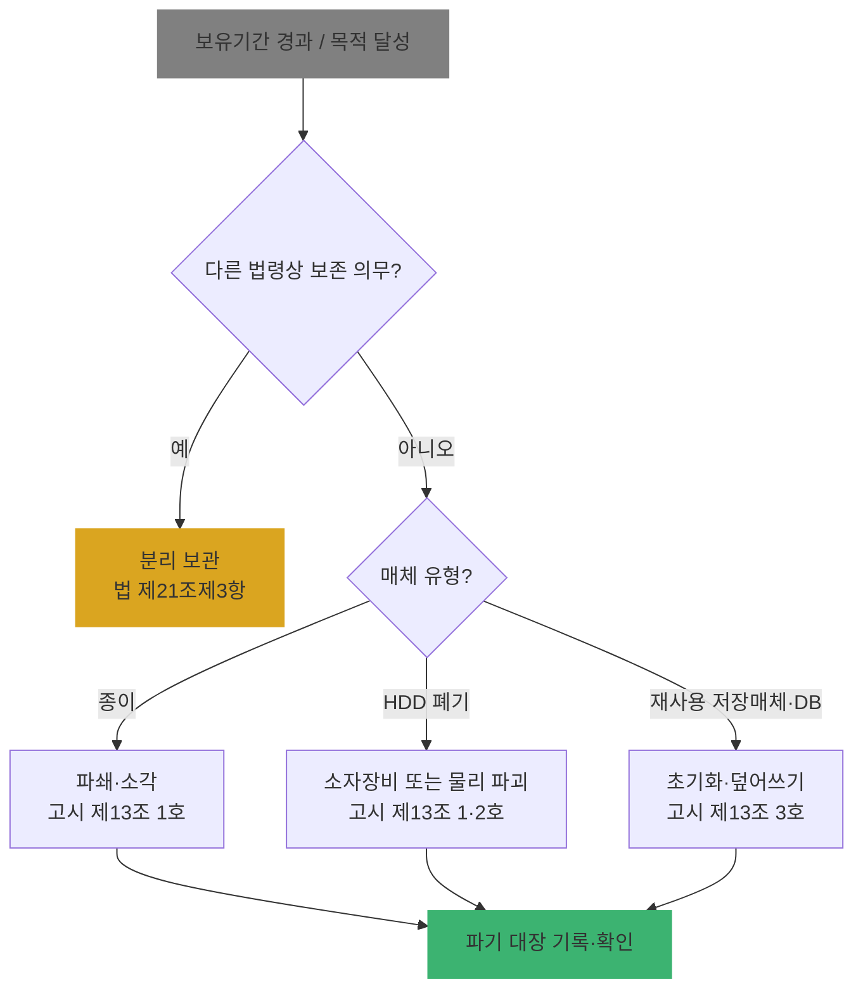

# Ch05. 안전성 확보조치 ③ 물리적 조치·재해 대비·출력·복사·파기

| 항목 | 내용 |
|---|---|
| 주차 | 1주차 |
| 컨설팅 영역 | 공통 |
| 핵심 근거 | 「개인정보의 안전성 확보조치 기준」 제10조, 제11조, 제12조, 제13조 / 「개인정보 보호법」 제21조 |
| 법령 확인일 | 2026-11-11 (고시 **제2026-9호**, 2026.7.1. 일부개정 원문 대조 완료 — `references/` 폴더) |
| 예상 학습 시간 | 2시간 |
| 선수 챕터 | Ch04 |

---

## 1. 학습 목표

1. 물리적 보관 장소·매체 관리 요건을 점검할 수 있다.
2. 출력·복사물의 최소화·관리 요건을 설명할 수 있다.
3. 고시 제13조의 파기 방법 3가지를 구분하고 현장 파기 절차를 평가할 수 있다.

---

## 2. 🧩 한 줄 비유

> 아무리 시스템을 잘 잠가도 **인쇄물이 복사기 위에 놓여 있고 폐PC가 창고에 쌓여 있다면**, 정문은 잠그고 뒷문은 열어둔 셈이다.

---

## 3. 📜 법령 조문

### 3.1 원문 인용 (고시)

> **제10조(물리적 안전조치)**
> ① 개인정보처리자는 전산실, 자료보관실 등 개인정보를 보관하고 있는 물리적 보관 장소를 별도로 두고 있는 경우에는 이에 대한 출입통제 절차를 수립·운영하여야 한다.
> ② 개인정보처리자는 개인정보가 포함된 서류, 보조저장매체 등을 잠금장치가 있는 안전한 장소에 보관하여야 한다.

> **제12조(출력·복사시 안전조치)**
> ① 개인정보처리자는 개인정보처리시스템에서 개인정보의 출력시(인쇄, 화면표시, 파일생성 등) 용도를 특정하여야 하며, 용도에 따라 출력 항목을 최소화하여야 한다.
> ② 개인정보처리자는 개인정보가 포함된 종이 인쇄물, 개인정보가 복사된 외부 저장매체 등 개인정보의 출력·복사물을 안전하게 관리하기 위해 필요한 안전조치를 하여야 한다.

> **제13조(개인정보의 파기)** 제1항
> 개인정보처리자는 개인정보를 파기할 경우 다음 각 호의 어느 하나의 조치를 하여야 한다.
> 1. 완전파괴(소각·파쇄 등)
> 2. 전용 소자장비(자기장을 이용해 저장장치의 데이터를 삭제하는 장비)를 이용하여 삭제
> 3. 데이터가 복원되지 않도록 초기화 또는 덮어쓰기 수행

> **제10조제3항**: 개인정보가 포함된 보조저장매체의 **반출·입 통제**를 위한 보안대책 마련. 다만, 별도의 개인정보처리시스템 없이 업무용 컴퓨터·모바일 기기로만 처리하는 경우 적용하지 아니할 수 있다.
>
> **제13조제2항(일부 파기)**: 1. 전자적 파일 → 삭제 후 복구·재생되지 않도록 관리·감독 2. 그 외 기록물·인쇄물 → 해당 부분 **마스킹, 구멍 뚫기** 등으로 삭제
> **제13조제3항**: 기술적 특성으로 위 방법이 현저히 곤란하면 법 제58조의2(익명정보)에 해당하는 정보로 처리하여 복원 불가능하게 조치
>
> ※ 위 인용은 고시 제2026-9호 원문 기준입니다.

### 3.2 제11조(재해·재난 대비 안전조치) 요지

| 적용 대상 | 의무 내용 |
|---|---|
| 정보주체 **10만 명 이상** 대기업·중견기업·공공기관 또는 **100만 명 이상** 중소기업·단체 | 화재·홍수·단전 등 재해·재난 시 개인정보처리시스템 보호를 위해 1. **위기대응 매뉴얼** 등 대응절차 마련·정기 점검 2. **백업 및 복구 계획** 마련 |

### 3.3 쉬운 풀이

| 조문 요소 | 쉬운 말 | 컨설턴트가 확인할 것 |
|---|---|---|
| 누가 | 모든 개인정보처리자 (제10조제1항은 별도 보관 장소가 있는 경우) | 전산실·문서고 존재 여부 |
| 무엇을 | 출입통제, 잠금 보관, 출력 최소화, 확실한 파기 | 현장 실사 |
| 언제 | 파기는 불필요해진 때 **지체 없이** (법 제21조) | 파기 대장 일자 |
| 위반 시 | 제29조·제21조 위반 과태료, 유출 시 과징금 | |

---

## 4. 🛠 실무 적용

| 구분 | 요구사항 (근거) | 현장 확인 방법 | 증빙 자료 예시 |
|---|---|---|---|
| 관리적 | 출력·복사 및 파기 사항을 내부 관리계획에 반영 (제4조제1항제12·13호) | 계획서 목차 | 내부 관리계획서 |
| 관리적 | 파기 대장 작성·CPO 확인 | 파기 대장 샘플 | 파기 대장, 파기 업체 확인서 |
| 기술적 | 출력 항목 최소화·마스킹 (제12조제1항) | 출력 화면 확인 | 마스킹 화면 캡처 |
| 기술적 | 보조저장매체(USB) 통제 | 매체 제어 정책 | DLP·매체제어 정책 |
| 기술적 | 덮어쓰기·초기화 파기 (제13조제1항제3호) | 파기 도구·로그 | 완전삭제 로그 |
| 물리적 | 전산실·문서고 출입통제 (제10조제1항) | 출입 기록부, 카드 리더 | 출입 기록 |
| 물리적 | 서류·매체 잠금장치 보관 (제10조제2항) | 캐비닛 실사 | 사진 |
| 물리적 | 재해 대비 백업·복구 (제11조) | 백업 위치·복구 훈련 | 복구 훈련 결과서 |

### 4.1 Windows 11 실습 — 공유폴더·암호화·덮어쓰기 확인

```powershell
# 1) 이 PC의 공유 폴더 목록 (불필요한 공유는 출력·복사 통제 위반 위험)
Get-SmbShare | Select-Object Name, Path, Description

# 2) BitLocker 암호화 상태 (관리자 권한 필요) — 분실·도난 대비
manage-bde -status C:

# 3) 삭제된 파일 잔여 데이터 덮어쓰기 (폴더가 있는 드라이브의 빈 공간을 덮어씀, 시간 소요)
cipher /w:C:\Temp
```

| 확인 항목 | 🟩 양호 | 🟥 취약 |
|---|---|---|
| 공유 폴더 | 기본 관리 공유(`C$`, `ADMIN$`, `IPC$`) 외 없음 | `Everyone` 공유 개인정보 폴더 |
| BitLocker | `Protection On` | `Protection Off` (노트북) |
| 파기 방법 | 덮어쓰기 도구·물리 파쇄 기록 | 휴지통 비우기·빠른 포맷만 |

> ※ `cipher /w`는 **이미 삭제된 영역**을 덮어쓰는 명령입니다. 사용 중인 파일 삭제가 아니므로 실습 PC에서 안전하게 수행하되, SSD는 제조사 보안 삭제 기능·물리 파쇄를 함께 검토합니다.

---

## 5. 🔄 프로세스 다이어그램 — 파기 의사결정



---

## 6. ⚖ 개인정보보호위원회 위반·처분 사례

| 항목 | 내용 |
|---|---|
| 의결 연도 | 2024년 |
| 피심인 유형 | 골프 플랫폼 사업자 (골프존, 랜섬웨어 공격으로 대규모 유출) |
| 위반 사실 | 해커가 직원 **VPN 계정**(서버 관리자 계정 포함)을 탈취해 업무망 **파일서버**(윈도우 공유폴더로 임직원 PC와 공유)에 접속·유출 → 약 **221만 명** 정보 유출, 일부 **주민등록번호(5,831명)·계좌번호(1,647명)** 포함. 파일서버에 주민번호 포함 다량 개인정보 저장·공유, **파기 미이행** 등 |
| 위반 조문 | 🟥 「개인정보 보호법」 제29조(안전조치의무), 제21조제1항(파기), 제24조의2제2항(주민등록번호 암호화) |
| 처분 결과 | 🟥 과징금 **75억 400만 원**, 과태료 **540만 원**, 시정명령, 공표명령 |
| 컨설팅 시사점 | **파기하지 않은 데이터 = 유출 피해 규모 확대 요인**. 파일서버·**공유폴더**(고시 제6조③)의 장기 방치 파일을 반드시 점검 |
| 출처 | 개인정보보호위원회 보도자료 (2024.5.9.) |

---

## 7. ❌ 오답노트

| # | 🟨 흔한 착각 | 🟩 올바른 이해 | 근거 |
|---|---|---|---|
| 1 | "휴지통 비우기·빠른 포맷이면 파기 완료" | 복원 가능 → 덮어쓰기·초기화·소자·물리 파괴 중 하나 | 고시 제13조제1항 |
| 2 | "전산실이 없으니 물리적 조치는 해당 없음" | 제10조제1항만 해당 없음. **서류·USB 잠금 보관(제2항)**은 그대로 적용 | 고시 제10조 |
| 3 | "출력물 관리는 보안팀 정책일 뿐 법적 의무 아님" | 출력 용도 특정·항목 최소화는 고시상 의무, 2025 개정으로 내부 관리계획 필수 항목 | 고시 제12조, 제4조 |
| 4 | "백업은 있으니 재해 대비 완료" | 복구 **절차·정기 점검**까지 필요 — 복구 훈련 기록 확인 | 고시 제11조 |

---

## 8. ✅ 고객사 점검용 체크리스트

| No | 점검 항목 | 근거 조문 | 점검 방법 | 결과 | 비고 |
|---|---|---|---|---|---|
| 1 | 전산실·문서고 출입통제 절차 및 기록 | 고시 제10조제1항 | 현장 | | |
| 2 | 서류·보조저장매체 잠금 보관 | 고시 제10조제2항 | 현장 | | 클린데스크 샘플 |
| 3 | 위기대응 매뉴얼·백업·복구 계획 및 점검 | 고시 제11조 | 문서 | | 대상 범위 확인 |
| 4 | 출력 용도 특정·항목 최소화(마스킹) | 고시 제12조제1항 | 화면 | | |
| 5 | 출력·복사물 관리 조치 | 고시 제12조제2항 | 현장 | | |
| 6 | 파기 방법 적정성 및 파기 대장 | 고시 제13조, 법 제21조 | 문서 | | |
| 7 | 보유기간 경과 데이터 잔존 여부 | 법 제21조 | DB·파일서버 | | |

### 8.1 💡 실무 산출물 연계 팁

- **연계 산출물**: 현장 실사 보고서(사진 첨부), 파기 절차서
- **작성 팁**: 현장 사진은 개인정보가 보이지 않게 **모자이크 후** 첨부. 사진 파일명 `점검항목번호_장소_일자.jpg`로 통일
- **Excel 활용**: 파기 대장 양식 `파기일 | 대상 | 건수 | 방법(1·2·3호) | 수행자 | 확인자(CPO)`

---

## 9. 📝 퀴즈

> 정답·해설: [answers_and_explanations.md](../../answers_and_explanations.md#ch05)

**Q1. (OX)** 별도 전산실이 없는 소규모 사업자는 고시 제10조 전체가 적용되지 않는다.

**Q2. (객관식)** 고시 제13조제1항의 파기 방법이 **아닌** 것은?
- ① 소각·파쇄 ② 전용 소자장비 이용 삭제 ③ 초기화 또는 덮어쓰기 ④ 파일명 변경 후 숨김 처리

**Q3. (단답)** 출력 시 안전조치의 두 가지 핵심 요건(제12조제1항)은?

---

## 10. 📚 참고 자료

- 국가법령정보센터 행정규칙 「개인정보의 안전성 확보조치 기준」: https://www.law.go.kr
- 개인정보보호위원회 「개인정보의 안전성 확보조치 기준 안내서」(2025.11.): https://www.pipc.go.kr

---

⬅ [이전: Ch04](ch04_safeguard_tech.md) | [목차](../../README.md) | [다음: Ch06](ch06_breach_sanction.md) ➡
