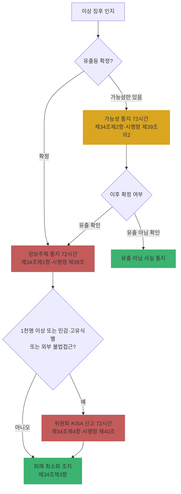

# Ch06. 유출 대응과 행정처분 체계

| 항목 | 내용 |
|---|---|
| 주차 | 1주차 |
| 컨설팅 영역 | 공통 (모든 영역의 리스크 산정 기준) |
| 핵심 근거 | 「개인정보 보호법」 제34조, 제64조, 제64조의2, 제75조 / 시행령 제39조, 제39조의2, 제39조의3, 제40조, 제60조의2 |
| 법령 확인일 | 2026-11-11 (법률 제21445호·대통령령 제36671호, 2026.9.11. 시행분 반영. 일부 세부는 2차 출처 기반 — 원문 대조 필수) |
| 예상 학습 시간 | 3시간 |
| 선수 챕터 | Ch03 ~ Ch05 |

---

## 1. 학습 목표

1. 2026년 개정으로 바뀐 제34조의 **항 구조**(통지·가능성 통지·피해 최소화·신고)를 설명할 수 있다.
2. 유출 통지·신고의 **72시간** 기한과 신고 대상 요건을 적용할 수 있다.
3. 과징금 기본 상한(3%)과 가중 상한(10%)의 요건, 투자 감경 제도를 구분할 수 있다.

---

## 2. 🧩 한 줄 비유

> 유출 대응은 **화재 대응**과 같다 — 불이 났거나 **연기만 보여도**(가능성) 72시간 안에 이웃(정보주체)과 소방서(위원회·KISA)에 알리고, 평소 소방 설비 투자(안전조치)가 많았다면 과태료가 줄어든다.

---

## 3. 📜 법령 조문

### 3.1 제34조 구조 (2026.9.11. 개정 후)

| 항 | 내용 | 비고 |
|---|---|---|
| 제1항 | 유출등을 알게 되었을 때 정보주체에게 **지체 없이 통지** (항목, 시점·경위, 피해 최소화 방법, 대응 조치·구제절차, 담당부서 연락처 + **손해배상 등 법적 권리와 행사 방법(제6호 신설)** 등) | 제3호 "구체적인" 정보로 강화 |
| 제2항 **[신설]** | 대통령령으로 정하는 유출등의 **가능성**을 알게 된 때 → 가능성 있는 모든 정보주체에게 지체 없이 통지 | 시행령 제39조의2 |
| 제3항 (구 제2항) | 피해 최소화 대책 마련·조치 (회수·삭제 등 확산 방지 명시) | 🟨 항 번호 이동 |
| 제4항 (구 제3항) | 일정 규모 이상 유출등 → 보호위원회 또는 전문기관(**KISA**) **신고** | 🟨 "제34조제3항 신고"라는 옛 표현 사용 금지 |

> **"유출등"** = 분실·도난·유출·위조·변조 또는 훼손 (제23조제2항 정의). 랜섬웨어 암호화(훼손)도 포함.

### 3.2 시행령 기한·요건

| 구분 | 근거 | 기한 | 요건·예외 |
|---|---|---|---|
| 확정 유출 통지 | 시행령 제39조 | 알게 된 때부터 **72시간 이내** 서면등 통지 | 긴급 조치(접속경로 차단·취약점 보완·회수 등) 필요 또는 천재지변 등 부득이한 경우 사유 해소 후 즉시 |
| 유출 가능성 통지 | 시행령 제39조의2 | **72시간 이내** | ① 불법 접근으로 유출 의심되나 정보주체 특정 곤란 ② 일부 유출 확인(제3자 거래 등) + 다른 정보주체 유출 가능성. 긴급 조치는 지연 사유 **아님** |
| 연락처 모를 때 | 시행령 제39조의3 | — | 홈페이지 **30일 이상** 게시로 갈음 가능 |
| 신고 | 시행령 제40조 | 알게 된 때부터 **72시간 이내** | ① **1천 명 이상** ② **민감정보·고유식별정보** ③ **외부 불법 접근** 중 하나. 회수·삭제로 침해 가능성 현저히 낮아지면 신고 생략 가능. 확인 못한 내용은 우선 신고 후 추가 신고 |

### 3.3 과징금 (제64조의2)

| 구분 | 상한 | 요건 |
|---|---|---|
| 기본 (제1항) | 전체 매출액의 **3%** 이하 (매출 산정 곤란 시 20억 원 이하) | 유출등(제1항제9호 — 안전성 확보조치를 다한 경우 제외) 등 |
| 가중 (제2항, **2026 신설**) | 전체 매출액의 **10%** 이하 (산정 곤란 시 50억 원 이하) | ① 과징금 처분일부터 **3년 내** 같은 호 재위반(고의·중과실) ② 고의·중과실 + 피해 **1천만 명 이상** ③ 시정조치 명령(제64조제1항) 불이행으로 유출 발생 |
| 투자 감경 (제6항, **신설**) | 기준금액의 **40% 범위** 필수 감경 (고의·중과실 제외) | 시행령 제60조의2제5항: 보호 투자 규모·지속성, **제30조의3 대표자 책임 이행**, CPO·보호조직 운영 수준 등 |

> 매출액 = 직전 사업연도 매출과 직전 3개 사업연도 연평균 매출 중 **큰 금액** (시행령 제60조의2제1항), 위반과 무관한 매출은 제외 (제64조의2제3항).

### 3.4 과태료 (제75조, 2026 개정 반영)

| 위반 | 조문 | 상한 |
|---|---|---|
| 유출 통지(제34조제1항·제2항) 위반 | 제75조제2항제17호 | 3천만 원 이하 |
| 유출 신고(제34조제4항) 위반 | 제75조제2항제18호 | 3천만 원 이하 |
| CPO 미지정·이사회 의결 누락·신고 누락 | 제75조제2항제14호의2~제14호의4 | 3천만 원 이하 |

> 위 호 번호는 2차 출처(법령 해설 사이트) 기준입니다. 산출물 기재 전 원문 대조하십시오.

---

## 4. 🛠 실무 적용

| 구분 | 요구사항 (근거) | 현장 확인 방법 | 증빙 자료 예시 |
|---|---|---|---|
| 관리적 | 유출사고 대응 절차를 내부 관리계획에 반영 (고시 제4조) | 계획서·대응 매뉴얼 | 유출 대응 매뉴얼 |
| 관리적 | 통지 문안에 **법적 권리·행사 방법** 포함 (제34조제1항제6호) | 통지 템플릿 검토 | 통지문 템플릿 |
| 관리적 | 가능성 통지 판단 기준·결재 라인 (제34조제2항) | 매뉴얼 | 의사결정 플로우 |
| 관리적 | 모의훈련 | 훈련 결과 | 훈련 보고서 |
| 기술적 | 72시간 내 대상자 추출 가능한 로그·DB 구조 | 접속기록 조회 시연 | 추출 쿼리·시연 결과 |
| 기술적 | 접속경로 차단·회수·삭제 (제34조제3항) | 대응 기록 | 조치 보고서 |
| 물리적 | 분실·도난 매체 대응 (노트북·USB 분실 시) | 분실 신고 절차 | 자산 분실 보고 양식 |

### 4.1 Windows 11 실습 — 72시간 타이머와 사고 기록 시작

```powershell
# 사고 인지 시각 기준 72시간 마감 시각 계산
$detected = Get-Date "2026-11-11 09:30"
"통지·신고 마감: {0:yyyy-MM-dd HH:mm}" -f $detected.AddHours(72)

# 사고 대응 타임라인 로그 파일 생성 (기록은 시각과 함께 누적)
$log = "$env:USERPROFILE\Desktop\incident_timeline.csv"
"시각,행위,담당자" | Out-File $log -Encoding utf8
"{0:yyyy-MM-dd HH:mm},최초 인지,보안관제" -f $detected | Add-Content $log -Encoding utf8
```

| 확인 항목 | 🟩 양호 | 🟥 취약 |
|---|---|---|
| 인지 시각 기록 | 시각 단위 기록, 근거 로그 보존 | "며칠 전쯤" 구두 보고 |
| 통지·신고 마감 관리 | 72시간 마감 시각 명시 | 기한 개념 없음 |

---

## 5. 🔄 프로세스 다이어그램 — 유출 대응 (2026 개정 반영)



---

## 6. ⚖ 개인정보보호위원회 위반·처분 사례

| 항목 | 내용 |
|---|---|
| 의결 연도 | 2025년 8월 |
| 피심인 유형 | 이동통신사업자 (SK텔레콤, 유심 정보 유출) |
| 위반 사실 | 외부 해킹으로 다수 가입자 유심 인증 관련 정보 유출. 안전조치 미흡, 유출 통지 지연 등이 지적됨 |
| 위반 조문 | 🟥 「개인정보 보호법」 제29조, 제34조 등 (당시 조문 기준) |
| 처분 결과 | 🟥 과징금 약 1,348억 원, 과태료 및 시정명령 `[의결서 원문 확인 필요]` |
| 컨설팅 시사점 | ① 통지는 "조사 완료 후"가 아니라 **인지 후 72시간** 기준 ② 2026 개정 이후 동일 규모·고의·중과실 사안은 **최대 10%** 구간 적용 가능 |
| 출처 | 개인정보보호위원회 보도자료 (2025.8.) |

---

## 7. ❌ 오답노트

| # | 🟨 흔한 착각 | 🟩 올바른 이해 | 근거 |
|---|---|---|---|
| 1 | "유출이 확정될 때까지 통지하지 않는다" | 2026.9.11.부터 **가능성** 단계에서도 72시간 내 통지 | 제34조제2항, 시행령 제39조의2 |
| 2 | "1천 명 미만이면 아무것도 안 해도 된다" | 정보주체 **통지는 1명이어도** 의무. 1천 명 기준은 **신고** 요건 | 제34조제1항, 시행령 제40조 |
| 3 | "신고 근거는 제34조제3항" | 개정 후 **제34조제4항**. 제3항은 피해 최소화 | 제34조 |
| 4 | "ISMS-P 인증이 있으면 과징금이 절반" | 감경 폭 축소(인증 감경 최대 30% 등, 고시 기준 `[원문 확인]`), 투자 감경은 40% 범위 | 제64조의2제6항, 과징금 고시 |
| 5 | "랜섬웨어는 데이터가 밖으로 안 나갔으니 유출 아님" | **훼손**도 "유출등"에 포함 | 제23조제2항, 제34조 |

---

## 8. ✅ 고객사 점검용 체크리스트

| No | 점검 항목 | 근거 조문 | 점검 방법 | 결과 | 비고 |
|---|---|---|---|---|---|
| 1 | 유출 대응 매뉴얼이 2026 개정(가능성 통지·항 번호) 반영 | 제34조 | 문서 | | |
| 2 | 통지문 템플릿에 법정 항목 + 법적 권리·행사 방법 | 제34조제1항 | 문서 | | |
| 3 | 72시간 기한 관리 및 인지 시각 기록 체계 | 시행령 제39조·제40조 | 문서·시연 | | |
| 4 | 신고 대상 판단 기준(1천 명/민감·고유식별/외부 불법접근) | 시행령 제40조 | 문서 | | |
| 5 | 연락처 미보유 시 홈페이지 30일 게시 절차 | 시행령 제39조의3 | 문서 | | |
| 6 | 보호 투자·대표자 보고 기록 (투자 감경 대비) | 제64조의2제6항, 제30조의3 | 문서 | | 직전 3개 사업연도 |
| 7 | 연 1회 이상 모의훈련 | 고시 제4조 (내부 관리계획) | 기록 | | |

### 8.1 💡 실무 산출물 연계 팁

- **연계 산출물**: 유출사고 대응 매뉴얼, 과징금 리스크 분석 보고서 (경영진 보고용)
- **작성 팁**: 경영진 보고 시 "매출 × 3%" 와 "매출 × 10%" 두 시나리오 + **투자 감경 40%** 효과를 나란히 제시하면 보호 투자 예산 확보 논리가 됨 (단, 실제 산정은 부과기준율·조정 단계를 거치므로 "상한 시나리오"로 표기)
- **Excel 활용**: 인지 시각 셀에 `=A2+3`(72시간 = 3일) 마감 열 생성, 조건부 서식으로 경과 시 `#c35b5b` 배경

---

## 9. 📝 퀴즈

> 정답·해설: [answers_and_explanations.md](../../answers_and_explanations.md#ch06)

**Q1. (OX)** 정보주체 300명의 개인정보가 내부 직원 실수로 유출된 경우(민감·고유식별정보 아님), 정보주체 통지 의무는 없다.

**Q2. (객관식)** 시행령 제40조의 신고 요건이 **아닌** 것은?
- ① 1천 명 이상 유출등 ② 민감정보 유출등 ③ 외부 불법 접근으로 유출등 ④ 매출 1,800억 원 초과 사업자의 유출등

**Q3. (사례)** 2026년 10월, 고객사가 서버 불법 접근 흔적을 발견했으나 어떤 회원 정보가 유출됐는지 특정하지 못하고 있다. 적용 조문과 기한은?

**Q4. (단답)** 과징금 가중 상한(매출 10%)이 적용되는 3가지 요건을 쓰시오.

---

## 10. 📚 참고 자료

- 국가법령정보센터 「개인정보 보호법」(법률 제21445호), 시행령(대통령령 제36671호): https://www.law.go.kr
- 개인정보보호위원회 「개인정보 유출등 대응 안내서」(2026.9.), 과징금 투자감경 관련 안내: https://www.pipc.go.kr
- 개인정보 포털 유출 신고: https://www.privacy.go.kr

---

⬅ [이전: Ch05](ch05_safeguard_physical.md) | [목차](../../README.md) | [다음: Ch07](../week2/ch07_governance_overview.md) ➡
