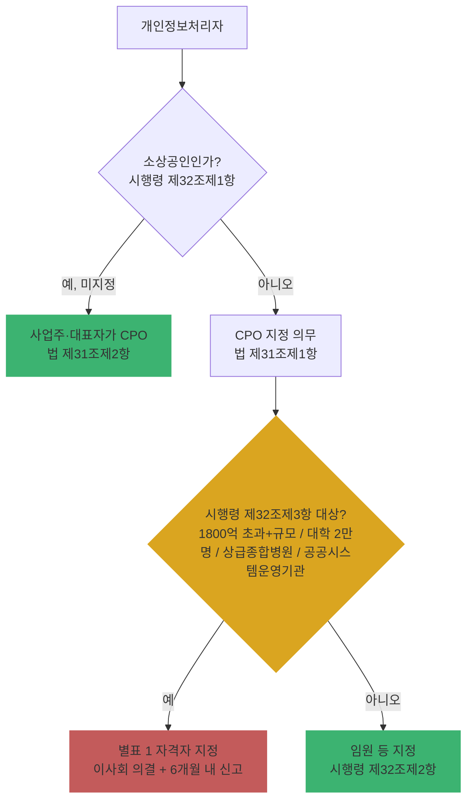

# Ch07. 관리체계 컨설팅 개요 (CPO·처리방침·대표자 책임)

| 항목 | 내용 |
|---|---|
| 주차 | 2주차 |
| 컨설팅 영역 | ① 개인정보 관리체계 |
| 핵심 근거 | 「개인정보 보호법」 제30조, 제30조의2, 제30조의3, 제31조 / 시행령 제31조, 제31조의2, 제32조 / 고시 제4조 |
| 법령 확인일 | 2026-11-11 (법률 제21445호, 시행령 제36804호, 고시 제2026-9호 원문 대조 — `references/`) |
| 예상 학습 시간 | 2.5시간 |
| 선수 챕터 | Ch01, Ch03 |

---

## 1. 학습 목표

1. 관리체계의 3축(**대표자 책임 → CPO → 내부 관리계획**)을 설명할 수 있다.
2. CPO 지정 요건과 2026년 신설된 **이사회 의결·신고 대상**을 판정할 수 있다.
3. 처리방침 법정 기재사항을 점검표로 검증할 수 있다.

---

## 2. 🧩 한 줄 비유

> 관리체계는 **축구팀**이다 — 구단주(대표자)가 예산을 대고, 감독(CPO)이 전술(내부 관리계획)을 짜고, 관중에게는 경기 규칙표(처리방침)를 공개한다.

---

## 3. 📜 법령 조문

### 3.1 원문 인용

> **「개인정보 보호법」 제30조의3(사업주 또는 대표자의 책임)** [본조신설 2026. 3. 10.]
> 개인정보처리자의 사업주 또는 대표자는 개인정보의 안전한 처리 및 정보주체의 권리 보호에 대한 최종적인 책임자로서 개인정보 보호에 필요한 전문 인력과 충분한 예산의 지원 등 총괄적인 관리 조치를 실효성 있게 하여야 한다.

> **제31조(개인정보 보호책임자의 지정 등)** 제3항 [신설 2026. 3. 10.]
> 매출액, 개인정보의 보유 규모 등을 고려하여 대통령령으로 정하는 기준에 해당하는 개인정보처리자는 다음 각 호의 사항을 준수하여야 한다.
> 1. 개인정보 보호책임자를 지정하거나 그 지정을 변경 또는 해제할 때에는 이사회(법인인 경우로 한정한다. 이하 같다)의 의결을 거칠 것
> 2. 보호위원회에 대통령령으로 정하는 바에 따라 개인정보 보호책임자 지정ㆍ변경 또는 해제에 관한 사항을 신고할 것

### 3.2 CPO 관련 조문 정리

| 조문 | 내용 |
|---|---|
| 법 제31조제1항·제2항 | CPO 지정 의무. **소상공인**(시행령 제32조제1항)은 지정하지 않을 수 있고, 이 경우 **사업주·대표자가 CPO** |
| 시행령 제32조제2항 | 지정 대상자 — 공공기관: 기관 유형별 직급(예: 중앙행정기관 고위공무원, 시·도 3급 이상, 시·군·구 4급 이상 등) / 민간: **사업주·대표자 또는 임원**(임원 없으면 개인정보 처리 업무 담당 부서장) |
| 시행령 제32조제3항 [2026 신설] | 이사회 의결·신고 대상: ① 연간 매출액등 **1,800억 원 초과**(각급 학교·의료기관 제외) + (민감·고유식별정보 **5만 명 이상** 또는 개인정보 **100만 명 이상**) ② 재학생 **2만 명 이상** 대학 ③ **상급종합병원** ④ **공공시스템운영기관** |
| 시행령 제32조제4항 | 사유 발생일부터 **6개월 이내** 신고서 제출 (부득이한 경우 **1년** 범위 연장 가능) |
| 시행령 제32조제2항 후단 + **별표 1** | 제3항 대상 처리자의 CPO는 개인정보보호·정보보호·정보기술 경력 **합산 4년 이상**, 그중 **개인정보보호 경력 2년 이상**. 동일 기간 중복 업무는 하나만 인정. 관련 학위는 경력으로 환산(예: 개인정보보호 관련 박사 2년·석사 1년·학사 6개월, 정보보호 관련 박사 2년·석사 1년) |
| 법 제31조제4항 | CPO 업무 9가지 — 2026 개정으로 **제2호 전문 인력 관리·예산 확보**, **제3호 대표자·이사회 보고** 추가 |
| 법 제31조제7항 | CPO에게 정당한 이유 없이 불이익 금지, **독립적 업무 수행 보장** |

### 3.3 처리방침 (법 제30조 + 시행령 제31조)

| 구분 | 필수 기재사항 |
|---|---|
| 법 제30조제1항 | 1. 처리 목적 2. 처리·보유 기간 3. 제3자 제공(해당 시) 3의2. **파기절차·방법**(보존 시 근거·항목) 3의3. 민감정보 공개 가능성·비공개 선택 방법(해당 시) 4. 위탁(해당 시) 4의2. **가명정보 처리**(해당 시) 5. 정보주체 권리·행사방법 6. CPO 성명 또는 담당부서·연락처 7. **자동수집장치(쿠키 등)** 설치·운영·거부(해당 시) 8. 대통령령 사항 |
| 시행령 제31조제1항 | 1. 처리 항목 2. **국외 이전** 근거와 법 제28조의8제2항 사항 3. **안전성 확보조치** 4. 국외에서 직접 수집 시 처리 국가명 |
| 공개 방법 | 홈페이지 **지속 게재**(시행령 제31조제2항), 불가 시 사업장 게시·관보·신문 등 |
| 효력 | 처리방침과 계약 내용이 다르면 **정보주체에게 유리한 것** 적용 (법 제30조제3항) |
| 평가 | 보호위원회가 처리방침을 평가·개선권고 (법 제30조의2, 시행령 제31조의2) |

---

## 4. 🛠 실무 적용

| 구분 | 요구사항 (근거) | 현장 확인 방법 | 증빙 자료 예시 |
|---|---|---|---|
| 관리적 | 대표자 보고·예산 승인 체계 (법 제30조의3, 제31조제4항제2·3호) | 이사회·경영회의 안건 | 보고 문서, 예산 집행 내역 |
| 관리적 | CPO 지정·자격·이사회 의결·신고 (법 제31조, 시행령 제32조) | 인사 발령, 의사록, 신고 접수증 | 이사회 의사록, 신고서 |
| 관리적 | 처리방침 법정 항목·최신성 (법 제30조) | 홈페이지 vs 실제 흐름 대조 | 처리방침 개정 이력 |
| 관리적 | 내부 관리계획 수립·연 1회 점검 (고시 제4조) | 결재본 | 내부 관리계획서 |
| 기술적 | 처리방침의 안전성 확보조치 기재가 실제 설정과 일치 (시행령 제31조제1항제3호) | 기재 내용 vs 시스템 설정 | 설정 캡처 |
| 물리적 | 홈페이지가 없을 때 사업장 게시 (시행령 제31조제3항) | 현장 확인 | 게시물 사진 |

### 4.1 Windows 11 실습 — 홈페이지 처리방침 링크 확인

```powershell
# 고객사 홈페이지에서 '개인정보' 문구가 포함된 링크 추출 (주소는 고객사 것으로 교체)
$r = Invoke-WebRequest -Uri "https://www.example.co.kr" -UseBasicParsing
$r.Links | Where-Object { $_.outerHTML -match '개인정보' } | Select-Object href, outerHTML
```

| 확인 항목 | 🟩 양호 | 🟥 취약 |
|---|---|---|
| 처리방침 링크 | 메인 하단에 "개인정보 처리방침" 명칭으로 상시 게재 | 링크 없음, "이용약관"에 통합 |
| 개정 이력 | 시행일·이전 버전 열람 가능 | 시행일 없음 |

---

## 5. 🔄 프로세스 다이어그램 — CPO 지정 판정



---

## 6. ⚖ 개인정보보호위원회 위반·처분 사례

| 항목 | 내용 |
|---|---|
| 의결 연도 | 2025년 |
| 피심인 유형 | 해외 온라인 쇼핑 플랫폼 (테무) |
| 위반 사실 | 국외 이전(처리위탁·보관) 사실을 **처리방침에 공개하거나 이용자에게 알리지 않음**, 국내대리인 미지정, 회원 탈퇴 절차를 **7단계**로 복잡하게 구현, 판매자 신분증·얼굴 동영상 수집 및 **법적 근거 없는 주민등록번호 처리** |
| 위반 조문 | 🟥 「개인정보 보호법」 제28조의8제1항(국외 이전), 제26조(위탁 공개), 제31조의2제1항(국내대리인), 제38조제4항(권리행사 방법), 제24조의2제1항(주민등록번호) |
| 처분 결과 | 🟥 과징금 **13억 6,900만 원**, 과태료 **1,760만 원**, 시정명령, 개선권고(국내법인을 국내대리인으로 지정) |
| 컨설팅 시사점 | 처리방침은 "홈페이지 문서"가 아니라 **실제 데이터 흐름의 공시**. 흐름 분석(Ch08)과 대조하지 않은 처리방침은 위반 근거가 됨 |
| 출처 | 개인정보보호위원회 보도자료 (2025.5.15.) |

---

## 7. ❌ 오답노트

| # | 🟨 흔한 착각 | 🟩 올바른 이해 | 근거 |
|---|---|---|---|
| 1 | "CPO는 정보보안팀 과장을 지정하면 된다" | 민간은 **사업주·대표자 또는 임원**(임원 없을 때만 부서장) | 시행령 제32조제2항제2호 |
| 2 | "이사회 의결은 상장사만" | 기준은 **매출 1,800억 원 초과 + 처리 규모** 등. 대학·상급종합병원·공공시스템운영기관도 대상 | 시행령 제32조제3항 |
| 3 | "처리방침에 '관련 법령에 따라 안전하게 관리' 한 줄이면 충분" | 시행령상 **안전성 확보조치 사항**, 국외 이전 근거 등 구체 기재 필요 | 시행령 제31조제1항 |
| 4 | "대표자 책임 조항은 선언적이라 무시해도 된다" | 직접 벌칙은 없으나, 과징금 **투자 감경** 고려사항에 대표자 책임 이행 정도가 포함 | 법 제30조의3, 시행령 제60조의2 |
| 5 | "CPO 신고는 1개월 내" | **6개월 이내** (입법예고안 1개월에서 변경), 부득이 시 1년 연장 | 시행령 제32조제4항 |

---

## 8. ✅ 고객사 점검용 체크리스트

| No | 점검 항목 | 근거 조문 | 점검 방법 | 결과 | 비고 |
|---|---|---|---|---|---|
| 1 | 대표자 보고·예산 지원 기록 | 법 제30조의3, 제31조제4항 | 문서 | | |
| 2 | CPO 지정 및 직급·직위 적정성 | 법 제31조, 시행령 제32조제2항 | 인사 문서 | | |
| 3 | 이사회 의결·신고 대상 여부 판정 | 시행령 제32조제3항 | 매출·규모 자료 | | |
| 4 | 대상이면 이사회 의결 및 6개월 내 신고 | 법 제31조제3항, 시행령 제32조제4항 | 의사록·접수증 | | |
| 5 | CPO 독립성 보장 (조직도·보고 라인) | 법 제31조제7항 | 조직도 | | |
| 6 | 처리방침 법정 항목 전부 기재 | 법 제30조제1항, 시행령 제31조제1항 | 문서 | | |
| 7 | 처리방침 홈페이지 지속 게재·개정 이력 | 시행령 제31조제2항 | 화면 | | |
| 8 | 내부 관리계획 연 1회 이상 이행 점검 | 고시 제4조제4항 | 문서 | | |

### 8.1 💡 실무 산출물 연계 팁

- **연계 산출물**: 관리체계 현황 진단서, CPO 지정 판정표, 처리방침 개정안
- **작성 팁**: CPO 판정표는 `매출액 | 민감·고유식별 처리 인원 | 전체 처리 인원 | 기관 유형 | 판정` 열로 만들고, 근거 수치의 출처(재무제표·DB 카운트)를 각주로 남길 것
- **Excel 활용**: `=AND(매출>180000000000, OR(민감>=50000, 전체>=1000000))` 로 1호 대상 자동 판정

---

## 9. 📝 퀴즈

> 정답·해설: [answers_and_explanations.md](../../answers_and_explanations.md#ch07)

**Q1. (OX)** 소상공인이 CPO를 지정하지 않으면 개인정보 보호책임자 공백 상태가 된다.

**Q2. (객관식)** 시행령 제32조제3항(이사회 의결·신고) 대상이 **아닌** 것은?
- ① 매출 2,000억 원, 개인정보 150만 명 처리 기업 ② 재학생 2만 5천 명 대학 ③ 상급종합병원 ④ 매출 1,000억 원, 민감정보 10만 명 처리 기업

**Q3. (단답)** 처리방침과 정보주체와의 계약 내용이 다를 때 적용 원칙과 근거 조문은?

---

## 10. 📚 참고 자료

- `references/개인정보 보호법(법률)(제21445호)(20260911).pdf`
- `references/개인정보 보호법 시행령(대통령령)(제36804호)(20261110).pdf`
- 개인정보 포털 CPO 신고: https://www.privacy.go.kr
- 개인정보보호위원회 「개인정보 처리방침 작성지침」: https://www.pipc.go.kr

---

⬅ [이전: Ch06](../week1/ch06_breach_sanction.md) | [목차](../../README.md) | [다음: Ch08](ch08_dataflow_gap.md) ➡
