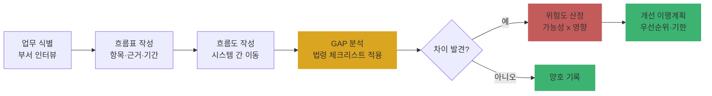

# Ch08. 개인정보 흐름 분석과 현황 진단(GAP)

| 항목 | 내용 |
|---|---|
| 주차 | 2주차 |
| 컨설팅 영역 | ① 개인정보 관리체계 (④ PIA·③ 실태점검과 공통 기반) |
| 핵심 근거 | 「개인정보 보호법」 제15조~제22조, 제23조, 제24조, 제29조, 제32조 / 고시 제3조, 제4조제1항제15호 |
| 법령 확인일 | 2026-11-11 (법률 제21445호, 고시 제2026-9호 원문 대조) |
| 예상 학습 시간 | 3시간 |
| 선수 챕터 | Ch02, Ch07 |

---

## 1. 학습 목표

1. 개인정보 흐름표·흐름도를 작성할 수 있다.
2. 법적 요구사항 대비 현황 차이(GAP)를 근거 조문과 함께 도출할 수 있다.
3. GAP 결과를 위험도와 개선 우선순위로 변환할 수 있다.

---

## 2. 🧩 한 줄 비유

> 흐름 분석은 **수도관 도면 그리기**다 — 도면 없이 누수(유출) 지점을 찾을 수 없고, GAP 분석은 그 도면 위에 **규정과 다른 배관**을 빨간 펜으로 표시하는 일이다.

---

## 3. 📜 법령 조문

### 3.1 흐름 분석이 필요한 법적 근거

| 조문 | 원문 요지 | 흐름 분석과의 관계 |
|---|---|---|
| 고시 제3조(안전조치의 적용 원칙) | 처리하는 개인정보의 **보유 수, 유형 및 정보주체에게 미치는 영향** 등을 고려하여 스스로의 환경에 맞는 조치를 적용 | 보유 수·유형을 모르면 조치 수준을 정할 수 없음 |
| 고시 제4조제1항제15호 | 내부 관리계획에 **위험 분석 및 관리**에 관한 사항 포함 | 흐름 분석 = 위험 분석의 입력값 |
| 고시 제8조제1항 | 5만 명 이상 / 고유식별·민감정보 처리 시스템은 접속기록 **2년** | 시스템별 처리 인원·유형 파악 필요 |
| 법 제32조 | **공공기관**은 개인정보파일의 명칭, 운영 근거·목적, 항목, 처리방법, 보유기간, 통상적 제공처 등을 보호위원회에 등록 | 공공기관은 흐름 분석 결과가 파일 등록 내용과 일치해야 함 |
| 법 제30조 | 처리방침 기재사항(목적·기간·제공·위탁·파기 등) | 흐름표 = 처리방침의 원천 데이터 |

### 3.2 쉬운 풀이

| 조문 요소 | 쉬운 말 | 컨설턴트가 확인할 것 |
|---|---|---|
| 누가 | 모든 처리자 (공공은 파일 등록까지) | 업무 부서별 담당자 |
| 무엇을 | 수집→이용→제공·위탁→보관→파기 전 단계 파악 | 시스템·문서·PC 파일까지 |
| 얼마나 | 업무 변경 시 갱신 (고시 제4조제3항 "중요한 변경 시 즉시 반영") | 흐름표 갱신일 |
| 위반 시 | 흐름 미파악 자체보다 그로 인한 **동의 누락·과다 보관·미암호화**가 위반으로 이어짐 | |

---

## 4. 🛠 실무 적용

### 4.1 흐름 분석 4단계

| 단계 | 산출물 | 방법 |
|---|---|---|
| ① 업무 식별 | 개인정보 처리 업무 목록 | 부서 인터뷰, 업무분장표 |
| ② 흐름표 작성 | 업무별 흐름표 | 수집 항목·경로·근거·보유기간·제공/위탁처 |
| ③ 흐름도 작성 | 시스템 간 데이터 이동도 | 시스템 구성도 위에 화살표 |
| ④ GAP 분석 | 법적 요구 vs 현황 차이 목록 | 체크리스트(Ch02~Ch05) 적용 |

### 4.2 안전성 확보조치 연계

| 구분 | 요구사항 (근거) | 현장 확인 방법 | 증빙 자료 예시 |
|---|---|---|---|
| 관리적 | 위험 분석 및 관리 (고시 제4조제1항제15호) | 위험 분석 보고서 | 흐름표, 위험 평가표 |
| 관리적 | 공공기관 개인정보파일 등록 (법 제32조) | 등록 목록 vs 실제 DB | 개인정보파일 등록 현황 |
| 기술적 | 시스템별 암호화 대상 식별 (고시 제7조) | 흐름표의 항목 열 → 암호화 여부 | DB 컬럼 목록 |
| 기술적 | 시스템별 접속기록 보관기간 결정 (고시 제8조제1항) | 처리 인원·유형 | 로그 정책 |
| 물리적 | 종이 문서 흐름(신청서·동의서) 보관 위치 | 현장 실사 | 문서고 목록 |

### 4.3 Windows 11 실습 — 흐름표 템플릿 생성

```powershell
# 흐름표 CSV 템플릿 생성 (Excel에서 열기 — UTF-8 BOM으로 저장해 한글 깨짐 방지)
$path = "$env:USERPROFILE\Desktop\개인정보_흐름표.csv"
$header = "업무명,처리부서,수집항목,민감/고유식별여부,수집경로,법적근거(조항호),이용목적,제공처,위탁처,국외이전,보유기간,파기방법,처리시스템,정보주체수"
$header | Out-File $path -Encoding utf8
"회원가입,고객지원팀,이름·휴대폰·이메일,N,홈페이지,제15조①1호(동의),회원관리,없음,콜센터(A사),없음,탈퇴 시,DB삭제(배치),CRM,120000" |
  Add-Content $path -Encoding utf8
Invoke-Item $path
```

| 확인 항목 | 🟩 양호 | 🟥 취약 |
|---|---|---|
| 법적근거 열 | 조·항·호까지 기재 | "동의" 또는 공란 |
| 정보주체수 | DB 카운트 근거 | "약 몇 만" 추정 |

---

## 5. 🔄 프로세스 다이어그램 — 흐름 분석 → GAP → 개선



---

## 6. ⚖ 개인정보보호위원회 위반·처분 사례

| 항목 | 내용 |
|---|---|
| 의결 연도 | 2024년 11월 |
| 피심인 유형 | 글로벌 SNS 사업자 (메타) |
| 위반 사실 | 페이스북 프로필을 통해 국내 이용자 약 **98만 명**의 종교관·정치관·동성과 결혼 여부 등 **민감정보**를 수집하고, '좋아요' 페이지·클릭 광고 등 **행태정보를 분석해 민감정보 관련 광고주제**를 만들어 약 4,000개 광고주가 이용. 데이터 정책에 불분명하게 기재만 하고 **별도 동의 없이** 처리. 그 밖에 정당한 사유 없는 열람 거절, 안전조치 의무 위반 |
| 위반 조문 | 🟥 「개인정보 보호법」 제23조제1항(민감정보), 제29조(안전조치), 제35조제3항(열람) |
| 처분 결과 | 🟥 과징금 **216억 1,300만 원**, 과태료 **1,020만 원**, 시정명령 |
| 컨설팅 시사점 | 흐름 분석에서 **"수집"뿐 아니라 "생성·추론"** 단계도 식별해야 함(법 제2조제2호 '처리'에 **생성** 포함). 분석·광고 시스템이 민감정보를 만들어내는지 확인 |
| 출처 | 개인정보보호위원회 보도자료 (2024.11.) |

---

## 7. ❌ 오답노트

| # | 🟨 흔한 착각 | 🟩 올바른 이해 | 근거 |
|---|---|---|---|
| 1 | "흐름 분석은 DB만 보면 된다" | 엑셀 파일, 종이 서류, 메일 첨부, 외부 SaaS까지 포함 | 법 제2조제2호(처리 정의) |
| 2 | "수집 항목에 민감정보가 없으면 민감정보 처리 없음" | **추론·생성**된 민감정보도 처리에 해당 | 법 제2조제2호, 제23조 |
| 3 | "흐름표는 연 1회 갱신하면 충분" | 중요한 변경 시 **즉시** 내부 관리계획 반영 → 흐름표도 함께 갱신 | 고시 제4조제3항 |
| 4 | "GAP = 미흡 항목 목록" | GAP은 **근거 조문 + 현황 + 차이 + 위험도 + 개선안**까지 있어야 산출물로 쓸 수 있음 | 실무 |

---

## 8. ✅ 고객사 점검용 체크리스트

| No | 점검 항목 | 근거 조문 | 점검 방법 | 결과 | 비고 |
|---|---|---|---|---|---|
| 1 | 개인정보 처리 업무 목록 존재 | 고시 제3조 | 문서 | | |
| 2 | 업무별 흐름표(항목·근거·기간·제공·위탁·국외이전) | 법 제15조~제22조, 제28조의8 | 문서 | | |
| 3 | 시스템 흐름도 및 정보주체 수 근거 | 고시 제3조, 제8조 | 문서·DB | | |
| 4 | 민감·고유식별정보(추론 포함) 식별 | 법 제23조, 제24조 | 인터뷰·DB | | |
| 5 | 공공기관: 개인정보파일 등록 현황 일치 | 법 제32조 | 등록 목록 | | |
| 6 | 처리방침 기재 내용과 흐름표 일치 | 법 제30조 | 대조 | | |
| 7 | 위험 분석 결과가 내부 관리계획에 반영 | 고시 제4조제1항제15호 | 문서 | | |

### 8.1 💡 실무 산출물 연계 팁

- **연계 산출물**: 개인정보 흐름표·흐름도 → **PIA 흐름분석(Ch16)**, **처리방침(Ch07)**, **개인정보파일 등록**에 그대로 재사용
- **작성 팁**: GAP 표 열 구성 `No | 영역 | 근거 조문 | 요구사항 | 현황 | 차이 | 위험도(상/중/하) | 개선안 | 담당 | 기한`
- **Excel 활용**: 위험도 열에 조건부 서식 — 상 `#c35b5b`, 중 `#daa520`, 하 `#3cb371`

---

## 9. 📝 퀴즈

> 정답·해설: [answers_and_explanations.md](../../answers_and_explanations.md#ch08)

**Q1. (OX)** 고객 구매 패턴으로 "임신 가능성"을 추론해 마케팅에 쓰는 것은 수집 항목에 건강정보가 없으므로 민감정보 처리가 아니다.

**Q2. (객관식)** 흐름표의 "정보주체 수" 열이 직접 영향을 주는 고시 조항이 **아닌** 것은?
- ① 제4조제1항 단서(1만 명 미만 생략) ② 제8조제1항(2년 보관) ③ 제11조(재해·재난) ④ 제12조제1항(출력 항목 최소화)

**Q3. (단답)** GAP 분석 결과 표에 반드시 들어가야 하는 열 5가지 이상을 쓰시오.

---

## 10. 📚 참고 자료

- `references/개인정보의 안전성 확보조치 기준(개인정보보호위원회고시)(제2026-9호)(20260701).pdf`
- `references/개인정보 영향평가 수행안내서(25.10.).pdf` — 흐름분석 양식 참고
- 개인정보보호위원회: https://www.pipc.go.kr

---

⬅ [이전: Ch07](ch07_governance_overview.md) | [목차](../../README.md) | [다음: Ch09](ch09_outsourcing_transfer.md) ➡
