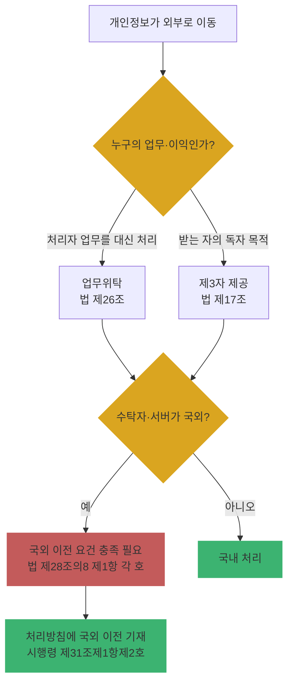

# Ch09. 위탁·제3자 제공·국외 이전 관리

| 항목 | 내용 |
|---|---|
| 주차 | 2주차 |
| 컨설팅 영역 | ① 개인정보 관리체계 |
| 핵심 근거 | 「개인정보 보호법」 제17조, 제26조, 제28조의8, 제64조의2제1항제5호·제7호 / 시행령 제28조, 제31조제1항제2호 / 고시 제4조제1항제16호 |
| 법령 확인일 | 2026-11-11 (법률 제21445호, 시행령 제36804호 원문 대조) |
| 예상 학습 시간 | 3시간 |
| 선수 챕터 | Ch02, Ch08 |

---

## 1. 학습 목표

1. 위탁·제3자 제공·국외 이전을 사례별로 구분할 수 있다.
2. 위탁 계약서 필수 조항과 수탁자 관리·감독 요건을 점검할 수 있다.
3. 국외 이전의 5가지 적법 요건을 적용할 수 있다.

---

## 2. 🧩 한 줄 비유

> **위탁**은 세탁소에 옷을 맡기는 것(내 일을 대신), **제공**은 친구에게 옷을 주는 것(친구 마음대로), **국외 이전**은 그 옷을 해외로 부치는 것(통관 서류 필요)이다.

---

## 3. 📜 법령 조문

### 3.1 업무위탁 (법 제26조, 2026.3.10. 일부 개정)

| 항 | 원문 요지 |
|---|---|
| ① | 위탁은 **문서**로 — 1. 위탁업무 수행 목적 외 처리 금지 2. 기술적·관리적 보호조치 3. 대통령령 사항 |
| ② | 위탁 업무 내용과 수탁자(**재수탁자 포함**)를 정보주체가 언제든 쉽게 확인하도록 **공개** |
| ③ | **홍보·판매 권유** 업무 위탁 시 정보주체에게 **알려야** 함 (변경 시에도) |
| ④ [2026 개정] | 위탁자는 유출등이 되지 않도록 수탁자를 **교육**하고, **처리 현황 점검** 등 대통령령으로 정하는 바에 따라 **감독** |
| ⑤ | 수탁자는 위탁 범위 초과 이용·제3자 제공 금지 |
| ⑥ | **재위탁 시 위탁자의 동의** |
| ⑦ | 손해배상책임에 대해 수탁자는 위탁자의 **소속 직원으로 간주** |
| ⑧ | 수탁자에게 제15조~제18조, 제29조, 제30조 등 다수 조항 **준용** |

**시행령 제28조제1항** (문서에 포함할 대통령령 사항): 1. 위탁업무의 목적 및 범위 2. **재위탁 제한** 3. 접근 제한 등 안전성 확보 조치 4. 개인정보 관리 현황 **점검 등 감독** 5. 수탁자 의무 위반 시 **손해배상 등 책임**

**시행령 제28조제2항·제3항** (공개 방법): 위탁자 홈페이지에 **지속 게재**, 불가 시 사업장 게시·관보·신문·연 2회 이상 간행물·계약서 등

### 3.2 제3자 제공 (법 제17조)

| 구분 | 요지 |
|---|---|
| 제1항 | 1. 정보주체 **동의** 2. 제15조제1항 **제2호, 제3호, 제5호~제7호**로 수집한 목적 범위에서 제공 — 🟨 **제4호(계약 이행)는 제17조제1항제2호에 열거되지 않음** |
| 제2항 | 동의 시 고지: 제공받는 자, 그 이용 목적, 제공 항목, 보유·이용 기간, 거부 권리·불이익 |

### 3.3 국외 이전 (법 제28조의8)

| 제1항 각 호 (이전 가능 요건) | 요지 |
|---|---|
| 1 | 국외 이전에 관한 **별도 동의** |
| 2 | 법률·조약·국제협정의 특별 규정 |
| 3 | 계약 체결·이행을 위한 **처리위탁·보관**으로서, 제2항 사항을 **처리방침에 공개**하거나 전자우편 등으로 **알린** 경우 |
| 4 | 이전받는 자가 **개인정보 보호 인증 등 위원회 고시 인증** + 안전조치·권리보장 조치 + 이전국 이행 조치 |
| 5 | 이전 국가·국제기구가 **동등 수준**이라고 위원회가 인정 |

> "이전" = 국외로 **제공(조회 포함)·처리위탁·보관**. 제2항 고지사항: 이전 항목, 이전 국가·시기·방법, 이전받는 자, 이용목적·보유기간, **거부 방법·절차·효과**.

### 3.4 제재 연결

| 위반 | 과징금 근거 |
|---|---|
| 수탁자 관리·감독·교육 소홀로 수탁자가 법 위반 | 법 제64조의2제1항**제5호** |
| 제28조의8제1항 위반 국외 이전 | 법 제64조의2제1항**제7호** |

---

## 4. 🛠 실무 적용

| 구분 | 요구사항 (근거) | 현장 확인 방법 | 증빙 자료 예시 |
|---|---|---|---|
| 관리적 | 위탁 계약서 필수 조항 (법 제26조①, 시행령 제28조①) | 계약서 조항 대조 | 위탁 계약서, 개인정보 처리 부속합의서 |
| 관리적 | 수탁자 공개(재수탁 포함) (법 제26조②) | 처리방침 위탁 목록 vs 실제 계약 | 처리방침 |
| 관리적 | 수탁자 교육·점검 (법 제26조④, 고시 제4조제1항제16호) | 점검 결과·교육 기록 | 수탁사 점검표, 교육 수료증 |
| 관리적 | 재위탁 동의 (법 제26조⑥) | 동의 문서 | 재위탁 승인 공문 |
| 기술적 | 수탁자 접근 권한 최소화·접속기록 (고시 제5조, 제8조) | 수탁자 계정 목록 | 계정 대장, 접속기록 |
| 기술적 | 클라우드·SaaS 리전 확인 (법 제28조의8) | 서비스 설정 화면 | 리전 설정 캡처 |
| 물리적 | 수탁사 사업장 보관 서류·매체 관리 | 현장 점검 | 수탁사 현장 점검 사진 |

### 4.1 Windows 11 실습 — PC에서 외부 통신 대상 확인 (숨은 국외 이전 단서 찾기)

```powershell
# 현재 연결된 외부 IP와 프로세스 확인 → 업무용 SaaS가 어디로 통신하는지 파악
Get-NetTCPConnection -State Established |
  Where-Object { $_.RemoteAddress -notmatch '^(127\.|10\.|192\.168\.|172\.(1[6-9]|2\d|3[01])\.|::1)' } |
  Select-Object RemoteAddress, RemotePort,
    @{n='Process';e={(Get-Process -Id $_.OwningProcess -ErrorAction SilentlyContinue).ProcessName}} |
  Sort-Object Process -Unique
```

| 확인 항목 | 🟩 양호 | 🟥 취약 |
|---|---|---|
| 업무용 SaaS 목록 | 흐름표·처리방침에 위탁/국외 이전으로 기재 | 처리방침에 없는 해외 SaaS로 고객 데이터 업로드 |

> ※ IP만으로 국가를 단정하지 마십시오. 서비스 계약서·데이터 리전 설정을 최종 근거로 확인합니다.

---

## 5. 🔄 프로세스 다이어그램 — 위탁 vs 제공 vs 국외 이전 판정



---

## 6. ⚖ 개인정보보호위원회 위반·처분 사례

| 항목 | 내용 |
|---|---|
| 의결 연도 | 2025년 1월 |
| 피심인 유형 | 간편결제 사업자 (카카오페이) |
| 위반 사실 | 관계 구조: **카카오페이 → 애플 = 제3자 제공**, **애플 → 알리페이 = 위수탁**. 카카오페이가 애플의 수탁사 알리페이의 NSF 점수(자금부족 가능성) 모델 구축용으로 이용자 정보(최소 1,590만 명, 24개 항목)를 **제3자 제공·국외 이전 별도 동의 없이** 전송. 애플은 제3국 수탁자(알리페이)를 통한 국외 이전 사실을 이용자에게 알리지 않음 |
| 위반 조문 | 🟥 「개인정보 보호법」 제28조의8제1항(국외 이전) 등 |
| 처분 결과 | 🟥 카카오페이 과징금 **59억 6,800만 원**, 애플 과징금 **24억 500만 원**·과태료 **220만 원** (총 83억 7,520만 원), 시정명령. 알리페이에 **NSF 점수 산출 모델 파기** 시정명령 |
| 컨설팅 시사점 | ① 데이터가 "상대방의 수탁사"로 가더라도 나와 상대방 사이는 **제공**일 수 있음 → 관계를 **단계별로** 판정 ② 동의 없이 만든 결과물(모델)까지 **파기 명령** 대상이 될 수 있음 |
| 출처 | 개인정보보호위원회 보도자료 (2025.1.23.) |

---

## 7. ❌ 오답노트

| # | 🟨 흔한 착각 | 🟩 올바른 이해 | 근거 |
|---|---|---|---|
| 1 | "계약서 제목이 '위탁계약'이면 위탁이다" | 받는 자의 **독자적 이익·목적** 처리가 있으면 제공 | 법 제17조, 제26조 (실질 판단) |
| 2 | "재위탁은 위탁자에게 통보만 하면 된다" | 위탁자의 **동의** 필요 | 법 제26조제6항 |
| 3 | "수탁자 사고는 수탁자 책임" | 감독 소홀로 수탁자가 위반하면 **위탁자에게 과징금** 가능, 손해배상에서 수탁자는 위탁자 직원으로 간주 | 법 제64조의2제1항제5호, 제26조제7항 |
| 4 | "해외 클라우드 보관은 국외 이전이 아니다" | **보관**도 이전에 포함. 계약 이행 목적 처리위탁·보관은 처리방침 공개 등으로 가능 | 법 제28조의8제1항 |
| 5 | "계약 이행에 필요하면 제3자 제공 동의 불필요" | 제17조제1항제2호는 제15조제1항 **제4호(계약)를 열거하지 않음** — 제공은 동의 또는 열거된 근거 필요 | 법 제17조제1항 |

---

## 8. ✅ 고객사 점검용 체크리스트

| No | 점검 항목 | 근거 조문 | 점검 방법 | 결과 | 비고 |
|---|---|---|---|---|---|
| 1 | 위탁·제공·국외 이전 대상 전수 목록 | 법 제17조, 제26조, 제28조의8 | 계약 목록 대조 | | |
| 2 | 위탁 계약서 필수 8개 사항 (법 3 + 시행령 5) | 법 제26조①, 시행령 제28조① | 문서 | | 손해배상 조항 누락 빈번 |
| 3 | 수탁자·재수탁자 공개 | 법 제26조② | 처리방침 | | |
| 4 | 홍보·판매 위탁 시 정보주체 통지 | 법 제26조③ | 통지 기록 | | |
| 5 | 수탁자 교육·처리 현황 점검 기록 | 법 제26조④ | 점검표 | | 2026 개정 |
| 6 | 재위탁 동의 문서 | 법 제26조⑥ | 문서 | | |
| 7 | 제3자 제공 근거·동의 고지 5항목 | 법 제17조 | 동의서 | | |
| 8 | 국외 이전 요건 및 처리방침 기재 | 법 제28조의8, 시행령 제31조제1항제2호 | 처리방침·계약 | | |

### 8.1 💡 실무 산출물 연계 팁

- **연계 산출물**: 수탁사 관리 대장, 수탁사 점검 체크리스트, 위탁 계약 표준 부속합의서
- **작성 팁**: 수탁사 대장 열 `수탁사 | 위탁업무 | 처리항목 | 재수탁사 | 국외여부(국가) | 계약일 | 최근 점검일 | 교육일 | 결과`
- **Excel 활용**: "최근 점검일"이 오늘로부터 365일 초과면 `#daa520` 배경 (`=TODAY()-H2>365`) — 점검 주기는 고객사 내부 관리계획 기준으로 조정

---

## 9. 📝 퀴즈

> 정답·해설: [answers_and_explanations.md](../../answers_and_explanations.md#ch09)

**Q1. (OX)** 수탁자가 다른 업체에 재위탁하려면 위탁자에게 사후 통보하면 된다.

**Q2. (객관식)** 시행령 제28조제1항의 위탁 문서 포함 사항이 **아닌** 것은?
- ① 재위탁 제한 ② 손해배상 등 책임 ③ 수탁자의 매출액 ④ 관리 현황 점검 등 감독

**Q3. (사례)** 국내 쇼핑몰이 고객 DB를 미국 리전 클라우드에 보관한다. 별도 동의 없이 적법하게 하려면 어떤 요건(조·항·호)을 충족해야 하는가?

---

## 10. 📚 참고 자료

- `references/개인정보 보호법(법률)(제21445호)(20260911).pdf`
- `references/개인정보 보호법 시행령(대통령령)(제36804호)(20261110).pdf`
- 개인정보보호위원회 「개인정보 국외 이전 운영 가이드라인」: https://www.pipc.go.kr

---

⬅ [이전: Ch08](ch08_dataflow_gap.md) | [목차](../../README.md) | [다음: Ch10](ch10_ismsp.md) ➡
