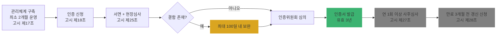

# Ch10. ISMS-P 인증 연계 관리체계

| 항목 | 내용 |
|---|---|
| 주차 | 2주차 |
| 컨설팅 영역 | ① 개인정보 관리체계 |
| 핵심 근거 | 「개인정보 보호법」 제32조의2, 제75조 / 시행령 제34조의2~제34조의8 / 「정보보호 및 개인정보보호 관리체계 인증 등에 관한 고시」(제2024-8호) |
| 법령 확인일 | 2026-11-11 (법률 제21445호, 시행령 제36804호, ISMS-P 고시 제2024-8호 및 **별표 7 인증기준** 원문 대조 — `references/`) |
| 예상 학습 시간 | 2.5시간 |
| 선수 챕터 | Ch07, Ch08 |

---

## 1. 학습 목표

1. ISMS-P 인증 구분, 절차, 유효기간, 사후관리를 설명할 수 있다.
2. 2026년 개정으로 생긴 **ISMS-P 의무 인증(2027.7.1. 시행)**의 현재 상태를 정확히 안내할 수 있다.
3. 인증 준비 컨설팅과 인증 심사의 **독립성 경계**를 지킬 수 있다.

---

## 2. 🧩 한 줄 비유

> ISMS-P는 **건물 안전 인증 마크**다 — 마크를 따려면 2개월 이상 실제로 운영한 기록이 있어야 하고, 매년 재점검을 받으며, 3년마다 갱신한다. 마크가 있다고 사고가 안 나는 건 아니다.

---

## 3. 📜 법령 조문

### 3.1 법 제32조의2 (2026.3.10. 개정)

> **제1항** 보호위원회는 개인정보처리자의 개인정보 처리 및 보호와 관련한 일련의 조치가 이 법에 부합하는지 등에 관하여 인증할 수 있다. **다만, 매출액, 개인정보의 처리 규모 등을 고려하여 대통령령으로 정하는 기준에 해당하는 개인정보처리자는 인증을 받아야 한다.** <개정 2026. 3. 10.>

| 항 | 요지 |
|---|---|
| ② | 인증 유효기간 **3년** |
| ③ | 인증 취소 사유 — 거짓·부정 취득(**필수 취소**), 사후관리 거부·방해, 인증기준 미달, 중대한 법령 위반 |
| ④ | **연 1회 이상** 사후관리 |
| ⑧ | 인증 기준: 개인정보 관리체계, 정보주체 권리보장, 안전성 확보조치 등 |

> 🟨 **의무 인증 시행 상태 (2026-11-11 기준)**
> - 법률 부칙에 따라 제32조의2제1항 **단서**와 미인증 과태료(제75조)는 **2027.7.1. 시행**
> - 대상 "대통령령으로 정하는 기준"은 현행 시행령(제36804호)에 **아직 규정되어 있지 않음** → 고객사에 "대상이다/아니다"를 단정하지 말고 **시행령 개정 동향 모니터링**으로 안내

### 3.2 ISMS-P 고시 핵심 조문

| 조문 | 요지 |
|---|---|
| 제18조 | 인증 구분 선택: 1. **정보보호 및 개인정보보호 관리체계 인증(ISMS-P)** 2. **정보보호 관리체계 인증(ISMS)** |
| 제17조 | 신청 전 인증기준에 따른 관리체계를 구축하여 **최소 2개월 이상 운영** |
| 제20조 | ISO/IEC 27001 인증, 주요정보통신기반시설 취약점 분석·평가 등이 있으면 **인증심사 일부 생략** 가능 |
| 제23조 | ISMS-P는 **별표 7 가목~다목**, ISMS는 **가목·나목** 적용 |
| 제25조 | 서면심사 + 현장심사 병행. 결함은 심사종료 다음날부터 **최대 100일(재조치 요구 60일 포함)** 내 보완 |
| 제27조 | 유효기간 중 **연 1회 이상 사후심사** 신청 |
| 제28조 | 유효기간 만료 **3개월 전** 갱신심사 신청, 미신청 시 효력 상실 |
| 제32조 | 인증서 유효기간 **3년** |
| 제10조 | 인증·심사기관은 **관리체계 구축 컨설팅 수행 금지** 노력 (공정성·독립성) |

### 3.3 인증기준 구조 (별표 7)

| 영역 | 내용 | 항목 수 |
|---|---|---|
| 가. 관리체계 수립 및 운영 | 관리체계 기반 마련, 위험 관리, 관리체계 운영, 관리체계 점검 및 개선 | 16 |
| 나. 보호대책 요구사항 | 정책·조직·자산, 인적 보안, 외부자 보안, 물리 보안, 인증·권한, 접근통제, 암호화, 개발 보안, 운영 관리, 보안 사고 대응, 재해 복구 등 | 64 |
| 다. 개인정보 처리 단계별 요구사항 | 3.1 수집 시 보호조치(7), 3.2 보유 및 이용 시(5), 3.3 제공 시(4), 3.4 파기 시(2), 3.5 정보주체 권리보호(3) | 21 |

> 항목 수 **16 / 64 / 21 = 총 101개**는 `references/[별표 7] 인증기준` 원문의 항목 번호(1.1.1~1.4.3, 2.1.1~2.12.2, 3.1.1~3.5.3)로 대조했습니다. 🟨 과거 자료의 "102개(개인정보 22개)"는 **구 기준**이므로 인용하지 마십시오.

---

## 4. 🛠 실무 적용

| 구분 | 요구사항 (근거) | 현장 확인 방법 | 증빙 자료 예시 |
|---|---|---|---|
| 관리적 | 인증 범위 설정 (고시 제18조제3항) | 범위 정의서 | 인증 범위 정의서, 자산 목록 |
| 관리적 | 2개월 이상 운영 기록 (고시 제17조) | 운영 증적 일자 | 위험평가 결과, 내부 감사 보고서 |
| 관리적 | 결함 100일 내 보완 (고시 제25조) | 보완 조치 계획 | 보완조치 결과서 |
| 기술적 | 보호대책(나목) — 안전성 확보조치 고시와 중복 영역 대응 | 고시 제5조~제9조 점검 결과 재사용 | 취약점 점검 결과 |
| 물리적 | 보호구역·출입통제(나목) | 현장 | 출입 기록 |

### 4.1 Windows 11 실습 — 인증 증적 폴더 구조 생성

```powershell
# ISMS-P 3개 영역 기준 증적 폴더 생성
$root = "$env:USERPROFILE\Desktop\ISMS-P_증적"
@('1_관리체계_수립및운영','2_보호대책_요구사항','3_개인정보_처리단계별_요구사항') | ForEach-Object {
  New-Item -ItemType Directory -Force -Path (Join-Path $root $_) | Out-Null
}
Get-ChildItem $root
```

| 확인 항목 | 🟩 양호 | 🟥 취약 |
|---|---|---|
| 증적 관리 | 인증기준 번호별 폴더·파일명 규칙 | 담당자 개인 PC에 산재 |

---

## 5. 🔄 프로세스 다이어그램 — 인증 생명주기



---

## 6. ⚖ 개인정보보호위원회 위반·처분 사례

| 항목 | 내용 |
|---|---|
| 의결 연도 | 2025년 |
| 피심인 유형 | 이동통신사업자 (SK텔레콤) |
| 위반 사실 | 대규모 유심 정보 유출. SKT는 ISMS-P 인증을 **일부 고객관리시스템(T World 등)에 대해서만** 취득했고, 사고가 난 **이동통신 네트워크 시스템은 인증 범위 밖**이었음 |
| 위반 조문 | 🟥 「개인정보 보호법」 제29조 등 |
| 처분 결과 | 🟥 과징금 **1,347억 9,100만 원**, 과태료 960만 원, 시정명령 + **ISMS-P 인증 범위를 이동통신 네트워크 시스템으로 확대**하도록 개선권고 |
| 컨설팅 시사점 | ① 인증은 **인증 범위 안**만 본다 — 범위 밖 시스템이 사고 지점이 될 수 있음 ② 「과징금 부과기준」(고시 제2026-12호) 제10조상 인증 보유 감경은 **1차 조정 금액의 100분의 30 이하** — 인증을 "면죄부"로 설명하지 말 것 |
| 출처 | 개인정보보호위원회 보도자료 (2025.8.28.) |

---

## 7. ❌ 오답노트

| # | 🟨 흔한 착각 | 🟩 올바른 이해 | 근거 |
|---|---|---|---|
| 1 | "2027년 7월부터 매출 1조 원 이상 기업은 ISMS-P 의무" | 의무 대상 기준은 **아직 시행령에 없음** (입법예고 단계 수치를 확정처럼 말하지 말 것) | 법 제32조의2제1항 단서, 현행 시행령 |
| 2 | "ISMS 인증이 있으면 ISMS-P와 같다" | ISMS는 가·나목만 — **개인정보 처리 단계별 요구사항(다목) 미포함** | 고시 제23조 |
| 3 | "구축 끝나면 바로 신청 가능" | **최소 2개월 운영** 후 신청 | 고시 제17조 |
| 4 | "인증 취득 후 3년간 심사 없음" | **연 1회 이상 사후심사** | 법 제32조의2④, 고시 제27조 |
| 5 | "심사기관이 구축 컨설팅도 해주면 효율적" | 공정성·독립성 확보를 위해 **구축 컨설팅 수행 금지** 노력 대상 | 고시 제10조 |

---

## 8. ✅ 고객사 점검용 체크리스트 (인증 준비도)

| No | 점검 항목 | 근거 조문 | 점검 방법 | 결과 | 비고 |
|---|---|---|---|---|---|
| 1 | 인증 구분(ISMS / ISMS-P) 및 범위 확정 | 고시 제18조 | 문서 | | |
| 2 | 관리체계 2개월 이상 운영 증적 | 고시 제17조 | 증적 일자 | | |
| 3 | 위험평가 수행 및 결과 승인 | 별표 7 가목 | 문서 | | |
| 4 | 안전성 확보조치 고시 점검 결과(Ch03~05) 반영 | 별표 7 나목 | 문서 | | |
| 5 | 개인정보 처리 단계별 요구사항(Ch02) 점검 | 별표 7 다목 | 문서 | | |
| 6 | 일부 생략 대상 인증(ISO 27001 등) 보유 여부 | 고시 제20조 | 인증서 | | |
| 7 | 사후심사·갱신 일정 관리 | 고시 제27조·제28조 | 일정표 | | |
| 8 | 의무 인증 시행령 개정 동향 모니터링 | 법 제32조의2① 단서 | 동향 보고 | | 2027.7.1. |

### 8.1 💡 실무 산출물 연계 팁

- **연계 산출물**: 인증기준 대응표(101개 항목 × 증적), 결함 보완조치 결과서
- **작성 팁**: 대응표 열 `인증기준 번호 | 항목명 | 관련 법령 조문 | 운영 현황 | 증적 파일명 | 담당 | 상태` — "관련 법령 조문" 열에 Ch03~Ch09에서 정리한 조문을 매핑하면 실태점검·PIA에 재사용 가능
- **Excel 활용**: 상태 열 목록(완료/진행/미착수)으로 영역별 준비율 피벗

---

## 9. 📝 퀴즈

> 정답·해설: [answers_and_explanations.md](../../answers_and_explanations.md#ch10)

**Q1. (OX)** 현행 시행령에는 ISMS-P 의무 인증 대상 기준이 규정되어 있다.

**Q2. (객관식)** ISMS-P 고시상 인증심사 결함의 보완 기한은?
- ① 30일 ② 60일 ③ 최대 100일(재조치 요구 60일 포함) ④ 6개월

**Q3. (단답)** ISMS와 ISMS-P 인증기준의 차이(별표 7 기준)는?

---

## 10. 📚 참고 자료

- `references/정보보호 및 개인정보보호 관리체계 인증 등에 관한 고시(개인정보보호위원회고시)(제2024-8호)(20240724).pdf`
- KISA ISMS-P 인증 포털: https://isms.kisa.or.kr
- 국가법령정보센터 (별표 7 인증기준): https://www.law.go.kr

---

⬅ [이전: Ch09](ch09_outsourcing_transfer.md) | [목차](../../README.md) | [다음: Ch11](ch11_level_assessment.md) ➡
