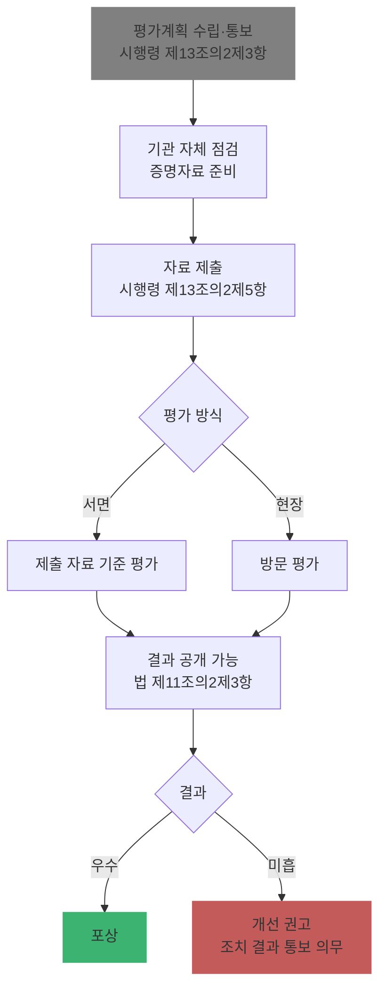

# Ch11. 개인정보 보호수준 평가 개요

| 항목 | 내용 |
|---|---|
| 주차 | 2주차 |
| 컨설팅 영역 | ② 개인정보 보호수준 평가 |
| 핵심 근거 | 「개인정보 보호법」 제11조의2 / 시행령 제13조의2 / 보호수준 평가 관련 보호위원회 고시 |
| 법령 확인일 | 2026-11-11 (법률 제21445호, 시행령 제36804호·별표 2 원문 대조. 보호수준 평가 세부 고시·연도별 편람은 미보유 — 해당 연도 평가계획으로 확인) |
| 예상 학습 시간 | 2시간 |
| 선수 챕터 | Ch07, Ch08 |

---

## 1. 학습 목표

1. 보호수준 평가의 대상 기관을 판정할 수 있다.
2. 시행령상 5대 평가 기준을 설명할 수 있다.
3. 평가 절차(계획 통보 → 자료 제출 → 평가 → 공개·포상·개선권고)를 설명할 수 있다.

---

## 2. 🧩 한 줄 비유

> 보호수준 평가는 공공기관의 **개인정보 성적표**다 — 매년 같은 기준으로 채점하고, 결과는 공개될 수 있으며, 우수 기관은 상을 받고 부진 기관은 개선 권고를 받는다.

---

## 3. 📜 법령 조문

### 3.1 원문 인용

> **「개인정보 보호법」 제11조의2(개인정보 보호수준 평가)** [본조신설 2023. 3. 14.]
> ① 보호위원회는 공공기관 중 중앙행정기관 및 그 소속기관, 지방자치단체, 그 밖에 대통령령으로 정하는 기관을 대상으로 **매년** 개인정보 보호 정책ㆍ업무의 수행 및 이 법에 따른 의무의 준수 여부 등을 평가(이하 "개인정보 보호수준 평가"라 한다)하여야 한다.
> ② 보호위원회는 개인정보 보호수준 평가에 필요한 경우 해당 공공기관의 장에게 관련 자료를 제출하게 할 수 있다.
> ③ 보호위원회는 개인정보 보호수준 평가의 결과를 인터넷 홈페이지 등을 통하여 **공개할 수 있다**.
> ④ 보호위원회는 개인정보 보호수준 평가의 결과에 따라 우수기관 및 그 소속 직원에 대하여 **포상**할 수 있고, 개인정보 보호를 위하여 필요하다고 인정하면 해당 공공기관의 장에게 **개선을 권고**할 수 있다. 이 경우 권고를 받은 공공기관의 장은 이를 이행하기 위하여 성실하게 노력하여야 하며, 그 조치 결과를 보호위원회에 알려야 한다.

### 3.2 시행령 제13조의2 정리

| 항 | 요지 |
|---|---|
| ① 대상 기관 (대통령령) | 1. 「공공기관의 운영에 관한 법률」 제4조 공공기관 2. **지방공사·지방공단** 3. 시행령 제2조제3호의2·제4호·제5호 공공기관 중 **보호위원회가 고시하는 기준**에 해당하는 기관 <개정 2025.9.23.> |
| ② 평가 기준 | 1. 보호 정책·업무 **수행실적 및 개선 정도** 2. **관리체계의 적정성** 3. **정보주체 권리보장** 조치 및 이행 정도 4. **침해방지 조치 및 안전성 확보 조치** 이행 정도 5. 그 밖의 안전한 관리 필요 조치 준수 여부 |
| ③ 평가계획 | 시행 전 평가대상·기준·방법·**평가지표** 포함 계획을 평가대상기관의 장에게 **통보** |
| ④ 평가단 | 전문가 포함 평가단 구성·운영 가능 |
| ⑤ 자료 제출 | 1. **자체 점검 결과 및 증명자료** 2. 증명자료 검증에 필요한 자료 3. 그 밖의 필요한 자료 |
| ⑥ 평가 방식 | 제출 자료 기준 평가 또는 **방문 평가** |
| ⑦ 지원 요청 | 중앙행정기관·지자체의 장에게 소관 분야 평가대상기관 지원 요청 |
| ⑧ | 세부 사항은 보호위원회 **고시** |

### 3.3 쉬운 풀이

| 조문 요소 | 쉬운 말 | 컨설턴트가 확인할 것 |
|---|---|---|
| 누가 | 중앙행정기관·소속기관, 지자체, 공공기관운영법상 공공기관, 지방공사·공단, 고시 기준 기관 | 고객 기관이 대상 목록에 있는지 |
| 무엇을 | 5대 기준 + 연도별 평가지표 | 해당 연도 평가계획 |
| 언제 | **매년** | 자료 제출 기한 |
| 결과 | 공개·포상·개선권고 (권고 시 조치 결과 통보 의무) | 전년도 결과와 권고 이행 |

### 3.4 2026년 평가 실제 운영 (개인정보위 보도자료, 2026.8.24.)

| 항목 | 내용 |
|---|---|
| 대상 | 총 **1,458개** 기관 — 중앙부처 51, 소속기관 453, 지자체 241, 공공기관 340, 지방공기업 167, 시·도교육청 16 및 교육지원청 176, 학교·특수법인 10, 공공시스템 운영기관 4 |
| 방식 | **자체평가(정량 지표 40개, 50점)** + 외부 전문가 **심층평가(정성 지표 6개, 50점)** + 가점·감점 |
| 정량 지표 분야 | 개인정보 관리체계 **5개**, 정보주체 권리보장 **7개**, 개인정보 안전조치 **28개** |
| 정성 지표 (중점관리 업무 6개) | 1. 보호 인력·조직 및 예산 2. 처리시스템 및 파일 관리 3. **기관장 노력** 4. 처리 및 권리 보장 5. **위·수탁 및 사후관리** 6. 유출 사고 예방·대응 |
| 가점 | AI 등 신기술 환경에서 개인정보 안전한 활용 및 리스크 관리 |
| 감점 | 유출 사고 발생, 대응조치 미흡, **과징금·과태료·시정명령·시정권고·공표·개선권고**, 평가 방해(유출신고 고의 누락·현지실사 방해), 자체평가 보고서 절차 미준수, 처리시스템 선정 기준 미준수, **전년도 개선권고 미이행** 등 (건당) |
| 등급 | **S**(90점 이상)·**A**·**B**·**C**·**D**(60점 미만) 5개 등급 |
| 평가단 | 외부 전문가 100명 — 현지실사, 평정, 우수·미흡 사례 발굴 |

> 출처: `references/[260824 15시보도] 2026년 공공기관 개인정보 보호수준 평가단 위촉(자율보호정책과)_최종.pdf`. 세부 지표 정의는 평가 편람으로 확인하십시오.

---

## 4. 🛠 실무 적용 — 5대 기준과 안전성 확보조치 매핑

| 평가 기준 (시행령 제13조의2②) | 구분 | 연계 법령 (이전 챕터) | 증빙 자료 예시 |
|---|---|---|---|
| 1. 정책·업무 수행실적 및 개선 | 관리적 | 법 제31조(CPO 업무), 고시 제4조 | 연간 보호 계획·실적 보고서 |
| 2. 관리체계의 적정성 | 관리적 | 법 제30조, 제31조, 제32조, 고시 제4조 | CPO 지정 문서, 내부 관리계획, 파일 등록 현황 |
| 3. 정보주체 권리보장 | 관리적 | 법 제35조~제38조(열람·정정·삭제·처리정지 등) | 권리 행사 처리 대장 |
| 4. 침해방지·안전성 확보조치 | 기술적 | 고시 제5조~제9조, 제14조~제18조(공공시스템) | 접근권한 점검 결과, 접속기록 점검, 암호화 현황 |
| 4. 〃 | 물리적 | 고시 제10조~제13조 | 출입 기록, 파기 대장 |
| 5. 그 밖의 준수 | 관리적 | 위탁 관리(제26조), 영향평가(제33조) 등 | 수탁사 점검 결과, 영향평가 결과 |

### 4.1 Windows 11 실습 — 증빙 파일 무결성 해시 생성

```powershell
# 제출 증빙 폴더의 파일별 SHA-256 해시 목록 생성 (제출본 위·변조 논란 예방)
$dir = "$env:USERPROFILE\Desktop\보호수준평가_증빙"
Get-ChildItem $dir -File -Recurse |
  Get-FileHash -Algorithm SHA256 |
  Select-Object @{n='파일';e={$_.Path.Replace($dir,'')}}, Hash |
  Export-Csv "$dir\_증빙_해시목록.csv" -NoTypeInformation -Encoding UTF8
```

| 확인 항목 | 🟩 양호 | 🟥 취약 |
|---|---|---|
| 증빙 버전 관리 | 제출본 해시 목록 보관 | 제출 후 원본 수정, 버전 불명 |

---

## 5. 🔄 프로세스 다이어그램 — 평가 절차



---

## 6. ⚖ 개인정보보호위원회 위반·처분 사례

| 항목 | 내용 |
|---|---|
| 성격 | 🟨 **보호수준 평가 자체는 행정처분이 아니다** (평가·공개·포상·개선권고) |
| 연계 리스크 | 평가에서 드러난 안전조치 미흡이 **실태점검(Ch13)·조사**로 이어지면 법 제29조 위반 등으로 시정명령·과태료·공표 대상 |
| 자료 관련 과태료 | 법 제11조의2제2항 위반(정당한 사유 없이 자료 미제출·거짓 제출) → 법 제75조제4항제1호, 시행령 별표 2 기준 **1회 300만 / 2회 600만 / 3회 이상 1,000만 원** |
| 학습 과제 | 개인정보보호위원회 홈페이지 → 보도자료에서 **"보호수준 평가 결과"** 와 **공공기관 처분 공표** 사례를 각 1건 찾아 기관 유형·미흡 영역을 정리하라 (실제 사례 확인 훈련) |
| 컨설팅 시사점 | 평가 대응 = 사실상 **연 1회 공공기관 자체 실태점검**. 평가 증빙을 실태점검 대비 자료로 재활용 |

---

## 7. ❌ 오답노트

| # | 🟨 흔한 착각 | 🟩 올바른 이해 | 근거 |
|---|---|---|---|
| 1 | "보호수준 평가는 민간 기업도 받는다" | **공공기관**(중앙·지자체·공공기관운영법 기관·지방공사·공단·고시 기준 기관) 대상 | 법 제11조의2①, 시행령 제13조의2① |
| 2 | "격년 평가" | **매년** | 법 제11조의2① |
| 3 | "개선권고는 따르지 않아도 그만" | 성실 이행 노력 + **조치 결과를 보호위원회에 알려야** 함 | 법 제11조의2④ |
| 4 | "평가지표는 법령에 고정되어 있다" | 시행령은 5대 기준만, 세부 지표는 **매년 평가계획으로 통보** | 시행령 제13조의2③ |
| 5 | "처리방침 평가와 같은 제도" | 처리방침 평가는 **법 제30조의2**(민간 포함 처리방침 대상), 보호수준 평가는 **제11조의2**(공공기관 종합 평가) | 법 제11조의2, 제30조의2 |

---

## 8. ✅ 고객사 점검용 체크리스트 (평가 준비)

| No | 점검 항목 | 근거 조문 | 점검 방법 | 결과 | 비고 |
|---|---|---|---|---|---|
| 1 | 평가 대상 기관 해당 여부 | 법 제11조의2①, 시행령 제13조의2① | 기관 유형 확인 | | |
| 2 | 해당 연도 평가계획·지표 수령 | 시행령 제13조의2③ | 공문 | | |
| 3 | 전년도 평가 결과·개선권고 이행 및 통보 | 법 제11조의2④ | 문서 | | |
| 4 | 5대 기준별 담당자·증빙 매핑 | 시행령 제13조의2② | 매핑표 | | |
| 5 | 자체 점검 결과 및 증명자료 정리 | 시행령 제13조의2⑤ | 증빙 폴더 | | |
| 6 | 소속·산하기관 지원 체계 (상급기관인 경우) | 시행령 제13조의2⑦ | 문서 | | |

### 8.1 💡 실무 산출물 연계 팁

- **연계 산출물**: 평가 대응 계획서, 지표별 증빙 매핑표, 자체 점검 결과서
- **작성 팁**: 매핑표는 `평가지표 | 시행령 기준 번호(1~5) | 관련 법령 조문 | 증빙 파일명 | 담당 부서 | 상태`로 구성해 다음 해에 그대로 재사용
- **Excel 활용**: 증빙 해시 목록 CSV(4.1 실습)를 매핑표 시트와 `XLOOKUP`으로 연결

---

## 9. 📝 퀴즈

> 정답·해설: [answers_and_explanations.md](../../answers_and_explanations.md#ch11)

**Q1. (OX)** 보호수준 평가 결과 개선권고를 받은 공공기관의 장은 조치 결과를 보호위원회에 알려야 한다.

**Q2. (객관식)** 시행령 제13조의2제2항의 평가 기준이 **아닌** 것은?
- ① 관리체계의 적정성 ② 정보주체 권리보장 조치 ③ 기관의 연간 예산 규모 ④ 안전성 확보 조치 이행 정도

**Q3. (단답)** 보호수준 평가 대상 중 시행령으로 추가된 기관 유형 3가지를 쓰시오.

---

## 10. 📚 참고 자료

- `references/개인정보 보호법(법률)(제21445호)(20260911).pdf`
- `references/개인정보 보호법 시행령(대통령령)(제36804호)(20261110).pdf`
- 개인정보보호위원회 보호수준 평가 공지·편람 (해당 연도): https://www.pipc.go.kr

---

⬅ [이전: Ch10](ch10_ismsp.md) | [목차](../../README.md) | [다음: Ch12](ch12_level_evidence.md) ➡
