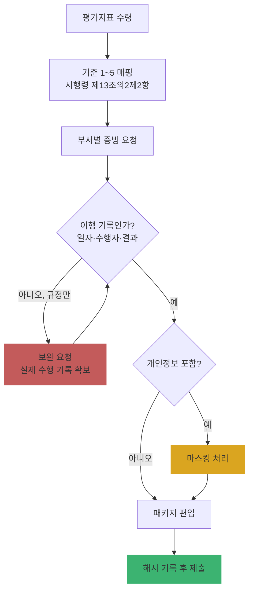

# Ch12. 보호수준 평가 지표 대응과 증빙 작성

| 항목 | 내용 |
|---|---|
| 주차 | 2주차 |
| 컨설팅 영역 | ② 개인정보 보호수준 평가 |
| 핵심 근거 | 「개인정보 보호법」 제11조의2 / 시행령 제13조의2제2항·제5항 / 고시 제4조, 제5조, 제8조, 제14조~제18조 |
| 법령 확인일 | 2026-11-11 (법률·시행령·안전성 확보조치 고시 원문 대조. 연도별 평가지표는 평가계획으로 확인) |
| 예상 학습 시간 | 3시간 |
| 선수 챕터 | Ch11 |

---

## 1. 학습 목표

1. 평가 기준별로 "증빙이 되는 자료"와 "증빙이 안 되는 자료"를 구분할 수 있다.
2. 공공시스템운영기관 추가 요건(고시 제3장)을 증빙에 반영할 수 있다.
3. 증빙 패키지를 제출 가능한 형태로 구성할 수 있다.

---

## 2. 🧩 한 줄 비유

> 증빙은 **영수증**이다 — "샀다"는 말(규정 문서)이 아니라 **언제, 누가, 얼마나** 했는지 찍힌 영수증(이행 기록)이 있어야 점수가 된다.

---

## 3. 📜 법령 조문

### 3.1 평가 기준과 증빙의 법적 근거

| 시행령 제13조의2제2항 기준 | 핵심 근거 조문 (원문 대조) | "이행 기록"으로 인정되는 증빙 |
|---|---|---|
| 1. 수행실적 및 개선 정도 | 법 제31조제4항제1호(보호 계획 수립·시행), 제4호(정기 조사·개선) | 연간 계획 + **결과 보고 + 전년 대비 개선 내역** |
| 2. 관리체계 적정성 | 법 제31조, 고시 제4조제1항·제3항(수정 이력 관리) | 내부 관리계획 결재본 + **개정 이력** |
| 3. 정보주체 권리보장 | 법 제35조~제37조 | 권리 행사 접수·처리 **대장(처리 기한 준수 여부)** |
| 4. 침해방지·안전조치 | 고시 제4조제4항(**CPO 연 1회 이상 이행 실태 점검**), 제5조제3항(권한 내역 3년), 제8조제2항(접속기록 점검) | 점검 결과서 + **조치 결과** |
| 5. 기타 준수 | 법 제26조제4항(수탁자 교육·감독), 제33조(영향평가) | 수탁사 점검표, 영향평가 결과 |

### 3.2 공공시스템운영기관 추가 증빙 (고시 제2026-9호 제3장)

| 조문 | 원문 요지 | 증빙 |
|---|---|---|
| 제15조 | 공공시스템별 내부 관리계획 (관리책임자 지정·역할 등) — **제5호(제16조~제18조 사항)는 2027.1.1. 시행** | 시스템별 내부 관리계획 |
| 제16조제1항~제3항 | 권한 부여·변경·말소 시 **인사정보 연계**, 인사정보 미등록자 계정 발급 금지, 계정 발급 시 **교육·보안 서약** | 연계 화면, 서약서 |
| 제16조제4항 | 권한 부여·변경·말소 내역 **반기별 1회 이상** 점검 | 반기 점검 결과서 |
| 제17조 | 접속기록 **자동화 분석**으로 유출·오남용 탐지, **소명** 요구, 이용기관이 직접 점검할 기능 제공 | 분석 시스템 화면, 소명 처리 대장 |
| 제18조 [2027.1.1. 시행] | 취약점 점검 **연 1회 이상** + 외부 전문기관 **침투테스트 연 1회 이상** + 지체 없는 보완 | 점검·침투테스트 보고서, 보완 결과 |

---

## 4. 🛠 실무 적용 — 증빙 품질 기준

| 구분 | 🟥 감점 위험 증빙 | 🟩 인정 가능 증빙 | 근거 |
|---|---|---|---|
| 관리적 | 결재 없는 내부 관리계획 초안 | 결재본 + 개정 이력표 | 고시 제4조제1항·제3항 |
| 관리적 | "교육 실시함" 공문 1장 | 교육 계획(목적·대상·내용·일정·방법) + 결과(출석·평가) | 고시 제4조제2항 |
| 기술적 | 접근통제 솔루션 구매 계약서 | 정책 설정 화면 + 차단 로그 | 고시 제6조 |
| 기술적 | 접속기록 "보관 중" 확인서 | 내부 관리계획에 정한 주기대로 수행한 **점검 결과 + 사후조치** | 고시 제8조제2항 |
| 기술적 | 암호화 솔루션 도입 사실 | 암호화 대상 컬럼 목록 + 적용 화면 | 고시 제7조 |
| 물리적 | 출입통제 규정 문서 | 출입 기록 샘플 + 미승인 출입 대응 기록 | 고시 제10조 |

### 4.1 Windows 11 실습 — 증빙 패키지 압축·목록화

```powershell
# 기준별 폴더를 하나의 제출 패키지로 압축하고 파일 목록 생성
$src = "$env:USERPROFILE\Desktop\보호수준평가_증빙"
$dst = "$env:USERPROFILE\Desktop\보호수준평가_제출_$(Get-Date -Format yyyyMMdd).zip"
Get-ChildItem $src -Recurse -File | Select-Object FullName, Length, LastWriteTime |
  Export-Csv "$src\_파일목록.csv" -NoTypeInformation -Encoding UTF8
Compress-Archive -Path "$src\*" -DestinationPath $dst -Force
Get-FileHash $dst -Algorithm SHA256
```

| 확인 항목 | 🟩 양호 | 🟥 취약 |
|---|---|---|
| 개인정보 포함 증빙 | 마스킹 후 제출 | 원본 개인정보(주민번호 등) 그대로 첨부 |
| 패키지 해시 | 제출본 해시 기록 | 없음 |

> 🟥 증빙에 개인정보가 들어가면 그 자체가 **불필요한 제공·유출 위험**입니다. 화면 캡처·로그 샘플은 반드시 마스킹하십시오.

---

## 5. 🔄 프로세스 다이어그램 — 증빙 작성 워크플로



---

## 6. ⚖ 개인정보보호위원회 위반·처분 사례

| 항목 | 내용 |
|---|---|
| 성격 | 보호수준 평가 증빙 자체에 대한 처분 사례는 확인하지 못함 — **허위 사례를 만들지 않습니다** |
| 연계 사례 유형 | 공공기관 개인정보 유출 사고 처분에서 반복적으로 지적되는 사항: **접근 권한 관리 미흡, 접속기록 점검 미흡, 퇴직자 계정 미말소** (Ch03·Ch04 근거 조문) |
| 학습 과제 | 개인정보보호위원회 → 심의·의결 → 의결서에서 피심인이 **공공기관**인 사례 1건을 찾아 ① 위반 조문 ② 평가 기준 1~5 중 어디에 해당하는지 ③ 해당 기관이 보호수준 평가 증빙으로 무엇을 냈어야 했는지 작성 |
| 평가와 처분의 연결 | 2026년 평가 감점 항목에 **과징금·과태료·시정명령·시정권고·공표·개선권고 건당 감점**, **전년도 개선권고 미이행 감점**이 포함됨 (2026.8.24. 보도자료) → 처분 이력이 곧 평가 점수 하락 |
| 컨설팅 시사점 | 고시 제3장 공공시스템 요건(반기 권한 점검, 접속기록 자동 분석, 2027년 침투테스트)은 **공공 유출 사고 재발 방지 대책**이 제도화된 것 → 증빙 1순위 |

---

## 7. ❌ 오답노트

| # | 🟨 흔한 착각 | 🟩 올바른 이해 | 근거 |
|---|---|---|---|
| 1 | "규정·지침 문서만 내면 된다" | 기준 1번은 **수행실적·개선 정도** — 이행 기록이 핵심 | 시행령 제13조의2②1 |
| 2 | "공공시스템 침투테스트는 지금 당장 의무" | 제18조는 **2027.1.1. 시행** (2026년은 준비 단계) | 고시 제2026-9호 부칙 |
| 3 | "공공시스템 권한 점검은 분기 1회" | **반기별 1회 이상** | 고시 제16조제4항 |
| 4 | "증빙 캡처에 실제 고객 정보가 보여도 내부 제출이라 괜찮다" | 불필요한 개인정보 노출 → 마스킹 필수 | 법 제3조(최소 처리), 고시 제12조 |
| 5 | "교육 사진이 교육 증빙" | 교육목적·대상, 내용, 일정·방법을 정한 **계획 + 결과** | 고시 제4조제2항 |

---

## 8. ✅ 고객사 점검용 체크리스트 (증빙 품질 점검)

| No | 점검 항목 | 근거 조문 | 점검 방법 | 결과 | 비고 |
|---|---|---|---|---|---|
| 1 | 내부 관리계획 결재본·개정 이력 | 고시 제4조①③ | 문서 | | |
| 2 | 교육 계획(3요소)·결과 | 고시 제4조② | 문서 | | |
| 3 | CPO 연 1회 이상 이행 실태 점검 결과 | 고시 제4조④ | 문서 | | |
| 4 | 권한 부여·변경·말소 내역(3년) | 고시 제5조③ | 대장 | | |
| 5 | 접속기록 점검 결과·사후조치 | 고시 제8조② | 기록 | | |
| 6 | (공공시스템) 인사정보 연계·반기 권한 점검 | 고시 제16조 | 시스템·문서 | | |
| 7 | (공공시스템) 접속기록 자동 분석·소명 | 고시 제17조 | 시스템 | | |
| 8 | (공공시스템) 2027 취약점 점검·침투테스트 준비 | 고시 제18조 | 계획서 | | 2027.1.1. |
| 9 | 증빙 마스킹·해시 기록 | 법 제3조 | 패키지 | | |

### 8.1 💡 실무 산출물 연계 팁

- **연계 산출물**: 증빙 패키지, 평가 대응 결과 보고서, 차년도 개선계획
- **작성 팁**: 각 증빙 파일 첫 장에 **"표지"**(평가 기준 번호·지표명·근거 조문·작성일·작성자)를 붙이면 평가위원이 빠르게 확인
- **Excel 활용**: 증빙 목록에 `기준번호` 열을 두고 `COUNTIFS`로 기준별 증빙 수 → 0건 기준을 `#c35b5b`로 표시

---

## 9. 📝 퀴즈

> 정답·해설: [answers_and_explanations.md](../../answers_and_explanations.md#ch12)

**Q1. (OX)** 공공시스템운영기관은 접근 권한 부여·변경·말소 내역을 분기별 1회 이상 점검해야 한다.

**Q2. (객관식)** 고시 제2026-9호 부칙상 2027.1.1.부터 시행되는 조항은?
- ① 제6조의2 ② 제8조제2항 ③ 제15조제5호 및 제18조 ④ 제16조 전체

**Q3. (사례)** 기관이 "개인정보 교육 실시" 공문 1장과 교육장 사진만 증빙으로 냈다. 보완해야 할 내용을 고시 조문과 함께 쓰시오.

---

## 10. 📚 참고 자료

- `references/개인정보의 안전성 확보조치 기준(개인정보보호위원회고시)(제2026-9호)(20260701).pdf`
- `references/개인정보의 안전성 확보조치 기준 안내서(2026.11).pdf`
- 개인정보보호위원회 보호수준 평가 공지: https://www.pipc.go.kr

---

⬅ [이전: Ch11](ch11_level_assessment.md) | [목차](../../README.md) | [다음: Ch13](../week3/ch13_inspection_overview.md) ➡
