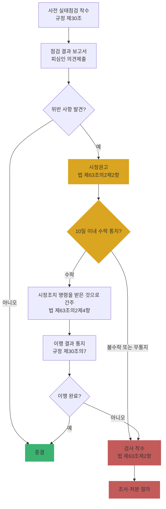

# Ch13. 실태점검 컨설팅 개요

| 항목 | 내용 |
|---|---|
| 주차 | 3주차 |
| 컨설팅 영역 | ③ 개인정보 실태점검 |
| 핵심 근거 | 「개인정보 보호법」 제63조, 제63조의2, 제64조, 제75조 / 시행령 제60조 / 「개인정보 보호위원회의 조사 및 처분에 관한 규정」(고시 제2026-13호) |
| 법령 확인일 | 2026-11-11 (법률 제21445호, 시행령 제36804호·별표 2, 조사·처분 규정 제2026-13호 원문 대조 — `references/`) |
| 예상 학습 시간 | 2.5시간 |
| 선수 챕터 | Ch03 ~ Ch06 |

---

## 1. 학습 목표

1. **조사·검사(제63조)**와 **사전 실태점검(제63조의2)**을 구분할 수 있다.
2. 사전 실태점검의 시정권고 → 수락 여부 통지(10일) → 이행 → 미이행 시 검사 흐름을 설명할 수 있다.
3. 고객사의 "실태점검 대비 컨설팅" 범위를 설계할 수 있다.

---

## 2. 🧩 한 줄 비유

> **사전 실태점검**은 사고 전에 오는 **정기 건강검진**(권고 중심), **조사·검사(제63조)**는 사고·신고 후 오는 **응급실 정밀검사**(처분으로 연결)다.

---

## 3. 📜 법령 조문

### 3.1 원문 인용

> **「개인정보 보호법」 제63조의2(사전 실태점검)** [본조신설 2023. 3. 14.]
> ① 보호위원회는 제63조제1항 각 호에 해당하지 아니하는 경우로서 개인정보 침해사고 발생의 위험성이 높고 개인정보 보호의 취약점을 사전에 점검할 필요성이 인정되는 개인정보처리자에 대하여 개인정보 보호실태를 점검할 수 있다.
> ② 보호위원회는 제1항에 따른 실태점검을 실시하여 이 법을 위반하는 사항을 발견한 경우 해당 개인정보처리자에 대하여 시정방안을 정하여 이에 따를 것을 권고할 수 있다.
> ③ 제2항에 따른 시정권고를 받은 개인정보처리자는 이를 통보받은 날부터 **10일 이내**에 해당 권고를 수락하는지 여부에 관하여 보호위원회에 통지하여야 하며, 그 이행 결과를 보호위원회가 고시로 정하는 바에 따라 보호위원회에 알려야 한다.
> ④ 제2항에 따른 시정권고를 받은 자가 해당 권고를 수락한 때에는 제64조제1항에 따른 **시정조치 명령**(중앙행정기관, 지방자치단체, 국회, 법원, 헌법재판소, 중앙선거관리위원회의 경우에는 제64조제3항에 따른 권고를 말한다)을 받은 것으로 본다.
> ⑤ 보호위원회는 제2항에 따른 시정권고를 받은 자가 해당 권고를 수락하지 아니하거나 이행하지 아니한 경우 제63조제2항에 따른 **검사**를 할 수 있다.
> ⑥ 보호위원회는 관계 중앙행정기관의 장과 **합동으로** 제1항에 따른 개인정보 보호실태를 점검할 수 있다.

### 3.2 제63조(자료제출 요구 및 검사) 요지

| 항 | 요지 |
|---|---|
| ① | 자료제출 요구 사유: 1. 위반 발견·혐의 2. **신고·민원** 접수 3. 대통령령 사유 — 시행령 제60조①: **유출 등 권리·이익 침해 사건·사고가 발생했거나 발생 가능성이 상당한 경우** |
| ② | 자료 미제출 또는 위반 사실 인정 시 **사무소·사업장 출입 검사** (증표 제시) |
| ⑤ | 절차·방법은 보호위원회 고시 → 「조사 및 처분에 관한 규정」 |
| ⑥ | 제출받은 자료는 법에 따른 경우 외 제3자 제공·공개 금지 |

### 3.3 조사·처분 규정 (고시 제2026-13호) 핵심

| 조문 | 요지 |
|---|---|
| 제7조 | 조사기간: 조사개시일부터 **6개월**(복잡·전문 사건 **12개월**) 내 조사결과 보고, 부득이 시 연장 |
| 제9조 | 자료제출 요구는 **조사공문**으로 — 요청사유, 제출자, 자료, **기한·장소**, 방식, **미제출 시 제재 내용** 기재 |
| 제10조 | 현장조사 전 조사공문 통지 (긴급·증거인멸 우려 시 개시와 동시 교부) |
| 제30조 | 사전 실태점검 착수 — 조사관 지정, **착수 보고서**(개요·방법·일정) 작성 |
| 제30조의3·제30조의4 | 결과 보고서 + 피심인 의견 → **시정권고안** → 시정권고(이행 기간 포함) |
| 제30조의6 | 통보받은 날부터 **10일 이내** 수락 여부 통지, **기일 내 통지 없으면 불수락으로 간주** |
| 제30조의7 | 이행 결과를 보호위원회가 정한 기간 내 통지 |
| 제30조의8 | 불수락·미이행 시 법 제63조제2항 **검사** → 이후 제2장(조사·처분) 절차 |

### 3.4 관련 과태료 (시행령 별표 2)

| 위반 | 근거 | 금액 (1회/2회/3회 이상) |
|---|---|---|
| 제63조제1항 자료 미제출·거짓 제출 | 법 제75조제2항제25호 | 900만 / 1,800만 / 3,000만 원 |
| 제63조제2항 출입·검사 거부·방해·기피 | 법 제75조제2항제26호 | 900만 / 1,800만 / 3,000만 원 |

---

## 4. 🛠 실무 적용 — 실태점검 대비 컨설팅

| 구분 | 요구사항 (근거) | 현장 확인 방법 | 증빙 자료 예시 |
|---|---|---|---|
| 관리적 | 자료제출 대응 절차·창구(CPO) 지정 (법 제63조①, 규정 제9조) | 대응 매뉴얼 | 대응 절차서, 담당자 지정 문서 |
| 관리적 | 10일 내 수락 여부 결정 체계 (법 제63조의2③) | 결재 라인 | 의사결정 절차 |
| 관리적 | 시정권고 이행 관리 (규정 제30조의7) | 이행 계획 | 이행 결과 보고서 |
| 기술적 | 요청 빈도 높은 증적의 즉시 추출 체계 (접속기록, 권한 내역, 암호화 현황) | 추출 시연 | 추출 쿼리, 샘플 |
| 물리적 | 현장조사 대응 공간·참관인 지정 (규정 제10조) | 대응 계획 | 현장 대응 체크리스트 |

### 4.1 Windows 11 실습 — 자료제출 대응 폴더와 기한 계산

```powershell
# 조사공문 수령일 기준 폴더 생성 + 사전 실태점검 시정권고 수락 통지 기한(10일) 계산
$recv = Get-Date "2026-11-11"
$root = "$env:USERPROFILE\Desktop\실태점검_대응_$($recv.ToString('yyyyMMdd'))"
@('00_공문','01_제출자료','02_제출목록','03_의견서','04_이행결과') | ForEach-Object {
  New-Item -ItemType Directory -Force -Path (Join-Path $root $_) | Out-Null }
"시정권고 수락 여부 통지 기한(통보일+10일): {0:yyyy-MM-dd}" -f $recv.AddDays(10)
```

> ※ 기간 계산의 초일 산입 여부 등은 공문에 기재된 기한을 최우선으로 확인하십시오.

| 확인 항목 | 🟩 양호 | 🟥 취약 |
|---|---|---|
| 제출 목록 관리 | 제출일·자료명·버전 기록 | 무엇을 냈는지 모름 |
| 기한 관리 | 공문 기한 + 10일 통지 기한 별도 관리 | 기한 경과 → 불수락 간주 |

---

## 5. 🔄 프로세스 다이어그램 — 사전 실태점검 흐름



---

## 6. ⚖ 개인정보보호위원회 위반·처분 사례

| 항목 | 내용 |
|---|---|
| 점검 개요 | 2023년 11월부터 KISA와 함께 주요 AI 서비스를 ① LLM 관련 사업자 ② 응용서비스 사업자로 나누어 **사전 실태점검**(법 제63조의2) |
| 1차 (2024.3.27. 의결) | LLM 관련 **6개 사업자**(오픈AI, 구글, MS, 메타, 네이버, 뤼튼) — 🟨 **개선권고**: 공개 데이터 학습 시 주민번호 등 중요 식별정보 제거 강화, 이용자 입력 데이터의 학습·이용 안내 및 침해 최소화, 처리방침 구체화, 취약점 발견 시 신속 대응 |
| 2차 (2024.6.12. 의결) | 응용서비스 **4개 사업자**(SKT 에이닷, 스노우, DeepL, 뷰노) — 예: 에이닷 통화녹음·요약 과정에서 텍스트 파일 보관 시스템 등에 **접속기록이 보관되지 않음** → 접속기록 보관·점검 등 안전조치 의무를 준수하도록 🟥 **시정권고** |
| 관련 조문 | 「개인정보 보호법」 제63조의2(사전 실태점검), 제29조 / 고시 제8조(접속기록) |
| 컨설팅 시사점 | ① 사전 실태점검 대상은 **침해 위험이 높은 신기술·서비스** 위주 → AI·플랫폼 고객사는 점검 가능성을 전제로 대비 ② 결과는 법 위반이 아니면 **개선권고**, 위반이면 **시정권고**(수락 시 시정조치 명령 간주) — 두 단계를 구분해 설명 ③ 신규 데이터 흐름(음성→텍스트→외부 클라우드 요약)마다 **접속기록 대상 시스템이 빠지지 않았는지** 확인 |
| 출처 | 개인정보보호위원회 보도자료 (2024.3.28., 2024.6.13.) — `references/` |

---

## 7. ❌ 오답노트

| # | 🟨 흔한 착각 | 🟩 올바른 이해 | 근거 |
|---|---|---|---|
| 1 | "실태점검 = 조사" | 사전 실태점검은 제63조제1항 사유(위반 혐의·신고 등)가 **없는** 경우의 예방 점검, 결과는 **시정권고** | 법 제63조의2① |
| 2 | "시정권고는 권고일 뿐 법적 효과 없음" | **수락하면 시정조치 명령을 받은 것으로 간주** → 불이행 시 제재 연결 | 법 제63조의2④ |
| 3 | "수락 여부는 천천히 검토" | 통보일부터 **10일 이내**, 기일 내 통지 없으면 **불수락 간주** → 검사 가능 | 법 제63조의2③, 규정 제30조의6 |
| 4 | "자료제출은 '협조' 차원" | 미제출·거짓 제출은 **과태료(최대 3,000만 원)** | 법 제75조제2항제25호 |
| 5 | "조사는 무기한 진행" | 원칙 6개월(복잡 사건 12개월), 연장 시 보고 | 규정 제7조 |

---

## 8. ✅ 고객사 점검용 체크리스트 (실태점검 대비 준비도)

| No | 점검 항목 | 근거 조문 | 점검 방법 | 결과 | 비고 |
|---|---|---|---|---|---|
| 1 | 조사·점검 대응 창구 및 절차 | 법 제63조, 규정 제9조 | 문서 | | |
| 2 | 시정권고 10일 내 수락 결정 체계 | 법 제63조의2③ | 문서 | | |
| 3 | 필수 증적 즉시 제출 가능 (Ch03~Ch05 체크리스트 기준) | 고시 제4조~제13조 | 시연 | | |
| 4 | 처리방침·흐름표·위탁 현황 최신화 | 법 제26조, 제30조 | 문서 | | |
| 5 | 과거 시정권고·처분 이행 결과 보관 | 규정 제30조의7, 제27조 | 문서 | | |
| 6 | 현장조사 대응 계획(공간·참관인·사본 관리) | 규정 제10조 | 계획서 | | |

### 8.1 💡 실무 산출물 연계 팁

- **연계 산출물**: 실태점검 대응 매뉴얼, 모의 실태점검 결과 보고서
- **작성 팁**: 모의 점검 보고서는 실제 조사공문 형식(규정 제9조의 6개 기재사항)을 흉내 낸 **가상 공문**으로 시작하면 고객사 담당자 훈련 효과가 큼
- **Excel 활용**: 제출 목록 `No | 요청 항목 | 제출 자료명 | 버전 | 제출일 | 담당 | 비고` + 기한 열 조건부 서식

---

## 9. 📝 퀴즈

> 정답·해설: [answers_and_explanations.md](../../answers_and_explanations.md#ch13)

**Q1. (OX)** 사전 실태점검 시정권고를 받고 10일 내 아무 통지도 하지 않으면 수락한 것으로 본다.

**Q2. (객관식)** 시정권고를 수락한 민간 개인정보처리자의 법적 효과는?
- ① 효과 없음 ② 과징금 감경 ③ 제64조제1항 시정조치 명령을 받은 것으로 간주 ④ 조사 면제

**Q3. (단답)** 조사·처분 규정상 조사결과 보고 기한(원칙/복잡 사건)은?

---

## 10. 📚 참고 자료

- `references/개인정보 보호위원회의 조사 및 처분에 관한 규정(개인정보보호위원회고시)(제2026-13호)(20260911).pdf`
- `references/개인정보 보호법(법률)(제21445호)(20260911).pdf`
- `references/[별표 2] 과태료의 부과기준(제63조 관련)(개인정보 보호법 시행령).pdf`

---

⬅ [이전: Ch12](../week2/ch12_level_evidence.md) | [목차](../../README.md) | [다음: Ch14](ch14_inspection_field.md) ➡
