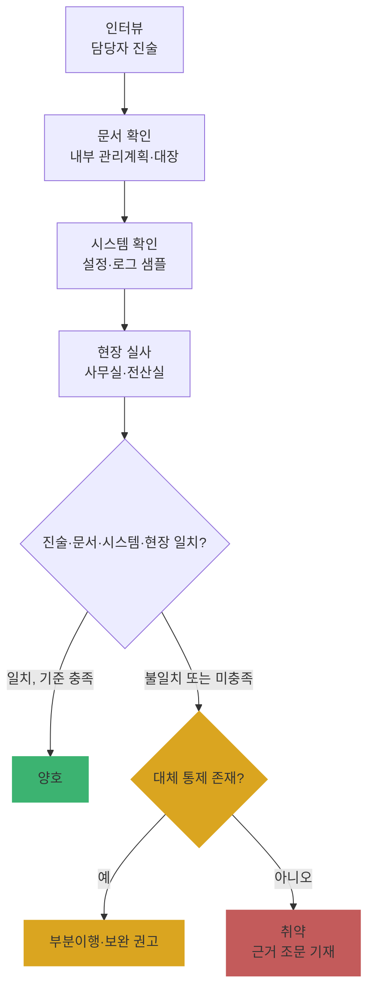

# Ch14. 실태점검 현장 수행 (Windows 11 점검 실습)

| 항목 | 내용 |
|---|---|
| 주차 | 3주차 |
| 컨설팅 영역 | ③ 개인정보 실태점검 |
| 핵심 근거 | 「개인정보 보호법」 제29조 / 「개인정보의 안전성 확보조치 기준」(고시 제2026-9호) 제5조~제10조, 제12조, 제13조 |
| 법령 확인일 | 2026-11-11 (고시 제2026-9호 원문 대조 — `references/`) |
| 예상 학습 시간 | 3시간 |
| 선수 챕터 | Ch13 |

---

## 1. 학습 목표

1. 현장 점검을 **인터뷰 → 문서 → 시스템 → 현장** 순서로 수행할 수 있다.
2. 개인정보취급자 PC를 PowerShell 스크립트로 점검하고 결과를 고시 조문에 매핑할 수 있다.
3. 샘플링 기준과 증적 수집 원칙을 지킬 수 있다.

---

## 2. 🧩 한 줄 비유

> 현장 점검은 **"말 → 서류 → 화면 → 눈"** 순서로 확인하는 **교차 검증**이다 — 담당자 말과 서류가 다르면 화면이, 화면과 현장이 다르면 현장이 진실이다.

---

## 3. 📜 법령 조문 — PC 점검 항목과 고시 조문 매핑

| 점검 항목 | 고시 조문 (제2026-9호 원문) |
|---|---|
| 취급자별 계정, 공유 금지 | 제5조제4항: 정당한 사유가 없는 한 개인정보취급자 별로 계정을 발급하고 다른 개인정보취급자와 공유되지 않도록 |
| 인증 실패 시 접근 제한 | 제5조제6항: 일정 횟수 이상 인증에 실패한 경우 접근을 제한하는 등 필요한 조치 |
| P2P·공유설정 노출 방지 | 제6조제3항: 인터넷 홈페이지, P2P, **공유설정** 등을 통하여 권한이 없는 자에게 공개되거나 유출되지 않도록 … 개인정보취급자의 **컴퓨터** 및 모바일 기기 등에 조치 |
| 자동 접속 차단 | 제6조제4항: 일정시간 이상 업무처리를 하지 않는 경우에는 자동으로 접속이 차단되도록 |
| 업무용 모바일 기기 | 제6조제5항: 분실·도난 대비 비밀번호 설정 등 보호조치 |
| PC 저장 시 암호화 | 제7조제5항: 이용자의 개인정보 또는 이용자가 아닌 정보주체의 고유식별정보·생체인식정보를 취급자의 **컴퓨터, 모바일 기기 및 보조저장매체** 등에 저장할 때 암호화 |
| 백신·업데이트 | 제9조제1항제1호: **자동 업데이트** 또는 **일 1회 이상** 업데이트 / 제2항: 보안 업데이트 공지 시 **즉시** |
| 보조저장매체 반출·입 | 제10조제3항: 반출·입 통제 보안대책 (별도 처리시스템 없이 PC만 쓰는 경우 적용 제외 가능) |
| 출력 최소화·출력물 관리 | 제12조 |
| 파기 | 제13조 |

---

## 4. 🛠 실무 적용

### 4.1 현장 점검 4단계

| 단계 | 방법 | 증적 | 주의 |
|---|---|---|---|
| ① 인터뷰 | CPO·취급자·시스템 담당자 면담 | 인터뷰 기록지 | 질문은 "어떻게 하세요?"(개방형) |
| ② 문서 | 내부 관리계획, 대장, 점검 결과 | 문서 사본 | 결재·일자 확인 |
| ③ 시스템 | 관리 화면, 설정, 로그 샘플 | 캡처(마스킹) | 고객사 담당자가 직접 조작 |
| ④ 현장 | 사무실·전산실·문서고 실사 | 사진(모자이크) | 촬영 동의 |

### 4.2 안전성 확보조치 구분별 현장 확인

| 구분 | 요구사항 (근거) | 현장 확인 방법 | 증빙 자료 예시 |
|---|---|---|---|
| 관리적 | 접속기록 점검 주기·방법을 내부 관리계획에 정하고 이행 (제8조②) | 계획서 주기 vs 실제 점검 기록 | 점검 결과서 |
| 기술적 | 취급자 PC 보호조치 (제5조, 제6조, 제7조⑤, 제9조) | **아래 PowerShell 점검** | 점검 결과 CSV |
| 물리적 | 서류·매체 잠금 보관, 반출·입 통제 (제10조) | 책상·캐비닛 실사 | 사진(모자이크) |

### 4.3 Windows 11 실습 — 취급자 PC 일괄 점검 스크립트

> 관리자 권한 PowerShell에서 실행합니다. **고객사 PC에서는 반드시 사전 동의**를 받고, 결과 파일에 개인정보가 포함되지 않는지 확인하십시오.

```powershell
# PC_점검.ps1 — 개인정보취급자 PC 기본 점검 (결과를 바탕화면 CSV로 저장)
$r = [System.Collections.Generic.List[object]]::new()
function Add-R($item,$clause,$value,$ok){ $r.Add([pscustomobject]@{점검항목=$item;근거=$clause;현황=$value;판정=$(if($ok){'양호'}else{'확인필요'})}) }

# 1) 계정 잠금 임계값 (제5조제6항)
$line = net accounts | Select-String '잠금 임계값|Lockout threshold' | Select-Object -First 1
$lock = if ($line) { $line.Line.Split(':')[-1].Trim() } else { '확인불가' }
Add-R '인증 실패 잠금' '고시 제5조⑥' $lock ($lock -notmatch 'Never|안 함|0')

# 2) 활성 로컬 계정 수 (제5조제4항 — 공용 계정 의심)
$users = Get-LocalUser | Where-Object Enabled
Add-R '활성 로컬 계정' '고시 제5조④' (($users.Name) -join ', ') ($users.Count -le 2)

# 3) 화면보호기 잠금 (제6조제4항)
$d = Get-ItemProperty 'HKCU:\Control Panel\Desktop'
Add-R '화면 잠금' '고시 제6조④' "Secure=$($d.ScreenSaverIsSecure), Timeout=$($d.ScreenSaveTimeOut)s" ($d.ScreenSaverIsSecure -eq '1')

# 4) 공유 폴더 (제6조제3항)
$shares = Get-SmbShare | Where-Object { $_.ShareType -eq 'FileSystemDirectory' -and $_.Name -notmatch '^(ADMIN|IPC|[A-Z]|print)\$$' }
Add-R '사용자 공유폴더' '고시 제6조③' (($shares.Name) -join ', ') ($shares.Count -eq 0)

# 5) 디스크 암호화 (제7조제5항 보조수단)
$bl = (Get-BitLockerVolume -MountPoint C: -ErrorAction SilentlyContinue).ProtectionStatus
Add-R 'BitLocker(C:)' '고시 제7조⑤' "$bl" ("$bl" -eq 'On')

# 6) 백신 실시간 보호·정의 업데이트 (제9조)
$mp = Get-MpComputerStatus
$age = ((Get-Date) - $mp.AntivirusSignatureLastUpdated).Days
Add-R '백신 실시간 보호' '고시 제9조①' "$($mp.RealTimeProtectionEnabled)" $mp.RealTimeProtectionEnabled
Add-R '백신 정의 경과일' '고시 제9조①1' "$age 일" ($age -le 1)

# 7) USB 저장장치 차단 여부 (제10조제3항 — 정책 적용 시 Start=4)
$usb = (Get-ItemProperty 'HKLM:\SYSTEM\CurrentControlSet\Services\USBSTOR' -ErrorAction SilentlyContinue).Start
Add-R 'USB 저장장치' '고시 제10조③' "Start=$usb" ($usb -eq 4)

$out = "$env:USERPROFILE\Desktop\PC점검_$($env:COMPUTERNAME)_$(Get-Date -Format yyyyMMdd).csv"
$r | Export-Csv $out -NoTypeInformation -Encoding UTF8
$r | Format-Table -AutoSize
```

| 판정 해석 | 설명 |
|---|---|
| 🟩 양호 | 스크립트 기준 충족 |
| 🟨 확인필요 | **즉시 "취약" 판정 금지** — USB 통제는 DLP 솔루션으로, 백신은 타사 제품으로 대체될 수 있음. 인터뷰·정책 문서로 대체 통제 확인 후 판정 |

> ※ 언어 설정에 따라 `net accounts` 출력 문구가 다를 수 있어 한/영 둘 다 검색합니다. 기업 환경에서는 그룹정책·EDR 콘솔 결과를 우선 증적으로 사용합니다.

---

## 5. 🔄 프로세스 다이어그램 — 현장 점검과 판정



---

## 6. ⚖ 개인정보보호위원회 위반·처분 사례

| 항목 | 내용 |
|---|---|
| 의결 연도 | 2023년 7월 |
| 피심인 유형 | 이동통신사업자 (LG유플러스) |
| 위반 사실 | 고객인증시스템 상용 SW **단종·기술지원 종료**, 침입차단·탐지시스템이 있었으나 **탐지·차단 정책 미적용**, **비밀번호 작성규칙 미적용**, 권한 내역·접속기록 보관 소홀 등 |
| 위반 조문 | 🟥 「개인정보 보호법」 제29조(안전조치의무) 등 |
| 처분 결과 | 🟥 과징금 **68억 45만 2천 원**, 과태료 **2,700만 원**, 시정조치 명령, 결과 공표 |
| 컨설팅 시사점 | 현장 점검에서 **"보안 장비가 있다"가 아니라 "정책이 실제로 켜져 있는가"**, **OS·DBMS 지원 종료 여부**를 시스템 화면으로 확인해야 하는 이유 (Windows에서는 `Get-ComputerInfo OsName, OsVersion`으로 지원 버전 확인) |
| 출처 | 개인정보보호위원회 보도자료 (2023.7.13.) |

---

## 7. ❌ 오답노트

| # | 🟨 흔한 착각 | 🟩 올바른 이해 | 근거 |
|---|---|---|---|
| 1 | "스크립트 결과 '확인필요' = 취약" | 대체 통제(DLP, EDR, 타사 백신) 확인 후 판정 | 고시 제3조(환경에 맞는 조치) |
| 2 | "컨설턴트가 고객 시스템을 직접 조작해 확인" | 원칙적으로 **고객사 담당자가 조작**, 컨설턴트는 관찰·기록 (책임 경계·사고 예방) | 실무 원칙 |
| 3 | "백신 업데이트는 주 1회면 충분" | **자동 업데이트** 또는 **일 1회 이상** | 고시 제9조①1 |
| 4 | "PC에 저장된 고객 엑셀은 사내망이니 암호화 불필요" | 이용자 개인정보를 취급자 **컴퓨터에 저장 시 암호화** | 고시 제7조⑤ |
| 5 | "모든 PC를 다 점검해야 한다" | **샘플링**: 고위험 직무(다운로드·권한 설정 가능자) 우선 + 부서별 무작위 | 실무 원칙 (고시 제6조의2 대상 직무 참고) |

---

## 8. ✅ 고객사 점검용 체크리스트 (현장 PC 점검)

| No | 점검 항목 | 근거 조문 | 점검 방법 | 결과 | 비고 |
|---|---|---|---|---|---|
| 1 | 취급자별 계정·공용 계정 부재 | 고시 제5조④ | 스크립트·인터뷰 | | |
| 2 | 인증 실패 잠금 | 고시 제5조⑥ | 스크립트 | | |
| 3 | 공유설정·P2P 차단 | 고시 제6조③ | 스크립트 | | |
| 4 | 미사용 시 자동 잠금 | 고시 제6조④ | 스크립트 | | |
| 5 | PC 저장 개인정보 암호화 | 고시 제7조⑤ | 파일 샘플·스크립트 | | |
| 6 | 백신 자동/일 1회 업데이트 | 고시 제9조 | 스크립트 | | |
| 7 | 보조저장매체 반출·입 통제 | 고시 제10조③ | 정책·스크립트 | | |
| 8 | 책상 위 출력물·잠금 보관 | 고시 제10조②, 제12조② | 현장 | | |

### 8.1 💡 실무 산출물 연계 팁

- **연계 산출물**: 현장 점검 결과서(PC 점검 CSV 첨부), 취약점 조치 계획
- **작성 팁**: 결과서에 **샘플링 기준**(대상 수, 선정 방법)을 반드시 기재 — "전체 중 몇 대를 왜 골랐는지"가 없으면 결과의 대표성이 공격받음
- **Excel 활용**: 여러 PC의 CSV를 `데이터 → 가져오기 → 폴더`로 합쳐 항목별 양호율 피벗

---

## 9. 📝 퀴즈

> 정답·해설: [answers_and_explanations.md](../../answers_and_explanations.md#ch14)

**Q1. (OX)** 고시 제9조에 따르면 백신은 주 1회 이상 업데이트하면 된다.

**Q2. (객관식)** 개인정보취급자 PC의 Windows 공유 폴더 점검과 가장 직접 관련된 조문은?
- ① 제5조제3항 ② 제6조제3항 ③ 제8조제1항 ④ 제11조

**Q3. (사례)** PC 점검 스크립트에서 USB 저장장치가 "확인필요"로 나왔다. 바로 취약으로 판정하면 안 되는 이유와 추가 확인 사항은?

---

## 10. 📚 참고 자료

- `references/개인정보의 안전성 확보조치 기준(개인정보보호위원회고시)(제2026-9호)(20260701).pdf`
- `references/개인정보의 안전성 확보조치 기준 안내서(2026.11).pdf`
- Microsoft Learn — PowerShell `Get-MpComputerStatus`, `Get-BitLockerVolume`, `Get-SmbShare` 문서

---

⬅ [이전: Ch13](ch13_inspection_overview.md) | [목차](../../README.md) | [다음: Ch15](ch15_pia_overview.md) ➡
