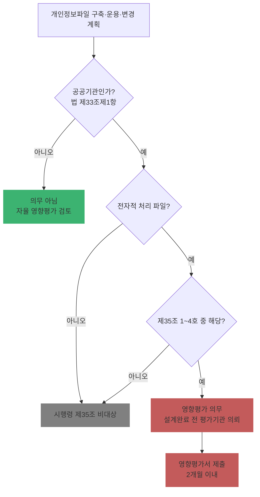

# Ch15. 개인정보 영향평가(PIA) 개요와 대상

| 항목 | 내용 |
|---|---|
| 주차 | 3주차 |
| 컨설팅 영역 | ④ 개인정보 영향평가(PIA) |
| 핵심 근거 | 「개인정보 보호법」 제33조, 제75조제2항제16호 / 시행령 제35조, 제37조, 제38조 / 「개인정보 영향평가에 관한 고시」(제2025-7호) |
| 법령 확인일 | 2026-11-11 (법률 제21445호, 시행령 제36804호·별표 2, 영향평가 고시 제2025-7호, 수행안내서(2025.10.) 원문 대조 — `references/`) |
| 예상 학습 시간 | 2.5시간 |
| 선수 챕터 | Ch08 |

---

## 1. 학습 목표

1. 영향평가 의무 주체와 **대상 개인정보파일 4가지 기준**을 판정할 수 있다.
2. 영향평가 **시기(설계 완료 전)**와 제출 기한(2개월)을 설명할 수 있다.
3. 민간 기업의 자율 영향평가가 갖는 실익을 설명할 수 있다.

---

## 2. 🧩 한 줄 비유

> 영향평가는 건물을 짓기 전에 받는 **설계도 안전 심사**다 — 다 짓고 나서 고치면 비싸니까, 설계가 끝나기 전에 위험을 찾아 도면에 반영한다.

---

## 3. 📜 법령 조문

### 3.1 원문 인용

> **「개인정보 보호법」 제33조(개인정보 영향평가)** 제1항
> **공공기관의 장**은 대통령령으로 정하는 기준에 해당하는 개인정보파일의 운용으로 인하여 정보주체의 개인정보 침해가 우려되는 경우에는 그 위험요인의 분석과 개선 사항 도출을 위한 평가(이하 "영향평가"라 한다)를 하고 그 결과를 보호위원회에 제출하여야 한다.

> **시행령 제35조(개인정보 영향평가의 대상)**
> … 개인정보를 **전자적으로** 처리할 수 있는 개인정보파일로서 다음 각 호의 어느 하나에 해당하는 개인정보파일을 말한다.
> 1. 구축·운용 또는 변경하려는 개인정보파일로서 **5만명 이상**의 정보주체에 관한 **민감정보 또는 고유식별정보**의 처리가 수반되는 개인정보파일
> 2. 구축·운용하고 있는 개인정보파일을 해당 공공기관 내부 또는 외부에서 구축·운용하고 있는 다른 개인정보파일과 **연계**하려는 경우로서 연계 결과 **50만명 이상**의 정보주체에 관한 개인정보가 포함되는 개인정보파일
> 3. 구축·운용 또는 변경하려는 개인정보파일로서 **100만명 이상**의 정보주체에 관한 개인정보파일
> 4. 영향평가를 받은 후에 개인정보 검색체계 등 개인정보파일의 **운용체계를 변경**하려는 경우 그 개인정보파일. 이 경우 영향평가 대상은 **변경된 부분으로 한정**한다.

### 3.2 제33조 나머지 항 요지

| 항 | 요지 |
|---|---|
| ② | 보호위원회가 **평가기관 지정**, 공공기관은 영향평가를 **평가기관에 의뢰**해야 함 |
| ③ | 고려사항: 처리하는 개인정보의 수, 제3자 제공 여부, 권리 침해 가능성·위험 정도, 대통령령 사항(시행령 제37조: **민감·고유식별정보 처리 여부, 보유기간**) |
| ④ | 보호위원회는 결과에 **의견 제시** 가능 |
| ⑤ | 영향평가를 한 개인정보파일을 **제32조 등록 시 결과 첨부** |
| ⑦ | 평가기관 지정 취소 사유 (거짓 지정·폐업은 필수 취소, 부실 수행 등) |
| ⑩ | 국회·법원·헌재·선관위(소속 기관 포함)는 각 규칙으로 정함 |

### 3.3 시기와 기한

| 구분 | 근거 | 내용 |
|---|---|---|
| 수행 시기 | 고시 제9조의2① | 별표 5 사항이 반영되도록 **설계완료 전** 수행 |
| 결과 반영 | 고시 제9조의2② | 영향평가 결과를 반영한 조치 이행 |
| 반영 확인 | 고시 제9조의3 | 개선계획 반영 여부를 **정보시스템 감리 시** 확인 (감리 없으면 **테스트 단계**) |
| 영향평가서 제출 | 시행령 제38조②, 고시 제12조① | 대상 파일 운용·변경 **전** 제출 / 영향평가서를 제출받은 날부터 **2개월 이내** 내부승인 후 보호위원회에 제출 |
| 개선사항 이행 | 고시 제12조② | 지적사항 이행결과·계획을 2개월 내 제출, 그 후 조치분은 **1년 이내** |
| 요약본 공개 | 시행령 제38조③, 고시 제12조의2 | 요약본 공개 가능 — 개인정보 포털 통합 공개 |

### 3.4 위반 시 제재

| 위반 | 근거 | 금액 (시행령 별표 2) |
|---|---|---|
| 영향평가를 하지 않거나 결과를 제출하지 않은 경우 | 법 제75조제2항제16호 | 1회 900만 / 2회 1,800만 / 3회 이상 3,000만 원 |

---

## 4. 🛠 실무 적용

| 구분 | 요구사항 (근거) | 현장 확인 방법 | 증빙 자료 예시 |
|---|---|---|---|
| 관리적 | 대상 판정 (시행령 제35조) | 정보주체 수·민감/고유식별·연계 계획 | 대상 판정서 |
| 관리적 | 직전 연도 예산 확보, 평가기관 선정 (수행안내서) | 예산·계약 | 사업계획서, 제안요청서 |
| 관리적 | 제안요청서에 **설계완료 전 수행**, **감리 시 반영 확인**, 요약본 작성 요건 포함 (수행안내서) | RFP 검토 | 제안요청서 |
| 기술적 | 개선계획의 시스템 반영 (고시 제9조의2②) | 감리·테스트 결과 | 감리 보고서 |
| 물리적 | 개인정보처리구역 보호조치 (평가분야 4.9) | 현장 | 보호구역 지정 문서 |

### 4.1 Windows 11 실습 — 영향평가 대상 판정 함수

```powershell
function Test-PIATarget {
  param(
    [int]$SensitiveOrUniqueSubjects = 0,   # 민감·고유식별정보 정보주체 수
    [int]$LinkedTotalSubjects = 0,         # 다른 파일과 연계 후 정보주체 수
    [int]$TotalSubjects = 0,               # 전체 정보주체 수
    [bool]$ChangeAfterPIA = $false         # 영향평가 후 운용체계 변경 여부
  )
  $hit = @()
  if ($SensitiveOrUniqueSubjects -ge 50000) { $hit += '제35조제1호(민감·고유식별 5만명 이상)' }
  if ($LinkedTotalSubjects -ge 500000)     { $hit += '제35조제2호(연계 결과 50만명 이상)' }
  if ($TotalSubjects -ge 1000000)          { $hit += '제35조제3호(100만명 이상)' }
  if ($ChangeAfterPIA)                     { $hit += '제35조제4호(운용체계 변경 — 변경 부분 한정)' }
  if ($hit) { "대상: " + ($hit -join ' / ') } else { "시행령 제35조 기준 비대상 (공공기관 여부·전자적 처리 여부 별도 확인)" }
}
Test-PIATarget -SensitiveOrUniqueSubjects 62000 -TotalSubjects 400000
```

---

## 5. 🔄 프로세스 다이어그램 — 대상 판정



---

## 6. ⚖ 개인정보보호위원회 위반·처분 사례

| 항목 | 내용 |
|---|---|
| 성격 | 영향평가 미실시로 과태료가 부과된 **구체적 의결 사례는 references 자료에서 확인하지 못함** — 허위 사례를 만들지 않습니다 |
| 제도 변화 | 수행안내서(2025.10.) 개정 이력에 **"영향평가 요약본·과태료 규정 신설 안내"** 및 **인공지능(AI) 평가분야·항목 신설**이 기재됨 → 미실시·미제출 시 **과태료(최대 3,000만 원)** 적용 가능 |
| 평가 연계 | 2026년 보호수준 평가 정량 지표에 **"개인정보 영향평가"** 항목이 포함 (2026.8.24. 보도자료) |
| 민간 실익 | 「과징금 부과기준」 제10조: 의무 대상이 아닌 자가 **자율로 영향평가**를 하는 등 성실한 보호 활동 → 2차 조정에서 **100분의 15 이하** 감경 사유 |
| 학습 과제 | 개인정보 포털 → 영향평가 요약본 공개 메뉴에서 공공기관 요약본 1건을 열어 ① 대상 근거(제35조 몇 호) ② 주요 침해요인 ③ 개선계획을 정리 |

---

## 7. ❌ 오답노트

| # | 🟨 흔한 착각 | 🟩 올바른 이해 | 근거 |
|---|---|---|---|
| 1 | "100만 명 이상 처리하는 민간 기업은 영향평가 의무" | 의무 주체는 **공공기관의 장** — 민간은 자율 | 법 제33조① |
| 2 | "시스템 오픈 후 영향평가" | **설계완료 전** 수행, 감리·테스트 단계에서 반영 확인 | 고시 제9조의2, 제9조의3 |
| 3 | "기관이 자체적으로 영향평가 수행" | **지정 평가기관에 의뢰** | 법 제33조② |
| 4 | "운용체계 변경 시 시스템 전체 재평가" | **변경된 부분으로 한정** | 시행령 제35조제4호 |
| 5 | "종이 서류 파일도 대상" | **전자적으로 처리할 수 있는** 개인정보파일 | 시행령 제35조 |

---

## 8. ✅ 고객사 점검용 체크리스트 (영향평가 준비)

| No | 점검 항목 | 근거 조문 | 점검 방법 | 결과 | 비고 |
|---|---|---|---|---|---|
| 1 | 공공기관 해당 여부 | 법 제2조제6호, 제33조① | 문서 | | |
| 2 | 제35조 1~4호 대상 판정 및 근거 수치 | 시행령 제35조 | DB 카운트 | | |
| 3 | 직전 연도 예산 확보 | 수행안내서 | 예산서 | | |
| 4 | 지정 평가기관 선정 | 법 제33조② | 계약서 | | |
| 5 | 설계완료 전 일정 반영 | 고시 제9조의2① | 사업 일정표 | | |
| 6 | 감리(또는 테스트) 시 반영 확인 요건 | 고시 제9조의3 | 감리 RFP | | |
| 7 | 영향평가서 2개월 내 제출, 이행결과 제출 | 고시 제12조 | 공문 | | |
| 8 | 개인정보파일 등록 시 결과 첨부 | 법 제33조⑤ | 등록 내역 | | |

### 8.1 💡 실무 산출물 연계 팁

- **연계 산출물**: 영향평가 대상 판정서, 사업계획서·제안요청서(RFP) 요건
- **작성 팁**: 판정서에는 "정보주체 수"의 **산정 기준일과 쿼리**를 함께 남길 것 — 50만/100만 경계 근처에서 다툼이 생김
- **Excel 활용**: 판정표 `파일명 | 전체 정보주체 | 민감·고유식별 정보주체 | 연계 후 정보주체 | 운용체계 변경 | 판정(호)`

---

## 9. 📝 퀴즈

> 정답·해설: [answers_and_explanations.md](../../answers_and_explanations.md#ch15)

**Q1. (OX)** 공공기관이 정보주체 30만 명의 파일을 다른 기관의 30만 명 파일과 연계해 연계 결과 55만 명이 되면 영향평가 대상이다.

**Q2. (객관식)** 영향평가 개선계획 반영 여부를 확인하는 시점은?
- ① 시스템 오픈 1년 후 ② 정보시스템 감리 시(감리 없으면 테스트 단계) ③ 보호수준 평가 시 ④ ISMS-P 심사 시

**Q3. (단답)** 영향평가 미실시·미제출 시 과태료 근거 조문과 1회 위반 금액은?

---

## 10. 📚 참고 자료

- `references/개인정보 영향평가에 관한 고시(개인정보보호위원회고시)(제2025-7호)(20250905).pdf`
- `references/개인정보 영향평가 수행안내서(25.10.).pdf`
- 개인정보 포털 영향평가 요약본 공개: https://www.privacy.go.kr

---

⬅ [이전: Ch14](ch14_inspection_field.md) | [목차](../../README.md) | [다음: Ch16](ch16_pia_process.md) ➡
