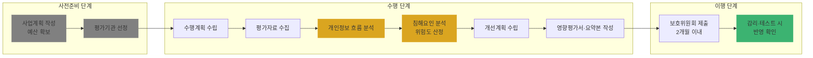

# Ch16. PIA 수행 절차 (사전준비 → 수행 → 이행)

| 항목 | 내용 |
|---|---|
| 주차 | 3주차 |
| 컨설팅 영역 | ④ 개인정보 영향평가(PIA) |
| 핵심 근거 | 「개인정보 영향평가에 관한 고시」(제2025-7호) 제9조, 제9조의2, 제9조의3, 제12조 / 시행령 제38조 / 「개인정보 영향평가 수행안내서」(2025.10.) |
| 법령 확인일 | 2026-11-11 (영향평가 고시 제2025-7호, 수행안내서 원문 대조 — `references/`) |
| 예상 학습 시간 | 3시간 |
| 선수 챕터 | Ch08, Ch15 |

---

## 1. 학습 목표

1. 영향평가 3단계와 단계별 주체·산출물을 설명할 수 있다.
2. 수행단계 6개 세부 절차를 순서대로 수행할 수 있다.
3. 흐름분석 산출물 6종을 작성할 수 있다.

---

## 2. 🧩 한 줄 비유

> 영향평가 절차는 **요리 레시피**다 — 장보기(사전준비) → 손질·조리(수행) → 시식·간 맞추기(이행) 순서를 건너뛰면 맛(결과)이 보장되지 않는다.

---

## 3. 📜 법령 조문

### 3.1 원문 인용

> **「개인정보 영향평가에 관한 고시」 제9조(평가절차)**
> 대상기관은 다음 각 호와 같이 사전 준비, 영향평가 수행, 이행 단계로 영향평가를 수행한다.
> 1. 사전 준비 단계에서는 영향평가 사업계획을 수립하여 예산을 확보하고 평가기관을 선정한다.
> 2. 영향평가 수행 단계에서는 평가기관이 개인정보 침해요인을 분석하고 개선계획을 수립하여 영향평가서를 작성한다.
> 3. 이행 단계에서는 영향평가서의 침해요인에 대한 개선계획이 반영되는 가를 점검한다.

### 3.2 영향평가서 필수 기재사항 (시행령 제38조제2항)

| 호 | 내용 |
|---|---|
| 1 | 영향평가의 대상 및 범위 |
| 2 | 평가 분야 및 항목 |
| 3 | 평가기준에 따른 개인정보 침해의 위험요인에 대한 분석·평가 |
| 4 | 제3호의 분석·평가 결과에 따라 조치한 내용 및 개선계획 |
| 5 | 영향평가의 결과 |
| 6 | 제1호~제5호를 **요약한 내용** (요약본 — 공개 가능, 시행령 제38조③) |

### 3.3 평가기준 (시행령 제38조제1항)

1. 개인정보의 종류·성질, 정보주체의 수 및 그에 따른 침해 가능성
2. 법 제23조②, 제24조③, 제24조의2②, 제25조⑥, **제29조**에 따른 **안전성 확보 조치의 수준** 및 침해 가능성
3. 침해 위험요인별 조치 여부
4. 그 밖에 법·영에 따른 필요한 조치 또는 의무 위반 요소

---

## 4. 🛠 실무 적용

### 4.1 단계별 절차와 산출물 (수행안내서 기준)

| 단계 | 세부 절차 | 주요 산출물 |
|---|---|---|
| **사전준비** | 1. 사업계획 작성 2. 영향평가 기관 선정 | 사업계획서, 제안요청서 |
| **수행** | 1. 수행계획 수립 2. 평가자료 수집 3. **개인정보 흐름 분석** 4. **침해요인 분석** 5. **개선계획 수립** 6. **영향평가서 및 요약본 작성** | 수행계획서, 흐름분석 산출물, 침해요인 목록, 위험도 산정결과, 개선계획, 영향평가서·요약본 |
| **이행** | 개선계획 반영 및 점검 (감리·테스트 시 확인) | 이행점검 결과 |

### 4.2 흐름 분석 4단계와 산출물 6종 (수행안내서)

| 순서 | 작업 | 산출물 |
|---|---|---|
| ① | 개인정보 처리업무 분석 | **개인정보 영향도 등급표**, **개인정보 처리업무표**, **개인정보 처리업무 흐름도** |
| ② | 처리업무표 기반 흐름표 작성 (수집·보유·이용·제공·파기 Life-Cycle) | **개인정보 흐름표** |
| ③ | 흐름표 기반 흐름도 작성 | **개인정보 흐름도** |
| ④ | 네트워크·보안시스템 구조 분석 | **정보시스템 구조도** |

### 4.3 평가자료 수집 대상 (수행안내서 예시)

| 구분 | 자료 |
|---|---|
| 사업수행자료 | 사업추진계획서, 제안요청서, 과제수행계획서, 요구사항 정의서, 업무매뉴얼 |
| 외부연계 | 위탁계획서, 연계계획서, 인터페이스 정의서, 아키텍처 설계서 |
| 개발 산출물 | 시스템 설계서, 요건 정의서, 업무 흐름도, 기능 정의서, ERD 등 |

### 4.4 안전성 확보조치와 연결

| 구분 | 영향평가에서 확인하는 내용 (평가분야) | 근거 |
|---|---|---|
| 관리적 | 1. 대상기관 관리체계(보호조직·계획·침해대응·권리보장), 2. 대상시스템 관리체계(취급자·파일·처리방침·공공시스템 내부 관리계획) | 법 제29조~제32조, 고시 제4조 |
| 기술적 | 4.1 접근권한 ~ 4.8 기타 기술적 보호조치 | 고시 제5조~제9조, 제12조, 제13조 |
| 물리적 | 4.6 물리적 접근방지, 4.9 개인정보처리구역 보호조치 | 고시 제10조 |

### 4.5 Windows 11 실습 — 영향평가 산출물 폴더 생성

```powershell
$root = "$env:USERPROFILE\Desktop\PIA_프로젝트"
@(
 '1_사전준비\사업계획서','1_사전준비\제안요청서',
 '2_수행\01_수행계획','2_수행\02_평가자료',
 '2_수행\03_흐름분석\영향도등급표','2_수행\03_흐름분석\처리업무표','2_수행\03_흐름분석\처리업무흐름도',
 '2_수행\03_흐름분석\흐름표','2_수행\03_흐름분석\흐름도','2_수행\03_흐름분석\정보시스템구조도',
 '2_수행\04_침해요인분석','2_수행\05_개선계획','2_수행\06_영향평가서_요약본',
 '3_이행\감리_테스트_반영확인'
) | ForEach-Object { New-Item -ItemType Directory -Force -Path (Join-Path $root $_) | Out-Null }
tree $root /F
```

---

## 5. 🔄 프로세스 다이어그램 — 영향평가 전체 절차



---

## 6. ⚖ 개인정보보호위원회 위반·처분 사례

| 항목 | 내용 |
|---|---|
| 의결 연도 | 2024년 11월 |
| 피심인 유형 | 글로벌 SNS 사업자 (메타) — *영향평가 의무 대상은 아니나 흐름 분석 실패의 교훈* |
| 위반 사실 | 프로필로 약 98만 명의 민감정보를 수집하고, **행태정보를 분석해 민감정보 관련 광고주제**(특정 종교, 동성애, 트랜스젠더, 북한이탈주민 등)를 만들어 광고주가 이용하도록 함 — 별도 동의 없음 |
| 위반 조문 | 🟥 「개인정보 보호법」 제23조제1항 등 |
| 처분 결과 | 🟥 과징금 **216억 1,300만 원**, 과태료 1,020만 원, 시정명령 |
| 컨설팅 시사점 | 영향평가 흐름분석에서 **"생성" 단계**를 놓치면 침해요인 분석 자체가 누락됨 → 처리업무표에 **분석·추론·프로파일링 업무**를 별도 행으로 기재. 수행안내서 평가영역 5.6 **자동화된 결정**, 5.7 **인공지능(AI)** 분야가 신설된 이유 |
| 출처 | 개인정보보호위원회 보도자료 (2024.11.) |

---

## 7. ❌ 오답노트

| # | 🟨 흔한 착각 | 🟩 올바른 이해 | 근거 |
|---|---|---|---|
| 1 | "영향평가서만 내면 끝" | **요약본** 작성 + 개선사항 **이행결과** 제출(2개월/1년) + 감리 시 반영 확인 | 시행령 제38조②6, 고시 제9조의3, 제12조 |
| 2 | "흐름도 하나면 흐름분석 완료" | 영향도 등급표·처리업무표·처리업무 흐름도·흐름표·흐름도·**정보시스템 구조도** 6종 | 수행안내서 |
| 3 | "평가기관이 다 알아서 한다" | 사전준비(예산·RFP)와 이행 단계는 **대상기관 책임** | 고시 제9조 |
| 4 | "흐름분석과 침해요인 분석은 별개" | 흐름분석 결과와 침해요인 분석 결과 간 **연계성·추적성** 확보 필요 | 수행안내서 |

---

## 8. ✅ 고객사 점검용 체크리스트 (수행 품질 검수)

| No | 점검 항목 | 근거 조문 | 점검 방법 | 결과 | 비고 |
|---|---|---|---|---|---|
| 1 | 사업계획서·RFP에 설계완료 전 수행·요약본·감리 반영 요건 | 고시 제9조의2·제9조의3, 수행안내서 | 문서 | | |
| 2 | 평가자료 수집 목록 (사업·연계·개발 산출물) | 수행안내서 | 목록 | | |
| 3 | 흐름분석 산출물 6종 | 수행안내서 | 문서 | | |
| 4 | 처리업무표에 분석·추론·자동화 결정 업무 포함 | 시행령 제38조①1 | 문서 | | |
| 5 | 영향평가서 시행령 제38조②1~6호 전부 포함 | 시행령 제38조② | 문서 | | |
| 6 | 요약본 비공개 대상 정보 검토 | 수행안내서 | 문서 | | |
| 7 | 이행 단계 반영 확인 계획 | 고시 제9조의3 | 감리 계획 | | |

### 8.1 💡 실무 산출물 연계 팁

- **연계 산출물**: Ch08의 흐름표·GAP 결과를 **영향평가 흐름분석 초안**으로 재사용
- **작성 팁**: 처리업무표의 각 행에 **업무 ID**(예: `P-01 회원가입-수집`)를 부여하고, 흐름표·침해요인 목록·개선계획 모두 같은 ID를 쓰면 추적성이 자동 확보됨
- **Excel 활용**: 시트 4개(처리업무표 / 흐름표 / 침해요인 / 개선계획)를 업무 ID로 `XLOOKUP` 연결

---

## 9. 📝 퀴즈

> 정답·해설: [answers_and_explanations.md](../../answers_and_explanations.md#ch16)

**Q1. (OX)** 영향평가 3단계 중 "이행 단계"는 평가기관의 책임이다.

**Q2. (객관식)** 시행령 제38조제2항 영향평가서 기재사항이 **아닌** 것은?
- ① 평가 분야 및 항목 ② 조치한 내용 및 개선계획 ③ 평가기관의 매출액 ④ 요약한 내용

**Q3. (단답)** 수행안내서의 흐름분석 산출물 6종을 쓰시오.

---

## 10. 📚 참고 자료

- `references/개인정보 영향평가에 관한 고시(개인정보보호위원회고시)(제2025-7호)(20250905).pdf`
- `references/개인정보 영향평가 수행안내서(25.10.).pdf` — 제2장 영향평가 수행절차

---

⬅ [이전: Ch15](ch15_pia_overview.md) | [목차](../../README.md) | [다음: Ch17](ch17_pia_report.md) ➡
