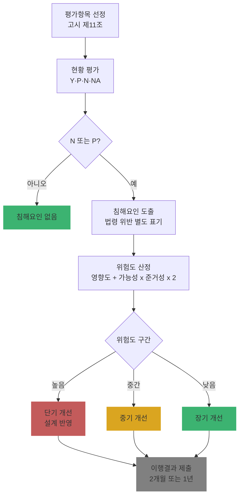

# Ch17. PIA 평가영역·위험도 산정·개선계획

| 항목 | 내용 |
|---|---|
| 주차 | 3주차 |
| 컨설팅 영역 | ④ 개인정보 영향평가(PIA) |
| 핵심 근거 | 「개인정보 영향평가에 관한 고시」(제2025-7호) 제10조, 제11조, 제12조 / 시행령 제38조 / 「개인정보 영향평가 수행안내서」(2025.10.) |
| 법령 확인일 | 2026-11-11 (영향평가 고시 제2025-7호 및 **별표 5**, 수행안내서(2025.10.) 원문 대조 — `references/`) |
| 예상 학습 시간 | 3시간 |
| 선수 챕터 | Ch16 |

---

## 1. 학습 목표

1. 5개 평가영역·29개 평가분야(고시 별표 5) 구조를 설명할 수 있다.
2. 평가 결과(Y/P/N/N/A)로 침해요인을 도출할 수 있다.
3. 수행안내서 예시 산식으로 위험도를 산정하고 개선계획 우선순위를 정할 수 있다.

---

## 2. 🧩 한 줄 비유

> 위험도 산정은 **응급실 분류(트리아지)**다 — 환자(침해요인)를 모두 치료해야 하지만, 중증도(영향도 × 가능성 × 법적 의무)에 따라 순서를 정한다.

---

## 3. 📜 법령 조문

### 3.1 원문 인용 (고시)

> **제10조(평가영역 및 평가분야)** 영 제38조제1항의 영향평가기준에 따른 평가영역은 별표 5와 같다. 다만, 대상기관이 **1년 이내**에 다른 정보시스템의 영향평가를 받은 경우에는 대상기관의 개인정보 보호 관리체계에 대한 평가는 **생략할 수 있다**.

> **제11조(평가항목)** ① 평가기관은 별표 5에 따라 적합한 평가항목을 선정하여 영향평가를 수행하여야 한다. 다만, 대상기관이 1년 이내에 이미 평가받은 항목은 그 변경이 없는 때에는 평가항목에서 제외된다.
> ② 별표 5에 명시되지 않은 **특화된 정보기술(IT)**을 적용하는 경우에는 해당 기술이 개인정보 보호에 미치는 영향에 대한 평가항목을 **개발하여** 영향평가 시 반영하여야 한다.

### 3.2 평가영역 구조 (고시 별표 5: 5개 영역 · 29개 분야)

> 🟨 **수치 차이 주의**: 고시 **별표 5** 원문은 평가분야 **1~29번**(29번 "인공지능(AI)")입니다. 수행안내서(2025.10.) 본문은 "5개 평가영역 **28개** 평가분야 **121개** 지표"로 적고 있어 AI 분야 신설분이 본문 수치에 반영되지 않은 것으로 보입니다. 산출물에는 **고시 별표 5** 기준으로 쓰고, 지표 수는 사용하는 수행안내서 판의 평가항목 표로 직접 세어 기재하십시오.

| 평가영역 | 평가분야 |
|---|---|
| 1. 대상기관 개인정보보호 관리체계 | 1.1 개인정보보호조직 1.2 개인정보보호계획 1.3 개인정보 침해대응 1.4 정보주체 권리보장 |
| 2. 대상시스템의 개인정보보호 관리체계 | 2.1 개인정보취급자 관리 2.2 개인정보파일 관리 2.3 개인정보처리방침 2.4 공공시스템 내부 관리계획 |
| 3. 개인정보 처리단계별 보호조치 | 3.1 수집 3.2 보유 3.3 이용·제공 3.4 위탁 3.5 파기 |
| 4. 대상시스템의 기술적 보호조치 | 4.1 접근권한 관리 4.2 접근통제 4.3 암호화 4.4 접속기록 보관·점검 4.5 악성프로그램 방지 등 4.6 물리적 접근방지 4.7 파기 4.8 기타 기술적 보호조치 4.9 개인정보처리구역 보호조치 |
| 5. 특정 IT 기술 활용 시 개인정보보호 | 5.1 고정형 영상정보처리기기 5.2 이동형 영상정보처리기기 5.3 생체인식정보 5.4 위치정보 5.5 가명정보 처리 5.6 **자동화된 결정** 5.7 **인공지능(AI)** |

> 영역 1은 **1년 이내** 이전 영향평가에서 평가했다면 대상기관과 협의해 제외 가능 (고시 제10조 단서, 수행안내서).

### 3.3 위험도 산정 예시 (수행안내서)

> **위험도 = 개인정보 영향도 + (침해요인 발생가능성 × 법적 준거성) × 2**

| 요소 | 등급·값 |
|---|---|
| 개인정보 영향도(자산가치) | 1등급 **5** (그 자체로 식별 가능·민감·법령상 처리 엄격 제한·범죄 직접 이용 가능) / 2등급 **3** (조합 시 식별 가능·유출 시 법적 책임) / 3등급 **1** (결합 시 부가정보·제한적 불법 이용) |
| 침해요인 발생가능성 | 높음 **3** (즉각적 침해 가능) / 중간 **2** / 낮음 **1** |
| 법적 준거성 | 법적 준수사항 **1.5** / 법률 외 요건 **1** |
| 위험도 범위 | 최대 5 + (3 × 1.5) × 2 = **14** / 최소 1 + (1 × 1) × 2 = **3** |

> 🟨 수행안내서는 이 산식이 **예시**이며, 평가기관 자체 방법론이나 사업 특성에 따라 가중치·산식을 조정할 수 있다고 명시합니다. 단, 산정 과정은 **합리적이고 납득 가능**해야 하고 **법적 준거성**이 반영되어야 합니다.

---

## 4. 🛠 실무 적용

### 4.1 침해요인 도출 규칙 (수행안내서)

| 평가 결과 | 처리 |
|---|---|
| 이행(Y), 해당없음(N/A) | 침해요인 없음 |
| 미이행(N), 부분이행(P) | 평가 결과를 근거로 **구체적 침해요인** 도출, **법령 위반 사항은 별도 표기** |

### 4.2 안전성 확보조치 연계 개선계획 예시

| 구분 | 침해요인 예시 | 근거 | 개선계획 예시 |
|---|---|---|---|
| 관리적 | 접속기록 점검 주기 미정 | 고시 제8조② | 내부 관리계획에 주기·방법·사후조치 명시 |
| 기술적 | 내부망 고유식별정보(주민번호 외) 미암호화, 위험도 분석 미수행 | 고시 제7조③2 | 위험도 분석 수행 또는 암호화 계획 수립 (**주민등록번호는 위험도 분석과 무관하게 암호화**) |
| 기술적 | 외부 접속 시 단일 비밀번호 인증 | 고시 제6조② | OTP 등 안전한 인증수단 적용 |
| 물리적 | 개인정보처리구역 미지정 | 평가분야 4.9 | 보호구역 지정·출입통제 |

### 4.3 Windows 11 실습 — 위험도 일괄 산정

```powershell
# 침해요인 목록 → 위험도 계산 → 우선순위 정렬 (수행안내서 예시 산식)
$items = @(
  [pscustomobject]@{ID='P-01';침해요인='주민번호 평문 저장';영향도=5;가능성=3;법적준거성=1.5}
  [pscustomobject]@{ID='P-02';침해요인='접속기록 점검 주기 미정';영향도=3;가능성=2;법적준거성=1.5}
  [pscustomobject]@{ID='P-03';침해요인='관리화면 마스킹 일부 누락';영향도=3;가능성=2;법적준거성=1}
  [pscustomobject]@{ID='P-04';침해요인='보안 교육 이수율 낮음';영향도=1;가능성=1;법적준거성=1}
)
$items | ForEach-Object {
  $_ | Add-Member -NotePropertyName 위험도 -NotePropertyValue ($_.영향도 + ($_.가능성 * $_.법적준거성) * 2) -PassThru
} | Sort-Object 위험도 -Descending | Format-Table -AutoSize
```

| 위험도 구간 (예시) | 조치 기한 (예시) |
|---|---|
| 🟥 11 이상 | 단기 — 설계 반영 필수, 2개월 내 이행결과 제출 |
| 🟨 7 ~ 10.9 | 중기 — 구축 기간 내 |
| 🟩 7 미만 | 장기 — 1년 이내 이행결과 제출 |

> 구간·기한은 학습용 예시입니다. 실제 기준은 평가기관 방법론과 고시 제12조(2개월/1년) 제출 기한에 맞춰 정하십시오.

---

## 5. 🔄 프로세스 다이어그램 — 평가 → 침해요인 → 위험도 → 개선



---

## 6. ⚖ 개인정보보호위원회 위반·처분 사례

| 항목 | 내용 |
|---|---|
| 의결 연도 | 2024년 |
| 피심인 유형 | 골프 플랫폼 사업자 (골프존) — *민간이라 의무 대상은 아니나 위험도 산정 실패의 교훈* |
| 위반 사실 | 랜섬웨어 공격 과정에서 VPN 계정 탈취 → **공유폴더로 연결된 파일서버**의 개인정보 약 221만 명 유출(주민등록번호 5,831명 포함). 파일서버에 주민번호 포함 다량 개인정보 저장·공유, 파기 미이행 |
| 위반 조문 | 🟥 「개인정보 보호법」 제29조, 제21조제1항, 제24조의2제2항 |
| 처분 결과 | 🟥 과징금 **75억 400만 원**, 과태료 540만 원, 시정명령, 공표명령 |
| 컨설팅 시사점 | 위험도 산정 시 **"운영 DB"만 자산으로 잡고 파일서버·백업·PC 저장분을 누락**하면 실제 최고 위험이 0점 처리됨 → 흐름분석 단계에서 **비정형 저장소**를 자산 목록에 포함 |
| 출처 | 개인정보보호위원회 보도자료 (2024년) |

---

## 7. ❌ 오답노트

| # | 🟨 흔한 착각 | 🟩 올바른 이해 | 근거 |
|---|---|---|---|
| 1 | "위험도 낮은 침해요인은 개선 안 해도 된다" | 원칙은 **모두 개선**, 예산 부족 등 불가피할 때만 우선순위에 따라 선택적 조치 | 수행안내서 |
| 2 | "수행안내서 산식을 반드시 써야 한다" | **예시**이며 자체 방법론 가능 — 단, 합리성·법적 준거성 반영 필수 | 수행안내서 |
| 3 | "별표 5에 없는 신기술은 평가 대상 아님" | 특화된 IT 적용 시 **평가항목을 개발**하여 반영 | 고시 제11조② |
| 4 | "주민번호도 내부망이면 위험도 분석으로 암호화 생략 가능" | **주민등록번호는 위험도 분석 결과와 무관하게 암호화** | 고시 제7조③2 단서, 법 제24조의2② |
| 5 | "영역 1(기관 관리체계)은 매번 평가" | 1년 이내 평가했으면 **협의 후 생략 가능** | 고시 제10조 단서 |

---

## 8. ✅ 고객사 점검용 체크리스트 (영향평가서 검수)

| No | 점검 항목 | 근거 조문 | 점검 방법 | 결과 | 비고 |
|---|---|---|---|---|---|
| 1 | 5개 영역 중 적용 영역 선정 사유 기재 | 고시 제10조·제11조 | 문서 | | |
| 2 | 신기술(AI·자동화 결정 등) 평가항목 반영 | 고시 제11조②, 평가분야 5.6·5.7 | 문서 | | |
| 3 | N/P 항목 전부 침해요인화, 법령 위반 별도 표기 | 수행안내서 | 문서 | | |
| 4 | 위험도 산정 방법론 명시·일관 적용 | 수행안내서 | 문서 | | |
| 5 | 비정형 저장소(파일서버·PC·백업) 자산 포함 | 시행령 제38조①1 | 자산 목록 | | |
| 6 | 개선계획에 담당·기한·단기/장기 구분 | 고시 제12조② | 문서 | | |
| 7 | 요약본 작성 및 비공개 정보 검토 | 시행령 제38조②6·③, 고시 제12조의2 | 문서 | | |

### 8.1 💡 실무 산출물 연계 팁

- **연계 산출물**: 침해요인 목록, 위험도 산정표, 개선계획서, 영향평가서·요약본
- **작성 팁**: 개선계획 열 `업무ID | 침해요인 | 근거 조문 | 위험도 | 개선방안 | 담당 | 기한(단기/장기) | 이행 확인 방법(감리/테스트)`
- **Excel 활용**: 위험도 열에 `=C2+(D2*E2)*2` 수식, 조건부 서식 11 이상 `#c35b5b`, 7~10.9 `#daa520`, 7 미만 `#3cb371`

---

## 9. 📝 퀴즈

> 정답·해설: [answers_and_explanations.md](../../answers_and_explanations.md#ch17)

**Q1. (계산)** 영향도 3, 발생가능성 3, 법적 준거성 1.5인 침해요인의 위험도는? (수행안내서 예시 산식)

**Q2. (객관식)** 수행안내서 평가영역 5(특정 IT 기술)에 포함되지 **않는** 분야는?
- ① 생체인식정보 ② 자동화된 결정 ③ 인공지능(AI) ④ 수탁사 관리·감독

**Q3. (OX)** 내부망에 저장하는 주민등록번호는 위험도 분석 결과 위험이 낮으면 암호화하지 않을 수 있다.

---

## 10. 📚 참고 자료

- `references/개인정보 영향평가에 관한 고시(개인정보보호위원회고시)(제2025-7호)(20250905).pdf`
- `references/개인정보 영향평가 수행안내서(25.10.).pdf` — 4. 개인정보 침해요인 분석, 5. 개선계획 수립
- 국가법령정보센터 — 영향평가 고시 별표 5: https://www.law.go.kr

---

⬅ [이전: Ch16](ch16_pia_process.md) | [목차](../../README.md) | [다음: Ch18](../week4/ch18_pseudonym_concept.md) ➡
