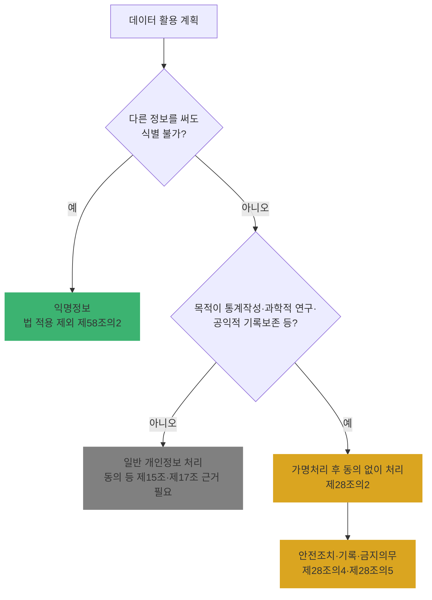

# Ch18. 가명정보의 개념과 처리 특례

| 항목 | 내용 |
|---|---|
| 주차 | 4주차 |
| 컨설팅 영역 | ⑤ 가명정보 관리체계 |
| 핵심 근거 | 「개인정보 보호법」 제2조제1호·제1호의2, 제28조의2, 제28조의7, 제58조의2 / 「가명정보 처리 가이드라인」(2026.3.) |
| 법령 확인일 | 2026-11-11 (법률 제21445호, 가명정보 처리 가이드라인(2026.3.) 원문 대조 — `references/`) |
| 예상 학습 시간 | 2시간 |
| 선수 챕터 | Ch02, Ch08 |

---

## 1. 학습 목표

1. 개인정보·가명정보·익명정보를 구분할 수 있다.
2. 가명정보 특례(동의 없는 처리)의 **목적 요건 3가지**와 **적용 제외 조항**을 설명할 수 있다.
3. 고객사의 가명정보 활용 계획이 특례 대상인지 판정할 수 있다.

---

## 2. 🧩 한 줄 비유

> 가명정보는 **열쇠를 따로 보관한 잠긴 상자**다 — 상자(가명정보)만으로는 누구 것인지 모르지만, 열쇠(추가정보)와 합치면 다시 알 수 있으므로 여전히 개인정보로 취급한다. 열쇠까지 녹여 없애야 **익명정보**가 된다.

---

## 3. 📜 법령 조문

### 3.1 원문 인용

> **「개인정보 보호법」 제2조(정의)**
> 1. "개인정보"란 살아 있는 개인에 관한 정보로서 다음 각 목의 어느 하나에 해당하는 정보를 말한다.
> 가. 성명, 주민등록번호 및 영상 등을 통하여 개인을 알아볼 수 있는 정보
> 나. 해당 정보만으로는 특정 개인을 알아볼 수 없더라도 다른 정보와 쉽게 결합하여 알아볼 수 있는 정보. 이 경우 쉽게 결합할 수 있는지 여부는 다른 정보의 입수 가능성 등 개인을 알아보는 데 소요되는 시간, 비용, 기술 등을 합리적으로 고려하여야 한다.
> 다. 가목 또는 나목을 제1호의2에 따라 가명처리함으로써 원래의 상태로 복원하기 위한 추가 정보의 사용·결합 없이는 특정 개인을 알아볼 수 없는 정보(이하 "가명정보"라 한다)
> 1의2. "가명처리"란 개인정보의 일부를 삭제하거나 일부 또는 전부를 대체하는 등의 방법으로 추가 정보가 없이는 특정 개인을 알아볼 수 없도록 처리하는 것을 말한다.

> **제28조의2(가명정보의 처리 등)**
> ① 개인정보처리자는 **통계작성, 과학적 연구, 공익적 기록보존 등**을 위하여 정보주체의 동의 없이 가명정보를 처리할 수 있다.
> ② 개인정보처리자는 제1항에 따라 가명정보를 제3자에게 제공하는 경우에는 특정 개인을 알아보기 위하여 사용될 수 있는 정보를 포함해서는 아니 된다.

> **제58조의2(적용제외)** 이 법은 시간·비용·기술 등을 합리적으로 고려할 때 다른 정보를 사용하여도 더 이상 개인을 알아볼 수 없는 정보에는 적용하지 아니한다.

> **제2조제8호** "과학적 연구"란 기술의 개발과 실증, 기초연구, 응용연구 및 민간 투자 연구 등 과학적 방법을 적용하는 연구를 말한다.

### 3.2 세 가지 정보 비교

| 구분 | 근거 | 개인 식별 | 「개인정보 보호법」 적용 |
|---|---|---|---|
| 개인정보 | 제2조제1호 가·나목 | 직접 또는 쉽게 결합해 식별 | 전면 적용 |
| 가명정보 | 제2조제1호 다목 | **추가정보 없이는** 식별 불가 | 적용 + 특례(제28조의2~제28조의7) |
| 익명정보 | 제58조의2 | 다른 정보를 써도 **더 이상** 식별 불가 | **적용 제외** |

### 3.3 가명정보에 적용되지 않는 조항 (제28조의7)

> 제28조의2 또는 제28조의3에 따라 처리된 가명정보는 **제20조, 제20조의2, 제27조, 제34조제1항·제2항, 제35조, 제35조의2, 제36조 및 제37조**를 적용하지 아니한다. <개정 2026. 3. 10.>

| 적용 제외 조항 | 의미 |
|---|---|
| 제20조, 제20조의2 | 수집 출처 통지, 이용·제공 내역 통지 |
| 제27조 | 영업양도 시 이전 통지 |
| 제34조제1항·제2항 | 유출 통지·**유출 가능성 통지** (2026 개정으로 제2항 추가) |
| 제35조, 제35조의2, 제36조, 제37조 | 열람, 전송 요구, 정정·삭제, 처리정지 |

> 🟨 **제34조제4항(신고)**과 **제29조(안전조치)**는 제외 대상이 아닙니다.

---

## 4. 🛠 실무 적용

| 구분 | 요구사항 (근거) | 현장 확인 방법 | 증빙 자료 예시 |
|---|---|---|---|
| 관리적 | 처리 목적이 통계·과학적 연구·공익적 기록보존 등에 해당 (제28조의2①) | 활용 계획서 검토 | 가명정보 활용 계획서 |
| 관리적 | 처리방침에 가명정보 처리 사항 기재 (제30조제1항제4호의2) | 처리방침 | 처리방침 |
| 기술적 | 제3자 제공 시 식별 가능 정보 미포함 (제28조의2②) | 제공 데이터 샘플 | 제공 데이터 명세 |
| 기술적 | "익명"이라 주장하는 데이터의 재식별 가능성 (제58조의2) | 결합 가능 정보 검토 | 익명처리 검토서 |
| 물리적 | 가명정보·추가정보 보관 장소 분리 (Ch20) | 현장 | 보관 위치 목록 |

### 4.1 Windows 11 실습 — 식별자 컬럼 탐지

```powershell
# CSV의 컬럼명으로 직접 식별자 후보 표시 (가명처리 대상 1차 선별)
$csv = Import-Csv "$env:USERPROFILE\Desktop\sample.csv" -Encoding UTF8
$direct = '이름|성명|주민|전화|휴대|이메일|주소|계좌|카드|여권|면허|ID|아이디'
$csv[0].PSObject.Properties.Name | ForEach-Object {
  [pscustomobject]@{ 컬럼 = $_; 구분 = $(if ($_ -match $direct) { '식별자 후보' } else { '속성/기타' }) }
}
```

| 확인 항목 | 🟩 양호 | 🟥 취약 |
|---|---|---|
| 직접 식별자 | 삭제 또는 대체(가명처리) | 원본 그대로 분석 환경에 존재 |

> ※ 컬럼명 기반 탐지는 출발점일 뿐입니다. **준식별자**(생년월일+성별+지역 등 조합)는 값의 분포를 봐야 하므로 Ch19의 위험성 검토로 이어집니다.

---

## 5. 🔄 프로세스 다이어그램 — 특례 적용 판정



---

## 6. ⚖ 개인정보보호위원회 위반·처분 사례

| 항목 | 내용 |
|---|---|
| 의결 연도 | 2024년 5월 |
| 피심인 유형 | 메신저 플랫폼 (카카오) — *가명정보 특례 사건은 아니나 "결합에 의한 식별"의 대표 사례* |
| 위반 사실 | 오픈채팅의 임시ID에 **회원일련번호**가 포함되어 있었고 일부는 암호화되지 않음 → 해커가 오픈채팅 참여자 정보와 친구추가 기능으로 얻은 정보를 **회원일련번호 기준으로 결합**해 개인정보 파일을 만들어 판매 |
| 위반 조문 | 🟥 「개인정보 보호법」 제29조 등 |
| 처분 결과 | 🟥 과징금 151억 4,196만 원, 과태료 780만 원, 시정명령, 처분결과 공표 |
| 컨설팅 시사점 | "이름이 없으니 개인정보 아님"은 오답. **일련번호 같은 연결키**가 남아 있으면 다른 정보와 **결합해 식별**(제2조제1호나목) → 가명처리 시 연결키 처리가 핵심 |
| 출처 | 개인정보보호위원회 보도자료 (2024.5.23.) |

---

## 7. ❌ 오답노트

| # | 🟨 흔한 착각 | 🟩 올바른 이해 | 근거 |
|---|---|---|---|
| 1 | "가명정보는 개인정보가 아니다" | 가명정보는 **개인정보의 한 유형**(제2조제1호다목) — 안전조치 의무 그대로 | 제2조, 제28조의4 |
| 2 | "가명처리하면 마케팅에 동의 없이 써도 된다" | 특례 목적은 **통계작성·과학적 연구·공익적 기록보존 등** | 제28조의2① |
| 3 | "가명정보 유출이면 신고도 안 해도 된다" | 제외되는 것은 제34조**제1항·제2항(통지)**뿐, **제4항(신고)은 적용** | 제28조의7 |
| 4 | "이름·전화번호만 지우면 익명정보" | 준식별자 조합·연결키로 재식별 가능하면 익명 아님 | 제58조의2 |
| 5 | "과학적 연구 = 학술 연구만" | 기술 개발·실증, 응용연구, **민간 투자 연구** 포함 | 제2조제8호 |

---

## 8. ✅ 고객사 점검용 체크리스트

| No | 점검 항목 | 근거 조문 | 점검 방법 | 결과 | 비고 |
|---|---|---|---|---|---|
| 1 | 가명정보 처리 목적이 특례 목적에 해당 | 제28조의2① | 계획서 | | |
| 2 | 익명정보 주장 데이터의 재식별 가능성 검토 | 제58조의2 | 검토서 | | |
| 3 | 제3자 제공 시 식별 가능 정보 미포함 | 제28조의2② | 데이터 샘플 | | |
| 4 | 처리방침에 가명정보 처리 사항 기재 | 제30조제1항제4호의2 | 처리방침 | | |
| 5 | 적용 제외 조항 범위를 정확히 이해(신고·안전조치 유지) | 제28조의7 | 인터뷰 | | |

### 8.1 💡 실무 산출물 연계 팁

- **연계 산출물**: 가명정보 활용 계획서, 가명정보 처리 대상 판정표
- **작성 팁**: 판정표에 `데이터명 | 활용 목적 | 특례 목적 해당(통계/연구/공익기록) | 제3자 제공 여부 | 결합 필요 여부(→ Ch20)` 열을 둘 것
- **Excel 활용**: 4.1 실습 결과를 붙여 컬럼별 처리 방법(삭제/대체/범주화) 열 추가 → Ch19 가명처리 계획서 초안

---

## 9. 📝 퀴즈

> 정답·해설: [answers_and_explanations.md](../../answers_and_explanations.md#ch18)

**Q1. (OX)** 가명정보가 유출된 경우 정보주체 통지 의무는 없지만 보호위원회 신고 의무는 있을 수 있다.

**Q2. (객관식)** 제28조의7에 따라 가명정보에 적용되지 **않는** 조항이 아닌 것(=적용되는 것)은?
- ① 제35조(열람) ② 제36조(정정·삭제) ③ 제29조(안전조치의무) ④ 제37조(처리정지)

**Q3. (단답)** 개인정보·가명정보·익명정보를 구분하는 법 조문을 각각 쓰시오.

---

## 10. 📚 참고 자료

- `references/개인정보 보호법(법률)(제21445호)(20260911).pdf`
- `references/가명정보 처리 가이드라인(2026.03.).pdf` — 제1장 개요
- 가명정보 지원 플랫폼: https://dataprivacy.go.kr

---

⬅ [이전: Ch17](../week3/ch17_pia_report.md) | [목차](../../README.md) | [다음: Ch19](ch19_pseudonym_process.md) ➡
