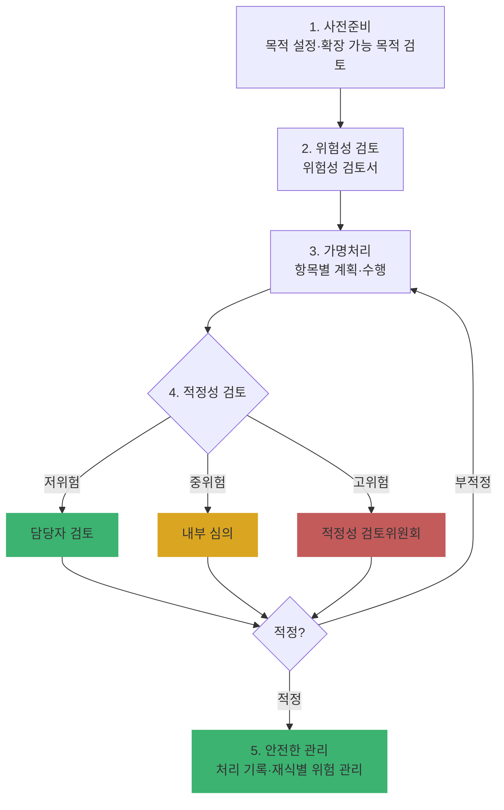

# Ch19. 가명처리 절차와 적정성 검토

| 항목 | 내용 |
|---|---|
| 주차 | 4주차 |
| 컨설팅 영역 | ⑤ 가명정보 관리체계 |
| 핵심 근거 | 「개인정보 보호법」 제2조제1호의2, 제28조의2, 제28조의4제3항 / 시행령 제29조의5제2항 / 「가명정보 처리 가이드라인」(2026.3.) 제2장 |
| 법령 확인일 | 2026-11-11 (법률·시행령·가이드라인(2026.3.) 원문 대조 — `references/`) |
| 예상 학습 시간 | 3시간 |
| 선수 챕터 | Ch18 |

---

## 1. 학습 목표

1. 가명처리 **5단계** 절차와 단계별 산출물을 설명할 수 있다.
2. 위험성 검토 결과에 따라 **적정성 검토 방식**을 차등 적용할 수 있다.
3. 2026년 가이드라인의 **"확장 가능한 목적"** 개념을 적용할 수 있다.

---

## 2. 🧩 한 줄 비유

> 가명처리는 **사진 모자이크**와 같다 — 너무 약하면 얼굴이 보이고(재식별), 너무 세면 무슨 사진인지 모른다(목적 달성 불가). 목표는 **용도에 맞는 적정 강도**다.

---

## 3. 📜 법령 조문

### 3.1 관련 조문

| 조문 | 원문 요지 |
|---|---|
| 법 제2조제1호의2 | 가명처리 = 개인정보의 일부를 **삭제**하거나 일부 또는 전부를 **대체**하는 등의 방법으로 추가 정보가 없이는 특정 개인을 알아볼 수 없도록 처리 |
| 법 제28조의4제3항 | 가명정보 처리 목적, 제3자 제공 시 제공받는 자, 처리 기간(별도로 정한 경우) 등 **관련 기록 작성·보관**, 가명정보 파기 시 **파기한 날부터 3년 이상** 보관 |
| 시행령 제29조의5제2항 | 기록 사항: 1. 처리 목적 2. **가명처리한 개인정보의 항목** 3. 가명정보의 **이용내역** 4. 제3자 제공 시 제공받는 자 5. 처리 기간(별도로 정한 경우) 6. 보호위원회 고시 사항 |
| 법 제28조의4제2항 | 처리목적 등을 고려하여 가명정보의 **처리 기간을 별도로 정할 수 있음** |

### 3.2 가이드라인(2026.3.) 가명처리 5단계

| 단계 | 내용 (가이드라인 원문 요지) | 주요 서류 |
|---|---|---|
| ① 사전준비 | **왜** 가명정보를 활용하려는지 정리 — 처리 목적 설정·검토, 목적에 필요한 가명처리 대상 선정 | 가명정보 활용 계획서 |
| ② 위험성 검토 | 가명처리 **전에** 데이터 자체와 처리환경의 위험성을 검토해 가명처리 방식·수준 판단 | **위험성 검토서** (저·중·고위험 판단 **근거**를 남길 것) |
| ③ 가명처리 | 위험성 검토 결과를 바탕으로 항목별 가명처리 계획 수립·수행. 목표는 재식별 위험 0이 아니라 **목적 달성 + 처리환경 내 재식별 위험 통제** | 가명처리 계획서, 가명처리 결과서 |
| ④ 적정성 검토 | 목적의 적절성, 이용항목 선정, 위험도 판단·가명처리의 적정성, **목적 달성 가능성** 종합 검토 | **적정성 검토 결과서** |
| ⑤ 안전한 관리 | 가명정보를 활용하면서 재식별 위험을 지속 관리 (Ch20) | 처리 기록, 안전조치 증적 |

### 3.3 적정성 검토의 차등 적용 (가이드라인)

| 위험도 | 검토 방식 |
|---|---|
| 🟩 저위험 | **담당자 검토** |
| 🟨 중위험 | **내부 심의** |
| 🟥 고위험 | **적정성 검토위원회** 개최 (외부 전문가 참여 권고) |

> 적정성 검토 결과 **부적정**이면 1~3단계를 다시 수행하거나 부분 추가 가명처리를 해야 합니다 (가이드라인).

### 3.4 2026년 가이드라인 신규 포인트 — "확장 가능한 목적"

> 최초 가명정보 처리 목적 설정 시, 단일 목적 외에 향후 **'유사 목적으로 확장 가능한 목적 범위'**까지 사전에 설정할 수 있음. 단, 적정성 검토 시 **확장 가능 목적까지 고려하여** 가명처리 방법·수준을 검토해야 함. (배경: 범용 목적 AI 개발 확산으로 목적 외 응용·고도화, 미세조정이 빈번)

---

## 4. 🛠 실무 적용

### 4.1 대표 가명처리 기법 (가이드라인 별권 제4장 참고)

| 유형 | 예시 | 적용 대상 |
|---|---|---|
| 삭제 | 이름·전화번호 컬럼 삭제, 부분 삭제 | 직접 식별자 |
| 대체 | 일련번호·해시·토큰으로 대체 | 연결키 (Ch18 카카오 사례 교훈) |
| 범주화 | 나이 → 30대, 주소 → 시·군 단위 | 준식별자 |
| 라운딩 | 소득 → 100만 원 단위 | 수치형 |
| 상·하단 코딩 | 양 끝단의 소수 분포를 범주화 | 희귀값(고소득·고령 등) |

### 4.2 안전성 확보조치 연계

| 구분 | 요구사항 (근거) | 현장 확인 방법 | 증빙 자료 예시 |
|---|---|---|---|
| 관리적 | 5단계 절차·서류 체계 (가이드라인) | 서류 존재·결재 | 활용 계획서, 위험성 검토서, 적정성 검토 결과서 |
| 관리적 | 처리 기록 6개 항목 작성·파기 후 3년 보관 (법 제28조의4③, 시행령 제29조의5②) | 기록 대장 | 가명정보 처리 기록부 |
| 기술적 | 항목별 가명처리 수행 결과와 계획 일치 | 원본·가명 샘플 대조 (보호구역에서) | 가명처리 결과서 |
| 물리적 | 가명처리 작업 공간 통제 | 현장 | 작업 공간 출입 기록 |

### 4.3 Windows 11 실습 — 범주화·대체 가명처리 맛보기

```powershell
# 학습용 샘플: 이름 삭제, 회원번호 → 솔트 해시 대체, 나이 → 연령대, 주소 → 시·도
$salt = [guid]::NewGuid().ToString()   # 추가정보(솔트) — 실무에서는 분리 보관 후 필요 없으면 파기
$sha = [System.Security.Cryptography.SHA256]::Create()
function Get-Token($v){ ($sha.ComputeHash([Text.Encoding]::UTF8.GetBytes("$salt$v")) | ForEach-Object { $_.ToString('x2') }) -join '' }

$raw = @(
  [pscustomobject]@{회원번호='M0001';이름='홍길동';나이=34;주소='서울특별시 강남구';구매액=128000}
  [pscustomobject]@{회원번호='M0002';이름='김영희';나이=58;주소='부산광역시 해운대구';구매액=54000}
)
$raw | ForEach-Object {
  [pscustomobject]@{
    가명ID  = (Get-Token $_.회원번호).Substring(0,16)
    연령대  = '{0}0대' -f [math]::Floor($_.나이 / 10)
    시도    = ($_.주소 -split ' ')[0]
    구매액  = [math]::Round($_.구매액 / 10000) * 10000
  }
} | Format-Table -AutoSize
```

> 🟥 실제 업무에서는 솔트·매핑표 등 **추가정보를 가명정보와 분리 보관**하고 접근 권한도 분리해야 합니다 (시행령 제29조의5제1항, Ch20). 이 스크립트는 기법 이해용입니다.

---

## 5. 🔄 프로세스 다이어그램 — 가명처리 5단계



---

## 6. ⚖ 개인정보보호위원회 위반·처분 사례

| 항목 | 내용 |
|---|---|
| 성격 | 가명처리 적정성 자체를 다룬 처분 사례는 `references/` 자료에서 확인하지 못함 — **허위 사례를 만들지 않습니다** |
| 연계 사례 | **메타(2024.11.)**: 행태정보 분석으로 민감정보 관련 광고주제를 생성 → 과징금 216억 1,300만 원. "가명/분석 데이터이니 괜찮다"는 판단이 **분석 결과물의 민감성**을 놓친 사례로, 위험성 검토 시 **산출물(추론 결과)**까지 검토해야 함을 보여줌 |
| 제재 근거 | 특정 개인을 알아보기 위한 목적의 가명정보 처리: 과징금(법 제64조의2제1항제6호), **5년 이하 징역 또는 5천만 원 이하 벌금**(법 제71조제8호) / 처리 기록 미작성·미보관: 과태료 **300만/600만/1,000만 원**(법 제75조제4항제7호, 시행령 별표 2) |
| 학습 과제 | 가명정보 지원 플랫폼(dataprivacy.go.kr)의 활용 사례 1건을 골라 5단계별 산출물을 역으로 추정해 보라 |

---

## 7. ❌ 오답노트

| # | 🟨 흔한 착각 | 🟩 올바른 이해 | 근거 |
|---|---|---|---|
| 1 | "가명처리 목표는 재식별 위험 0" | 목표는 **목적 달성 + 처리환경 내 재식별 위험 통제** | 가이드라인 제2장 |
| 2 | "적정성 검토는 항상 외부 위원회" | 위험도에 따라 **담당자 검토 / 내부 심의 / 위원회** 차등 | 가이드라인 |
| 3 | "위험성 검토서에 '저위험' 표시만 하면 된다" | 왜 그 위험도인지 **근거**를 남겨야 함 | 가이드라인 |
| 4 | "목적이 바뀌면 무조건 처음부터 다시" | 최초 설정 시 **확장 가능한 목적 범위**를 함께 정할 수 있음 (단, 적정성 검토에 반영) | 가이드라인(2026.3.) |
| 5 | "처리 기록은 가명정보 파기와 함께 삭제" | 파기한 날부터 **3년 이상** 보관 | 법 제28조의4③ |

---

## 8. ✅ 고객사 점검용 체크리스트

| No | 점검 항목 | 근거 | 점검 방법 | 결과 | 비고 |
|---|---|---|---|---|---|
| 1 | 처리 목적(확장 가능 목적 포함) 구체적 설정 | 가이드라인 1단계 | 계획서 | | |
| 2 | 위험성 검토서 작성 및 판단 근거 기재 | 가이드라인 2단계 | 검토서 | | |
| 3 | 항목별 가명처리 계획·결과 | 가이드라인 3단계 | 계획·결과서 | | |
| 4 | 위험도별 적정성 검토 방식 적용 | 가이드라인 4단계 | 결과서 | | |
| 5 | 부적정 시 재처리 이력 | 가이드라인 4단계 | 이력 | | |
| 6 | 처리 기록 6개 항목 및 파기 후 3년 보관 | 법 제28조의4③, 시행령 제29조의5② | 기록부 | | |

### 8.1 💡 실무 산출물 연계 팁

- **연계 산출물**: 가명정보 활용 계획서 → 위험성 검토서 → 가명처리 계획·결과서 → 적정성 검토 결과서 (가이드라인 별권 제5장 서식 활용)
- **작성 팁**: 모든 서류에 동일한 **가명처리 건 ID**를 부여해 추적성 확보 (Ch16 업무 ID 방식과 동일)
- **Excel 활용**: 처리 기록부 열 = 시행령 제29조의5제2항 1~5호 + 파기일 + 기록 보관 만료일(`=파기일+365*3`)

---

## 9. 📝 퀴즈

> 정답·해설: [answers_and_explanations.md](../../answers_and_explanations.md#ch19)

**Q1. (OX)** 가명처리의 목표는 재식별 위험을 0으로 만드는 것이다.

**Q2. (객관식)** 가이드라인상 고위험 가명처리 건의 적정성 검토 방식은?
- ① 담당자 검토 ② 내부 심의 ③ 적정성 검토위원회 ④ 생략 가능

**Q3. (단답)** 시행령 제29조의5제2항의 가명정보 처리 기록 사항 5가지를 쓰시오(고시 사항 제외).

---

## 10. 📚 참고 자료

- `references/가명정보 처리 가이드라인(2026.03.).pdf` — 제2장 가명처리 절차, 별권 제4장(기법)·제5장(서식)
- `references/개인정보 보호법 시행령(대통령령)(제36804호)(20261110).pdf` — 제29조의5

---

⬅ [이전: Ch18](ch18_pseudonym_concept.md) | [목차](../../README.md) | [다음: Ch20](ch20_pseudonym_safeguard.md) ➡
