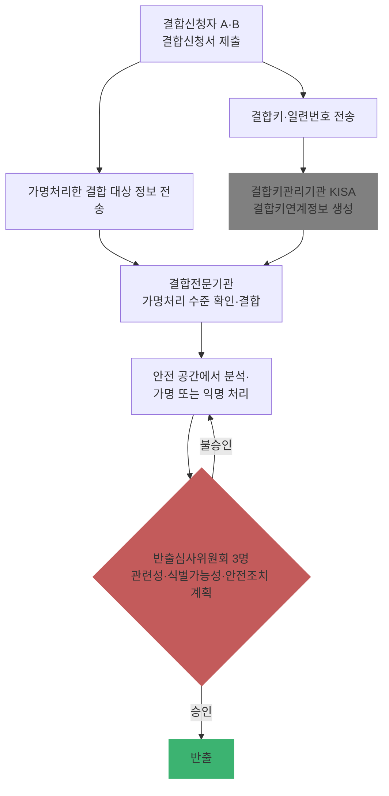

# Ch20. 가명정보 안전조치·결합·금지의무

| 항목 | 내용 |
|---|---|
| 주차 | 4주차 |
| 컨설팅 영역 | ⑤ 가명정보 관리체계 |
| 핵심 근거 | 「개인정보 보호법」 제28조의3, 제28조의4, 제28조의5, 제71조, 제75조 / 시행령 제29조의2~제29조의5 / 「가명정보의 결합 및 반출 등에 관한 고시」(제2025-8호) |
| 법령 확인일 | 2026-11-11 (법률·시행령·별표 2, 결합 고시 제2025-8호 원문 대조 — `references/`) |
| 예상 학습 시간 | 3시간 |
| 선수 챕터 | Ch19 |

---

## 1. 학습 목표

1. 가명정보 안전조치 3요소(일반 안전조치·**분리 보관**·**접근 권한 분리**)를 점검할 수 있다.
2. 서로 다른 처리자 간 **결합 절차**(결합키관리기관 → 결합전문기관 → 반출심사)를 설명할 수 있다.
3. 금지의무 위반 시 제재(과징금·벌칙·과태료)를 구분할 수 있다.

---

## 2. 🧩 한 줄 비유

> 가명정보 결합은 **은행 대여금고**와 같다 — 두 회사가 각자 상자를 맡기면 금고(결합전문기관) 안에서만 열어 합치고, 밖으로 가져가려면 심사(반출심사위원회)를 받아야 한다.

---

## 3. 📜 법령 조문

### 3.1 안전조치 (법 제28조의4제1항 + 시행령 제29조의5제1항)

> **법 제28조의4제1항** 개인정보처리자는 제28조의2 또는 제28조의3에 따라 가명정보를 처리하는 경우에는 원래의 상태로 복원하기 위한 **추가 정보를 별도로 분리하여 보관·관리**하는 등 해당 정보가 유출 등이 되지 아니하도록 대통령령으로 정하는 바에 따라 안전성 확보에 필요한 기술적·관리적 및 물리적 조치를 하여야 한다. <개정 2023. 3. 14., 2026. 3. 10.>

| 시행령 제29조의5제1항 | 내용 |
|---|---|
| 제1호 | 시행령 제30조에 따른 **일반 안전성 확보 조치** (= 안전성 확보조치 기준 고시 전체, Ch03~Ch05) |
| 제2호 | 가명정보와 추가정보의 **분리 보관**. 추가정보가 불필요하면 **파기** |
| 제3호 | 가명정보와 추가정보에 대한 **접근 권한의 분리**. 단, 소상공인 등 정당한 사유가 있으면 최소 권한 부여 + 권한 보유 현황 기록 |

### 3.2 금지의무 (법 제28조의5)

> ① 가명정보를 처리하는 자는 **특정 개인을 알아보기 위한 목적**으로 가명정보를 처리해서는 아니 된다.
> ② 가명정보를 처리하는 과정에서 특정 개인을 알아볼 수 있는 정보가 **생성된 경우에는 즉시 처리를 중지하고, 지체 없이 회수·파기**하여야 한다.

### 3.3 결합 (법 제28조의3 + 시행령 제29조의3 + 결합 고시)

| 근거 | 내용 |
|---|---|
| 법 제28조의3① | 서로 다른 개인정보처리자 간 가명정보 결합은 보호위원회 또는 관계 중앙행정기관의 장이 지정하는 **전문기관**이 수행 |
| 법 제28조의3② | 결합 기관 외부로 반출하려면 **가명정보 또는 익명정보(제58조의2)로 처리한 뒤 전문기관의 장의 승인** |
| 고시 제2조 | **결합키**: 그 자체로는 식별 불가하나 다른 결합 대상 정보와 구별되도록 조치한 정보 / **결합키관리기관**: 결합키연계정보를 생성해 결합전문기관에 제공하는 **한국인터넷진흥원** |
| 시행령 제29조의3① | 결합신청서 + 사업자 서류, 결합 대상 가명정보 서류, **결합 목적 증명 서류** 등 제출 |
| 고시 제9조 | 결합신청자 → 결합키·일련번호를 **결합키관리기관**에 전송 → 결합키연계정보 생성 / 가명처리한 결합 대상 정보는 **결합전문기관**에 전송 (가명처리 수준 확인·추가 처리 요청 가능) |
| 고시 제9조의3 | 본 결합 전 **모의결합**으로 유용성 사전 확인 가능 |
| 시행령 제29조의3③, 고시 제10조 | 결합전문기관에 설치된 **안전 공간**에서 가명정보 또는 익명정보로 처리·분석 |
| 시행령 제29조의3④ | 반출 승인 기준: 1. 결합 목적과 반출 정보의 **관련성** 2. **특정 개인을 알아볼 가능성이 없을 것** 3. 반출 정보 **안전조치 계획** + **반출심사위원회** 구성 |
| 고시 제11조 | 반출 요청 시 **영업일 5일 이내** 일정 통지, 반출심사위원회 **3명**(개인정보 보호 전문가 등 고루 포함) |

### 3.4 제재 (원문 대조)

| 위반 | 근거 | 제재 |
|---|---|---|
| 특정 개인을 알아보기 위한 목적으로 처리 | 법 제28조의5① | **과징금**(법 제64조의2제1항제6호) + **5년 이하 징역 또는 5천만 원 이하 벌금**(법 제71조제8호) |
| 지정받지 않고 결합 / 승인 없이 반출 | 법 제28조의3①·② | 5년 이하 징역 또는 5천만 원 이하 벌금 (법 제71조제6호·제7호) |
| 식별 정보 생성 시 처리 중지·회수·파기 미이행 | 법 제28조의5② | 과태료 900만/1,800만/3,000만 원 (법 제75조제2항제13호) |
| 가명정보 안전조치 미이행 | 법 제28조의4① | 과태료 900만/1,800만/3,000만 원 (법 제75조제2항제5호) |
| 처리 기록 미작성·미보관 | 법 제28조의4③ | 과태료 300만/600만/1,000만 원 (법 제75조제4항제7호) |

> 금액은 시행령 별표 2 개별기준(1회/2회/3회 이상)입니다.

---

## 4. 🛠 실무 적용

| 구분 | 요구사항 (근거) | 현장 확인 방법 | 증빙 자료 예시 |
|---|---|---|---|
| 관리적 | 가명정보 취급자와 추가정보 관리자 **분리 지정** (시행령 제29조의5①3) | 담당자 지정 문서 | 역할 분장표 |
| 관리적 | 재식별 발생 시 중지·회수·파기 절차 (법 제28조의5②) | 절차서 | 재식별 대응 절차서 |
| 기술적 | 추가정보 **별도 서버·DB·암호화 저장소**에 분리 (시행령 제29조의5①2) | 저장 위치 확인 | 시스템 구성도 |
| 기술적 | 접근 권한 분리 및 접속기록 (고시 제5조, 제8조) | 계정·권한 목록 | 권한 대장 |
| 물리적 | 분석 공간·매체 반출입 통제 (고시 제10조) | 현장 | 출입 기록 |

### 4.1 Windows 11 실습 — 추가정보 폴더 권한 분리 확인

```powershell
# 가명정보 폴더와 추가정보 폴더의 접근 권한(ACL) 비교 — 같은 사람이 둘 다 접근 가능한지 확인
$pseudo = "D:\가명정보"; $extra = "D:\추가정보"
$a = (Get-Acl $pseudo).Access | Where-Object { $_.AccessControlType -eq 'Allow' } | Select-Object -Expand IdentityReference
$b = (Get-Acl $extra ).Access | Where-Object { $_.AccessControlType -eq 'Allow' } | Select-Object -Expand IdentityReference
$both = Compare-Object $a $b -IncludeEqual -ExcludeDifferent -PassThru |
        Where-Object { $_ -notmatch 'SYSTEM|Administrators|CREATOR OWNER' }
if ($both) { "🟥 두 폴더 모두 접근 가능한 계정: $($both -join ', ')" } else { "🟩 일반 계정 기준 접근 권한 분리됨" }
```

| 확인 항목 | 🟩 양호 | 🟥 취약 |
|---|---|---|
| 추가정보 위치 | 별도 서버·저장소, 암호화 | 가명정보와 같은 폴더·DB 테이블 |
| 권한 | 담당자가 다름 | 동일 계정이 양쪽 접근 |

> ※ 경로는 예시입니다. 관리자 계정·SYSTEM은 운영상 양쪽 접근이 가능하므로 **관리자 접근 기록(접속기록)**을 별도로 점검하십시오.

---

## 5. 🔄 프로세스 다이어그램 — 가명정보 결합·반출



---

## 6. ⚖ 개인정보보호위원회 위반·처분 사례

| 항목 | 내용 |
|---|---|
| 의결 연도 | 2025년 1월 |
| 피심인 유형 | 간편결제 사업자 (카카오페이)·애플 — *가명정보 특례 사건은 아니나 "식별자를 해시하면 괜찮다"는 오해의 반례* |
| 위반 사실 | 카카오페이가 알리페이에 보낸 정보에 내부고객번호·휴대전화번호·이메일주소가 **해시값**으로 포함되어 있었으나, 이는 이용자별 NSF 점수 산출에 쓰인 **개인정보**로 다뤄졌고, 제3자 제공·국외 이전 **동의 없이** 전송한 것이 위반으로 판단됨 |
| 위반 조문 | 🟥 「개인정보 보호법」 제28조의8제1항 등 |
| 처분 결과 | 🟥 카카오페이 과징금 59억 6,800만 원, 애플 과징금 24억 500만 원·과태료 220만 원, **알리페이에 NSF 모델 파기** 시정명령 |
| 컨설팅 시사점 | 해시는 **대체(가명처리) 기법**일 뿐, 이용자별 점수를 산출해 개인에게 적용하는 순간 **특정 개인 대상 처리** → 가명정보 특례(통계·연구 등)로 정당화할 수 없음. 결합·분석 결과를 개인 단위로 되돌려 쓰는지 반드시 확인 |
| 출처 | 개인정보보호위원회 보도자료 (2025.1.23.) |

---

## 7. ❌ 오답노트

| # | 🟨 흔한 착각 | 🟩 올바른 이해 | 근거 |
|---|---|---|---|
| 1 | "추가정보는 가명정보 옆 테이블에 두면 편하다" | **분리 보관** + **접근 권한 분리** | 시행령 제29조의5①2·3 |
| 2 | "결합은 두 회사가 합의하면 직접 해도 된다" | **지정 전문기관**만 수행, 위반 시 **형사처벌** | 법 제28조의3①, 제71조제6호 |
| 3 | "결합 결과는 결합신청자가 바로 가져간다" | 안전 공간에서 처리 후 **반출심사위원회 승인** | 법 제28조의3②, 시행령 제29조의3④ |
| 4 | "분석 중 우연히 재식별되면 보고만 하면 된다" | **즉시 처리 중지, 지체 없이 회수·파기** | 법 제28조의5② |
| 5 | "식별자를 해시하면 개인정보가 아니다" | 해시는 가명처리 기법 — 개인 단위 적용·결합 가능하면 개인정보 | 법 제2조제1호 |

---

## 8. ✅ 고객사 점검용 체크리스트

| No | 점검 항목 | 근거 조문 | 점검 방법 | 결과 | 비고 |
|---|---|---|---|---|---|
| 1 | 일반 안전성 확보조치 적용 | 시행령 제29조의5①1 | Ch03~05 체크리스트 | | |
| 2 | 추가정보 분리 보관·불필요 시 파기 | 시행령 제29조의5①2 | 저장 위치 | | |
| 3 | 가명정보·추가정보 접근 권한 분리 | 시행령 제29조의5①3 | ACL·권한 대장 | | |
| 4 | 처리 기록 작성·파기 후 3년 보관 | 법 제28조의4③ | 기록부 | | |
| 5 | 재식별 시 중지·회수·파기 절차 | 법 제28조의5② | 절차서 | | |
| 6 | 타 기관 결합은 지정 전문기관 경유 | 법 제28조의3① | 결합 신청 이력 | | |
| 7 | 반출 승인서 보관 | 법 제28조의3②, 고시 제11조 | 승인서 | | |

### 8.1 💡 실무 산출물 연계 팁

- **연계 산출물**: 가명정보 관리 규정(내부 관리계획 부속), 재식별 대응 절차서, 결합 신청 패키지
- **작성 팁**: 내부 관리계획 제4조제1항제18호("그 밖에 필요한 사항")에 **가명정보 장(章)**을 추가하면 안전조치 고시 체계와 한 문서로 관리 가능
- **Excel 활용**: 가명정보 대장 `건ID | 목적 | 항목 | 추가정보 위치 | 추가정보 관리자 | 가명정보 취급자 | 처리기간 | 파기일 | 기록 보관 만료일`

---

## 9. 📝 퀴즈

> 정답·해설: [answers_and_explanations.md](../../answers_and_explanations.md#ch20)

**Q1. (OX)** 결합키관리기관은 한국인터넷진흥원이다.

**Q2. (객관식)** 특정 개인을 알아보기 위한 목적으로 가명정보를 처리한 경우의 형사처벌은?
- ① 1년 이하 징역 또는 1천만 원 이하 벌금 ② 3년 이하 징역 또는 3천만 원 이하 벌금 ③ 5년 이하 징역 또는 5천만 원 이하 벌금 ④ 형사처벌 없음

**Q3. (단답)** 시행령 제29조의3제4항의 반출 승인 기준 3가지를 쓰시오.

---

## 10. 📚 참고 자료

- `references/가명정보의 결합 및 반출 등에 관한 고시(개인정보보호위원회고시)(제2025-8호)(20250909).pdf`
- `references/가명정보 처리 가이드라인(2026.03.).pdf`
- `references/[별표 2] 과태료의 부과기준(제63조 관련)(개인정보 보호법 시행령).pdf`

---

⬅ [이전: Ch19](ch19_pseudonym_process.md) | [목차](../../README.md) | [다음: Ch21](ch21_new_issues.md) ➡
