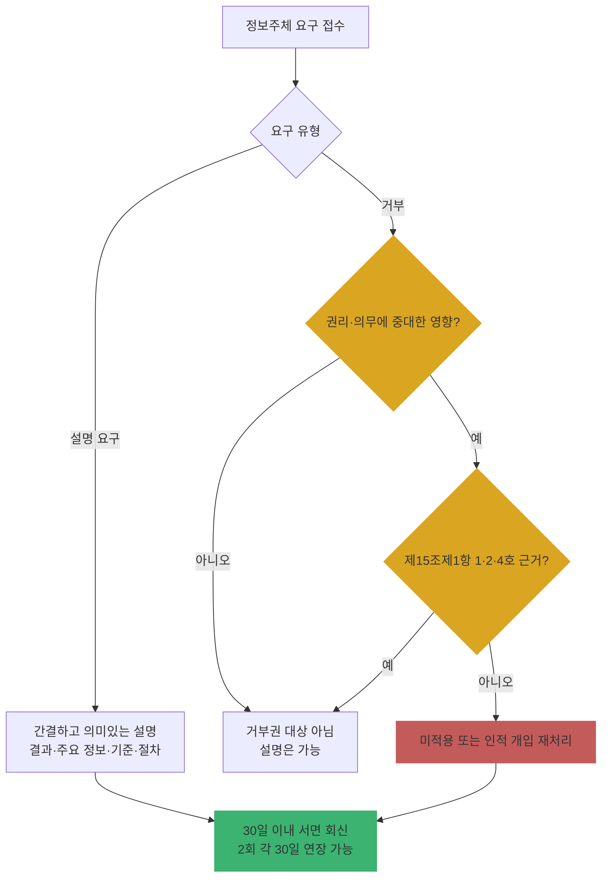

# Ch21. 신규 이슈 — 자동화된 결정·이동형 영상정보처리기기·AI

| 항목 | 내용 |
|---|---|
| 주차 | 4주차 |
| 컨설팅 영역 | 공통 (PIA 평가분야 23~29, 보호수준 평가 가점 연계) |
| 핵심 근거 | 「개인정보 보호법」 제25조의2, 제37조의2, 제28조의12~제28조의15(시행 예정) / 시행령 제27조의2, 제44조의2~제44조의4 / 관련 안내서 3종 |
| 법령 확인일 | 2026-11-11 (법률 제21445호, **2027.7.1. 시행본**(제28조의12~15 포함), 시행령 제36804호·별표 2, 「자동화된 결정에 대한 정보주체의 권리 안내서」(2024.9.), 「이동형 영상정보처리기기를 위한 개인영상정보 보호·활용 안내서」(2024.9.), 「생성형 인공지능(AI) 개발·활용을 위한 개인정보 처리 안내서」(2025.8.) 원문 대조 — `references/`) |
| 예상 학습 시간 | 3시간 |
| 선수 챕터 | Ch02, Ch17, Ch18 |

---

## 1. 학습 목표

1. 자동화된 결정에 대한 **거부권·설명요구권**의 요건과 처리자의 조치 의무를 설명할 수 있다.
2. 이동형 영상정보처리기기 촬영의 허용 요건과 **촬영 사실 표시** 방법을 점검할 수 있다.
3. 2027년 시행 예정인 **AI 기술 개발을 위한 개인정보 이용 특례**의 구조를 설명할 수 있다.

---

## 2. 🧩 한 줄 비유

> 자동화된 결정은 **심판 없는 VAR 판정**이다 — 기계가 판정해도 선수(정보주체)는 "사람이 다시 봐 달라(거부)" 또는 "왜 그렇게 판정했나(설명)"를 요구할 수 있다.

---

## 3. 📜 법령 조문

### 3.1 자동화된 결정 (법 제37조의2)

> ① 정보주체는 **완전히 자동화된 시스템(인공지능 기술을 적용한 시스템을 포함한다)**으로 개인정보를 처리하여 이루어지는 결정(「행정기본법」 제20조에 따른 행정청의 자동적 처분은 제외하며, 이하 "자동화된 결정"이라 한다)이 자신의 **권리 또는 의무에 중대한 영향**을 미치는 경우에는 해당 개인정보처리자에 대하여 해당 결정을 **거부할 수 있는 권리**를 가진다. 다만, 자동화된 결정이 **제15조제1항제1호·제2호 및 제4호**에 따라 이루어지는 경우에는 그러하지 아니하다.
> ② 정보주체는 개인정보처리자가 자동화된 결정을 한 경우에는 그 결정에 대하여 **설명 등을 요구**할 수 있다.
> ③ 개인정보처리자는 … 정당한 사유가 없는 한 자동화된 결정을 적용하지 아니하거나 **인적 개입에 의한 재처리·설명** 등 필요한 조치를 하여야 한다.
> ④ 개인정보처리자는 자동화된 결정의 기준과 절차, 개인정보가 처리되는 방식 등을 정보주체가 쉽게 확인할 수 있도록 **공개**하여야 한다.

| 시행령 | 요지 |
|---|---|
| 제44조의3① | 거부 시: 1. 자동화된 결정을 **적용하지 않는 조치** 또는 2. **인적 개입에 의한 재처리** 후 결과 통지 |
| 제44조의3② | 설명 요구 시 "간결하고 의미있는 설명": 1. 결정의 결과 2. 사용된 주요 개인정보 유형 3. 그 유형이 결정에 미친 영향 등 **주요 기준** 4. 처리 과정 등 **절차** |
| 제44조의3 | 요구를 받은 날부터 **30일 이내** 서면등으로 조치, 부득이한 경우 사유 통지 후 **2회에 한정하여 각 30일** 연장 |
| 제44조의4① | 홈페이지 등 공개 사항: 1. 자동화된 결정이 이루어진다는 사실·목적·대상 범위 2. 주요 개인정보 유형과 결정의 관계 3. 고려사항 및 처리 절차 4. 민감정보·14세 미만 아동 정보 처리 시 목적 등 |

> 🟨 **거부권 vs 설명요구권**: 거부권은 "중대한 영향" + 동의(제1호)·법률(제2호)·계약(제4호) 근거가 **아닌** 경우에만 성립. **설명요구권은 이런 제한 없이** 자동화된 결정 전반에 인정됨.

### 3.2 이동형 영상정보처리기기 (법 제25조의2)

| 항 | 요지 |
|---|---|
| ① | 업무 목적 이동형 기기로 **공개된 장소**에서 사람 영상 촬영 금지. 예외: 1. **제15조제1항 각 호** 해당 2. **촬영 사실을 명확히 표시**했는데 정보주체가 **거부 의사를 밝히지 않은** 경우(권리 부당 침해 우려 없고 합리적 범위 내) 3. 대통령령으로 정하는 경우 |
| ② | 목욕실·화장실·발한실·탈의실 등 내부를 볼 수 있는 곳에서 촬영 금지 (인명 구조·구급 등 예외) |
| ③ | 촬영 시 **불빛, 소리, 안내판** 등으로 촬영 사실 표시 |
| 시행령 제27조의2 | 불빛·소리·안내판·안내서면·안내방송 등으로 표시. **드론 항공촬영** 등 알리기 어려우면 **보호위원회 구축 인터넷 사이트에 공지** 가능 |

### 3.3 AI 기술 개발을 위한 개인정보 이용 특례 (법률 제21910호, 2026.9.8. 공포, **공포 후 6개월 경과일 시행 — 2026-11-11 현재 시행 전**)

| 조문 | 요지 |
|---|---|
| 제28조의12① | **보호위원회 심의·의결**을 거치면 적법하게 수집한 개인정보를 AI 기술 개발(성능 개선 포함) 목적으로 **목적 외 이용** 가능. 요건 모두 충족: 1. **익명·가명 처리로는 개발이 어려울 것** 2. 안전한 환경·추가 안전조치 등 **대통령령 기준 안전장치** 3. **공공의 이익** 또는 정보주체·제3자 이익 보호·사회적 이익 증진 목적 + 부당 침해 우려가 **현저히 낮을 것** |
| 제28조의13 | 보호위원회의 **주기적 이행 관리·감독**, 자료제출 요구 |
| 제28조의14 | 거짓 의결, 요건·조건 미충족, **6개월 내 처리 미개시**, 목적 달성 불가 시 처리 **전부 제한** |
| 제28조의15 | 이용 특례에 따른 적용의 일부 제외 |

### 3.4 생성형 AI 안내서(2025.8.)의 생애주기 4단계 + 거버넌스

| 단계 | 핵심 |
|---|---|
| 1. 목적 설정 | 사용 맥락·대상·기술적 한계를 고려한 구체적 목적 |
| 2. 전략 수립 | 조직 ICT 역량 진단, 개발·활용 방식과 리스크 관리 전략 |
| 3. AI 학습 및 개발 | 학습 데이터 적법 근거, 안전조치 |
| 4. 시스템 적용 및 관리 | 운영 중 개인정보 노출 방지, 정보주체 권리 보장 |
| 5. AI 프라이버시 거버넌스 | **CPO 중심** 내부 관리체계, 개발·보안 부서와 협력, 초기부터 참여 |

### 3.5 위반 시 과태료 (시행령 별표 2, 1회/2회/3회 이상)

| 위반 | 근거 | 금액 |
|---|---|---|
| 이동형 기기 촬영 제한 위반 | 법 제25조의2① | 900만 / 1,800만 / 3,000만 원 |
| 자동화된 결정 거부·설명 요구에 따른 조치 미이행 | 법 제37조의2③ | 900만 / 1,800만 / 3,000만 원 |

---

## 4. 🛠 실무 적용

| 구분 | 요구사항 (근거) | 현장 확인 방법 | 증빙 자료 예시 |
|---|---|---|---|
| 관리적 | 자동화된 결정 해당 업무 식별 (법 제37조의2①) | 업무 목록·인터뷰 | 자동화 결정 목록 |
| 관리적 | 기준·절차 공개 4개 항목 (시행령 제44조의4) | 홈페이지 | 공개 화면 |
| 관리적 | 거부·설명 요구 접수·30일 처리 절차 (시행령 제44조의3) | 절차서·처리 대장 | 요구 처리 대장 |
| 관리적 | AI 프로젝트에 CPO 초기 참여 (생성형 AI 안내서) | 회의록 | 거버넌스 문서 |
| 기술적 | 인적 개입 재처리 기능 (법 제37조의2③) | 시스템 시연 | 재처리 화면 |
| 기술적 | 설명 생성에 필요한 결정 로그 보관 | 로그 샘플 | 결정 로그 |
| 물리적 | 이동형 기기 촬영 표시(불빛·소리·안내판) (법 제25조의2③, 시행령 제27조의2) | 기기 실물·현장 | 표시 사진 |

### 4.1 Windows 11 실습 — 자동화된 결정 요구 처리 기한 계산

```powershell
# 거부·설명 요구 접수일 기준 처리 기한(30일)과 최대 연장 기한(2회 × 30일) 계산
$recv = Get-Date "2026-11-11"
[pscustomobject]@{
  '접수일'        = $recv.ToString('yyyy-MM-dd')
  '기본기한_30일' = $recv.AddDays(30).ToString('yyyy-MM-dd')
  '1차연장'       = $recv.AddDays(60).ToString('yyyy-MM-dd')
  '2차연장_최대'  = $recv.AddDays(90).ToString('yyyy-MM-dd')
}
```

> ※ 연장은 **부득이한 사유를 정보주체에게 알린 경우**에만 가능합니다. 기간 계산의 초일 산입 여부는 고객사 법무 검토를 따르십시오.

---

## 5. 🔄 프로세스 다이어그램 — 자동화된 결정 대응



---

## 6. ⚖ 개인정보보호위원회 위반·처분 사례

| 항목 | 내용 |
|---|---|
| 의결 연도 | 2025년 1월 |
| 피심인 유형 | 간편결제 사업자 (카카오페이)·애플·알리페이 |
| 위반 사실 | 애플의 수탁자 알리페이가 이용자별 **NSF 점수**(소액결제 묶음 청구 시 자금부족 가능성)를 산출하는 **모델**을 만들기 위해, 카카오페이가 이용자 정보를 동의 없이 국외 이전. 2019.6.~2024.5. 매일 이용자별 점수 산출 |
| 위반 조문 | 🟥 「개인정보 보호법」 제28조의8제1항(국외 이전) 등 |
| 처분 결과 | 🟥 총 83억 7,520만 원(카카오페이 과징금 59억 6,800만 원, 애플 과징금 24억 500만 원·과태료 220만 원), **알리페이에 NSF 점수 산출 모델 파기** 시정명령 |
| 컨설팅 시사점 | ① 개인별 점수로 결제 방식을 결정하는 구조는 **자동화된 결정** 검토 대상이 될 수 있음 ② 위법하게 확보한 데이터로 만든 **AI·통계 모델 자체가 파기 대상** — AI 특례(2027 시행)도 **보호위원회 심의·의결**이라는 사전 통제를 거치는 이유 |
| 출처 | 개인정보보호위원회 보도자료 (2025.1.23.) |

---

## 7. ❌ 오답노트

| # | 🟨 흔한 착각 | 🟩 올바른 이해 | 근거 |
|---|---|---|---|
| 1 | "AI가 추천만 하고 사람이 최종 결정하면 자동화된 결정" | **완전히 자동화된** 시스템의 결정이 대상 — 실질적 인적 개입이 있으면 해당하지 않을 수 있음 (개입의 실질성 검토) | 법 제37조의2①, 안내서 |
| 2 | "동의받았으니 설명 요구도 거절 가능" | 동의·계약 근거면 **거부권**만 제한, **설명요구권은 유지** | 법 제37조의2①② |
| 3 | "공공기관의 자동 과태료 부과도 거부 가능" | 「행정기본법」 제20조 **행정청의 자동적 처분은 제외** | 법 제37조의2① |
| 4 | "드론 촬영은 표시 방법이 없으니 의무 없음" | 보호위원회 구축 **인터넷 사이트 공지**로 알릴 수 있음 | 시행령 제27조의2 |
| 5 | "AI 학습 특례가 생겼으니 지금부터 목적 외 이용 가능" | 2026-11-11 현재 **시행 전**, 시행 후에도 **보호위원회 심의·의결** + 3가지 요건 필수 | 법 제28조의12, 부칙 |

---

## 8. ✅ 고객사 점검용 체크리스트

| No | 점검 항목 | 근거 조문 | 점검 방법 | 결과 | 비고 |
|---|---|---|---|---|---|
| 1 | 자동화된 결정 업무 식별·목록화 | 법 제37조의2① | 인터뷰·문서 | | |
| 2 | 기준·절차 공개 4개 항목 | 시행령 제44조의4① | 홈페이지 | | |
| 3 | 거부·설명 요구 30일 처리 절차·대장 | 시행령 제44조의3 | 절차서·대장 | | |
| 4 | 인적 개입 재처리 기능 | 법 제37조의2③ | 시연 | | |
| 5 | 이동형 기기 촬영 근거·표시 방법 | 법 제25조의2, 시행령 제27조의2 | 기기·현장 | | |
| 6 | 사생활 침해 장소 촬영 금지 통제 | 법 제25조의2② | 운영 지침 | | |
| 7 | AI 프로젝트 CPO 참여·거버넌스 | 생성형 AI 안내서 | 회의록 | | |
| 8 | AI 학습 특례 활용 계획 시 심의·의결 준비 | 법 제28조의12 (시행 예정) | 계획서 | | 시행일 확인 |

### 8.1 💡 실무 산출물 연계 팁

- **연계 산출물**: 자동화된 결정 공개 문안, 거부·설명 요구 처리 절차서, 이동형 기기 운영 지침, AI 프라이버시 거버넌스 체계도
- **작성 팁**: 공개 문안은 시행령 제44조의4제1항 1~4호를 **소제목 그대로** 사용하면 누락 점검이 쉬움
- **Excel 활용**: 요구 처리 대장 `접수일 | 유형(거부/설명) | 대상 결정 | 기한(=접수일+30) | 연장 여부 | 회신일 | 조치(미적용/재처리/설명)`

---

## 9. 📝 퀴즈

> 정답·해설: [answers_and_explanations.md](../../answers_and_explanations.md#ch21)

**Q1. (OX)** 정보주체 동의를 받아 이루어진 자동화된 결정에 대해서는 설명 요구도 할 수 없다.

**Q2. (객관식)** 시행령 제27조의2에 따라 드론 항공촬영처럼 촬영 사실을 알리기 어려운 경우의 방법은?
- ① 표시 의무 면제 ② 보호위원회가 구축하는 인터넷 사이트에 공지 ③ 사후 서면 통지 ④ 지자체 신고

**Q3. (단답)** 법 제28조의12제1항의 AI 기술 개발 특례 요건 3가지를 쓰시오.

---

## 10. 📚 참고 자료

- `references/★자동화된 결정에 대한 정보주체의 권리 안내서(2024.9).pdf`
- `references/이동형 영상정보처리기기를 위한 개인영상정보 보호·활용 안내서(2024.9.).pdf`
- `references/★고정형 영상정보처리기기 설치 운영 안내서(2024.12).pdf`
- `references/생성형 인공지능(AI) 개발·활용을 위한 개인정보 처리 안내서(2025.8.).pdf`
- `references/개인정보 보호법(법률)(제21445호)(20270701).pdf` — 제28조의12~15

---

⬅ [이전: Ch20](ch20_pseudonym_safeguard.md) | [목차](../../README.md) | [다음: Ch22](ch22_capstone.md) ➡
