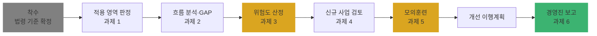

# Ch22. 종합 실습 — 가상 고객사 컨설팅 수행

| 항목 | 내용 |
|---|---|
| 주차 | 4주차 |
| 컨설팅 영역 | ①~⑤ 전 영역 통합 |
| 핵심 근거 | Ch01~Ch21 전 범위 (법률 제21445호, 시행령 제36804호, 고시 제2026-9호 등) |
| 법령 확인일 | 2026-11-11 (`references/` 원문 기준) |
| 예상 학습 시간 | 6시간 (2일 분할 권장) |
| 선수 챕터 | Ch01 ~ Ch21 |

---

## 1. 학습 목표

1. 하나의 고객사에 5대 컨설팅 영역 중 **무엇이 적용되는지** 판정할 수 있다.
2. 현황 진단 → GAP → 위험도 → 개선 이행계획까지 **산출물 세트**를 완성할 수 있다.
3. 경영진 보고용 요약(1페이지)을 작성할 수 있다.

---

## 2. 🧩 한 줄 비유

> 종합 실습은 **종합건강검진**이다 — 혈액(관리체계), 내시경(실태점검), 정밀 CT(영향평가), 특수검사(가명정보)를 한 사람에게 모두 적용하고, 마지막에 의사 소견서(경영진 보고서)를 쓴다.

---

## 3. 📜 시나리오 — 가상 고객사 "㈜한빛헬스케어" (가상 기업)

> ⚠ 아래 기업과 수치는 **학습용 가상 설정**이며 실제 기업과 무관합니다.

| 항목 | 내용 |
|---|---|
| 업종 | 건강관리 앱·온라인 쇼핑몰 운영 (민간 기업, 법인) |
| 매출 | 직전 사업연도 **2,100억 원** |
| 회원 | 전체 **130만 명**, 이 중 건강정보(민감정보) 처리 **8만 명** |
| 시스템 | 회원 DB(국내 IDC), 고객상담 SaaS(미국 리전), 사내 파일서버(공유폴더) |
| 위탁 | 콜센터(A사), 배송(B사) — A사는 상담 녹취를 C사에 재위탁 중 |
| 신규 사업 | ① 대학병원과 **가명정보 결합** 연구 ② 앱 내 **AI 건강점수**로 보험 할인 대상 자동 선정 ③ 현장 행사에서 **바디캠** 촬영 |
| 현황 메모 | CPO는 정보보안팀장(임원 아님), 접속기록 점검 주기 미정, 파일서버에 회원 엑셀 다수, 처리방침에 국외 이전 기재 없음 |

---

## 4. 🛠 실습 과제

### 과제 1. 적용 영역·의무 판정 (Ch01·Ch07·Ch10·Ch11·Ch15)

| 판정 항목 | 판정 | 근거 |
|---|---|---|
| CPO 이사회 의결·신고 대상 | `작성` | 시행령 제32조제3항 (매출 1,800억 초과 + 민감 5만/전체 100만) |
| CPO 자격 요건 적용 및 현 CPO 적정성 | `작성` | 시행령 제32조제2항, 별표 1 |
| 내부 관리계획 수립 의무 | `작성` | 고시 제4조① |
| 접속기록 보관 기간 | `작성` | 고시 제8조① |
| 재해·재난 대비 의무 | `작성` | 고시 제11조 |
| 암호 키 관리 절차 의무 | `작성` | 고시 제7조⑥ |
| 보호수준 평가 대상 | `작성` | 법 제11조의2 (공공기관 한정) |
| 영향평가 **의무** 대상 | `작성` | 법 제33조 (공공기관 한정) — 자율 PIA 실익은 과징금 고시 제10조 |
| ISMS-P 의무 인증 | `작성` | 법 제32조의2① 단서 (2027.7.1., 시행령 기준 미정) |

### 과제 2. GAP 분석 (Ch02~Ch09, Ch14)

현황 메모의 각 항목을 GAP 표로 작성하라.

| No | 영역 | 근거 조문 | 요구사항 | 현황 | 차이 | 위험도 | 개선안 |
|---|---|---|---|---|---|---|---|
| 1 | 관리체계 | 시행령 제32조②·③ | | CPO가 임원 아님 | | | |
| 2 | 기술적 | 고시 제8조② | | 점검 주기 미정 | | | |
| 3 | 기술적·물리적 | 고시 제6조③, 제7조⑤, 법 제21조 | | 파일서버 회원 엑셀 | | | |
| 4 | 관리체계 | 법 제28조의8, 시행령 제31조①2 | | 처리방침 국외 이전 미기재 | | | |
| 5 | 위탁 | 법 제26조⑥ | | A사 → C사 재위탁 | | | |

### 과제 3. 위험도 산정 (Ch17)

과제 2의 5개 GAP에 수행안내서 예시 산식 **위험도 = 영향도 + (가능성 × 법적 준거성) × 2**를 적용하고 우선순위를 정하라.

### 과제 4. 신규 사업 검토 (Ch18~Ch21)

| 신규 사업 | 검토 질문 |
|---|---|
| ① 가명정보 결합 연구 | 특례 목적 해당? 결합전문기관 경유? 추가정보 분리·접근 권한 분리? 반출심사 준비? |
| ② AI 건강점수 → 보험 할인 자동 선정 | 완전 자동화? 중대한 영향? 처리 근거(1·2·4호)? 기준·절차 공개 4항목? 30일 처리 절차? 민감정보(건강) 처리 근거? |
| ③ 바디캠 촬영 | 제25조의2① 예외 요건? 촬영 사실 표시 방법? 사생활 침해 장소 통제? |

### 과제 5. 유출 시나리오 모의훈련 (Ch06·Ch13)

> 2026년 11월, 파일서버에서 랜섬웨어 감염과 외부 접속 흔적이 발견됐다. 어떤 회원 파일이 나갔는지는 아직 특정되지 않았다.

1. 적용 조문(통지·가능성 통지·신고)과 각각의 기한을 쓰라.
2. 가능성 통지에 포함할 사항(시행령 제39조의2②)을 쓰라.
3. 과징금 가중(제64조의2②) 해당 가능성을 검토하라.

### 과제 6. 경영진 1페이지 보고서

| 섹션 | 내용 |
|---|---|
| 결론 (3줄) | 가장 시급한 3가지 |
| 법적 리스크 | 과징금 상한 시나리오(3% / 10%), 투자감경 40% 가능성 |
| 대표자 책임 | 법 제30조의3 — 예산·인력 지원 요청 사항 |
| 일정 | 단기(1개월)·중기(3개월)·장기(1년) |

### 4.1 Windows 11 실습 — 산출물 세트 폴더 일괄 생성

```powershell
$root = "$env:USERPROFILE\Desktop\한빛헬스케어_컨설팅"
@('01_착수보고','02_적용판정','03_흐름분석','04_GAP분석','05_위험도산정',
  '06_신규사업검토\가명결합','06_신규사업검토\자동화결정','06_신규사업검토\이동형영상',
  '07_모의훈련','08_개선이행계획','09_경영진보고') |
  ForEach-Object { New-Item -ItemType Directory -Force -Path (Join-Path $root $_) | Out-Null }
tree $root
```

---

## 5. 🔄 프로세스 다이어그램 — 종합 컨설팅 흐름



---

## 6. ⚖ 코스 전체 처분 사례 총정리 (보도자료 원문 대조)

| 연도 | 피심인 | 핵심 위반 | 과징금 | 과태료 | 학습 챕터 |
|---|---|---|---|---|---|
| 2022.9. | 구글 / 메타 | 동의 없이 타사 행태정보 수집·맞춤형 광고 | 692억 4,100만 / 308억 600만 원 | — | Ch02 |
| 2023.7. | LG유플러스 | 단종 SW, 탐지 정책 미적용, 비밀번호 규칙 미적용 등 | 68억 45만 2천 원 | 2,700만 원 | Ch04, Ch14 |
| 2024.5. | 골프존 | VPN 계정 탈취 → 공유폴더 파일서버 유출, 미파기, 주민번호 | 75억 400만 원 | 540만 원 | Ch05, Ch17 |
| 2024.5. | 카카오 | 회원일련번호 결합으로 식별, 임시ID 미암호화 | 151억 4,196만 원 | 780만 원 | Ch03, Ch18 |
| 2024.11. | 메타 | 민감정보 수집·광고주제 생성, 열람 거절 | 216억 1,300만 원 | 1,020만 원 | Ch08, Ch16 |
| 2025.1. | 카카오페이 / 애플 | 동의 없는 국외 이전, NSF 모델 | 59억 6,800만 / 24억 500만 원 | 애플 220만 원 | Ch09, Ch20, Ch21 |
| 2025.5. | 테무 | 국외 이전 미공개, 국내대리인 미지정, 탈퇴 7단계 | 13억 6,900만 원 | 1,760만 원 | Ch07 |
| 2025.8. | SK텔레콤 | 유심 인증키 평문 저장, 통지 지연 | 1,347억 9,100만 원 | 960만 원 | Ch01, Ch06, Ch10 |

> 출처: `references/` 폴더의 개인정보보호위원회 보도자료 원문. 의결서 원문과 세부 금액이 다를 경우 **의결서를 우선**합니다.

---

## 7. ❌ 오답노트 — 종합 실습에서 자주 나오는 실수

| # | 🟨 흔한 착각 | 🟩 올바른 이해 | 근거 |
|---|---|---|---|
| 1 | "민간 기업이니 PIA·보호수준 평가 다 해당 없음 → 보고서에서 삭제" | 의무는 없지만 **자율 PIA는 과징금 감경 사유**(과징금 고시 제10조) — "선택지"로 제시 | 과징금 고시 제10조 |
| 2 | "건강점수는 AI가 하니 무조건 자동화된 결정" | **완전 자동화 여부**와 **중대한 영향** 여부를 각각 판단 | 법 제37조의2① |
| 3 | "가명 결합이면 민감정보 동의 불필요하니 끝" | 특례 목적 해당 여부, **결합전문기관 경유**, 반출심사까지 확인 | 법 제28조의2, 제28조의3 |
| 4 | "경영진 보고에 과징금 10%를 확정 금액처럼 제시" | 10%는 **가중 요건 해당 시 상한**, 실제 산정은 부과기준율·조정 단계 | 법 제64조의2, 시행령 별표 1의5 |
| 5 | "랜섬웨어인데 유출 안 됐으면 신고 불필요" | 외부 불법 접근에 의한 **유출등(훼손 포함)**이면 신고 대상, 정보주체 특정 곤란 시 **가능성 통지** | 시행령 제39조의2, 제40조 |

---

## 8. ✅ 최종 산출물 체크리스트

| No | 산출물 | 연계 챕터 | 완료 |
|---|---|---|---|
| 1 | 적용 법령·버전 표 (확인일 포함) | Ch01 | ☐ |
| 2 | 적용 영역 판정표 | Ch07, Ch10, Ch11, Ch15 | ☐ |
| 3 | 개인정보 흐름표·흐름도 | Ch08, Ch16 | ☐ |
| 4 | GAP 분석표 | Ch08 | ☐ |
| 5 | 위험도 산정표 | Ch17 | ☐ |
| 6 | 신규 사업 검토서 3건 | Ch18~Ch21 | ☐ |
| 7 | 유출 모의훈련 결과서 | Ch06, Ch13 | ☐ |
| 8 | 개선 이행계획서 (단기·중기·장기) | Ch17 | ☐ |
| 9 | 경영진 1페이지 보고서 | Ch22 | ☐ |

### 8.1 💡 실무 산출물 연계 팁

- 모든 산출물 표지에 **법령 기준일**(이 코스는 2026-11-11)과 **references 파일명**을 적으면, 이후 법령 개정 시 어느 문서를 갱신해야 할지 바로 찾을 수 있습니다.
- 과제 결과는 [answers_and_explanations.md](../../answers_and_explanations.md#ch22)의 모범 답안과 비교하십시오.

---

## 9. 📝 퀴즈 (종합)

> 정답·해설: [answers_and_explanations.md](../../answers_and_explanations.md#ch22)

**Q1. (판정)** ㈜한빛헬스케어는 시행령 제32조제3항의 CPO 이사회 의결·신고 대상인가? 근거 수치와 함께 답하라.

**Q2. (판정)** ㈜한빛헬스케어 회원 DB의 접속기록 최소 보관 기간과 그 근거 호는?

**Q3. (사례)** 과제 5 상황에서 정보주체를 특정하지 못한 경우 적용 조문과 통지 기한은?

---

## 10. 📚 참고 자료

- [README.md](../../README.md) — 전체 법령 기준 표
- `references/` 폴더 전체

---

⬅ [이전: Ch21](ch21_new_issues.md) | [목차](../../README.md) | [정답·해설](../../answers_and_explanations.md) ➡
