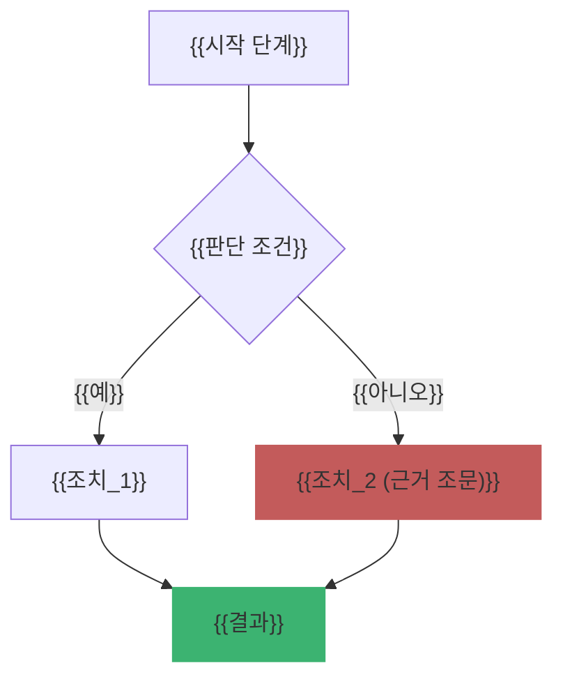

# Ch{{XX}}. {{챕터 제목}}

| 항목 | 내용 |
|---|---|
| 주차 | {{N}}주차 |
| 컨설팅 영역 | {{관리체계 / 보호수준 평가 / 실태점검 / 영향평가(PIA) / 가명정보 / 공통}} |
| 핵심 근거 | {{「개인정보 보호법」 제OO조, 시행령 제OO조, 「개인정보의 안전성 확보조치 기준」 제OO조}} |
| 법령 확인일 | {{YYYY-MM-DD}} (국가법령정보센터 현행 기준) |
| 예상 학습 시간 | {{N}}시간 |
| 선수 챕터 | {{ChXX}} |

---

## 1. 학습 목표

1. {{이 챕터를 마치면 ~을 설명할 수 있다}}
2. {{~을 고객사 현장에서 점검할 수 있다}}
3. {{~ 산출물을 작성할 수 있다}}

---

## 2. 🧩 한 줄 비유

> {{예: 안전성 확보조치는 "금고(암호화)·출입카드(접근통제)·CCTV 녹화(접속기록)"를 함께 갖추는 것이다.}}

---

## 3. 📜 법령 조문

### 3.1 원문 인용

> **「{{법령명}}」 제{{OO}}조({{조문 제목}})**
> ① {{원문 그대로 인용}}
> ② {{원문 그대로 인용}}

### 3.2 쉬운 풀이

| 조문 요소 | 쉬운 말 | 컨설턴트가 확인할 것 |
|---|---|---|
| {{누가 (의무 주체)}} | {{}} | {{}} |
| {{무엇을 (의무 내용)}} | {{}} | {{}} |
| {{언제/얼마나 (기한·기준)}} | {{}} | {{근거 조문 병기}} |
| {{위반 시 (제재 조문)}} | {{}} | {{제64조의2 / 제75조 등}} |

### 3.3 관련 하위 규정

- 시행령: {{제OO조 – 요지}}
- 고시: {{「개인정보의 안전성 확보조치 기준」 제OO조 – 요지}}
- 가이드라인/해설서: {{문서명, 발행 연도}}

---

## 4. 🛠 실무 적용 — 안전성 확보조치

| 구분 | 요구사항 (근거) | 현장 확인 방법 | 증빙 자료 예시 |
|---|---|---|---|
| 관리적 | {{예: 내부 관리계획 수립·연 1회 이상 점검 (고시 제4조)}} | {{문서 열람, 승인 이력 확인}} | {{내부 관리계획서, 점검 결과 보고서}} |
| 기술적 | {{예: 접속기록 보관·점검 (고시 제8조)}} | {{시스템 로그 샘플링}} | {{접속기록 점검 대장}} |
| 물리적 | {{예: 보관 장소 출입통제 (고시 제10조)}} | {{현장 실사}} | {{출입 기록부}} |

### 4.1 Windows 11 실습 (해당 시)

```powershell
# {{실습 목적 설명}}
{{PowerShell 명령어}}
```

| 확인 항목 | 🟩 양호 기준 | 🟥 취약 기준 |
|---|---|---|
| {{}} | {{}} | {{}} |

---

## 5. 🔄 프로세스 다이어그램



---

## 6. ⚖ 개인정보보호위원회 위반·처분 사례

| 항목 | 내용 |
|---|---|
| 의결 연도/의안번호 | {{YYYY / 제YYYY-OOO-OOO호}} |
| 피심인 유형 | {{예: 온라인 쇼핑몰 / 공공기관}} |
| 위반 사실 | {{요약}} |
| 위반 조문 | 🟥 {{「개인정보 보호법」 제29조, 고시 제OO조}} |
| 처분 결과 | 🟥 {{과징금 / 과태료 / 시정명령 / 공표 – 금액은 의결서 확인 시에만 기재}} |
| 컨설팅 시사점 | {{고객사에 적용할 교훈}} |
| 출처 | {{개인정보보호위원회 의결서 URL}} |

---

## 7. ❌ 오답노트 (현업에서 자주 하는 실수)

| # | 🟨 흔한 착각 (오답) | 🟩 올바른 이해 (정답) | 근거 |
|---|---|---|---|
| 1 | {{예: "암호화만 하면 접근통제는 안 해도 된다"}} | {{각 조치는 독립 의무이다}} | {{고시 제6조, 제7조}} |
| 2 | {{}} | {{}} | {{}} |
| 3 | {{}} | {{}} | {{}} |

---

## 8. ✅ 고객사 점검용 체크리스트

| No | 점검 항목 | 근거 조문 | 점검 방법 | 결과 (양호/미흡/취약/N/A) | 비고 |
|---|---|---|---|---|---|
| 1 | {{}} | {{}} | {{인터뷰 / 문서 / 시스템}} | | |
| 2 | {{}} | {{}} | {{}} | | |
| 3 | {{}} | {{}} | {{}} | | |

### 8.1 💡 실무 산출물 연계 팁

- **연계 산출물**: {{예: 현황 분석서 / 개선 이행계획서 / 영향평가서 / 적정성 검토 보고서}}
- **작성 팁**: {{예: 체크리스트 "미흡" 항목은 위험도(상·중·하)와 개선 기한을 함께 기재}}
- **Excel 활용**: {{예: 결과 열에 데이터 유효성 검사(목록) 적용 → 피벗으로 영역별 이행률 산출}}

---

## 9. 📝 퀴즈

> 정답·해설은 [answers_and_explanations.md](../../answers_and_explanations.md#ch{{XX}}) 참고

**Q1.** {{OX 문제}}

**Q2.** {{객관식 문제}}
- ① {{}}  ② {{}}  ③ {{}}  ④ {{}}

**Q3.** {{단답형 / 사례형 문제}}

---

## 10. 📚 참고 자료

- 국가법령정보센터 – 「{{법령명}}」: https://www.law.go.kr
- 개인정보보호위원회 – {{가이드라인/해설서명}}: https://www.pipc.go.kr
- {{기타 공식 출처}}

---

⬅ [이전: Ch{{XX-1}}]({{경로}}) | [목차](../../README.md) | [다음: Ch{{XX+1}}]({{경로}}) ➡
